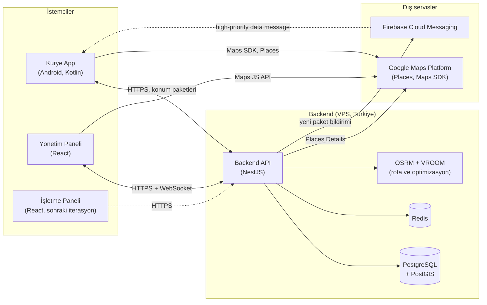

# Kurye Yönetim Sistemi — Proje Vitrini

> Restoranların platform komisyonu ödemeden kendi teslimatını yapabilmesi için, kurye firmalarına yönelik çok kiracılı (multi-tenant) kurye yönetim platformu: Android kurye uygulaması, web yönetim paneli ve backend.

**🚧 Geliştirme aşamasında — İterasyon 0: Planlama**

Pilot bölge: Eskişehir; tasarım çok şehirli kullanıma hazırdır ([ADR-0006](docs/kararlar/0006-hizmet-bolgesi-eskisehir.md)).

> **Bu bir vitrin (showcase) reposudur.** Ürün ticari olduğu için **kaynak kod özel (private) bir depoda tutulur** ve burada yer almaz. Bu depo; proje özetini, mimariyi, karar kayıtlarını (ADR), yapay zekâ destekli geliştirme sürecini, yol haritasını ve ekran görüntülerini içerir. Kaynak kod, mülakatlarda talep üzerine gösterilebilir. Vitrin, her iterasyon sonunda özel depodan güncellenir.

**English summary:** Kurye Yönetim Sistemi is a multi-tenant courier management platform for Turkish courier firms that deliver for many restaurants for a per-package fee. It consists of a lightweight native Android courier app (sideloaded APK with in-app updates), a React admin web panel and a NestJS/PostgreSQL backend. It is developed through an AI-orchestrated workflow (Claude Opus orchestrator + Sonnet sub-agents) with a human product owner; see [docs/GELISTIRME-SURECI.md](docs/GELISTIRME-SURECI.md). **This is a showcase repository:** the source code lives in a private repository because this is a commercial product, and can be demonstrated on request during interviews. This repository contains the architecture, decision records (ADRs), development process, roadmap and screenshots. The project is currently in the planning phase (iteration 0).

---

## İçindekiler

- [Problem ve çözüm](#problem-ve-çözüm)
- [Özellikler](#özellikler)
- [Ekran görüntüleri ve demo](#ekran-görüntüleri-ve-demo)
- [Mimari](#mimari)
- [Teknoloji yığını](#teknoloji-yığını)
- [Yol haritası](#yol-haritası)
- [Yapay zekâ destekli geliştirme süreci](#yapay-zekâ-destekli-geliştirme-süreci)
- [Bu depoda neler var?](#bu-depoda-neler-var)
- [Geliştirici](#geliştirici)
- [Lisans](#lisans)

## Problem ve çözüm

Restoranlar, Yemeksepeti veya Trendyol gibi platformların teslimat komisyonlarından kaçınmak için kendi teslimatlarını yapmak ister. Bunu genellikle paket başı ücretle çalışan yerel **kurye firmaları** üstlenir. Bu firmalar ise tipik olarak şu sorunlarla karşılaşır:

| Problem | Bu projenin yaklaşımı |
|---|---|
| Kuryeler ödemelerin (hakediş) neye göre hesaplandığına güvenmiyor | Paket bazlı, kuryenin kendi ekranında görebildiği şeffaf hakediş |
| Siparişler telefonla / mesajla dağıtılıyor, adil dağılım yok | Sipariş havuzu, yarıçap filtresi ve adil atama |
| Adres girişi yavaş ve hatalı | Google Places otomatik tamamlama ile adres girişi |
| Kurye uygulamaları ucuz telefonlarda yavaş, pil tüketiyor ve konumu kaçırıyor | Yerel (native) Kotlin, hafif uygulama, kuyruklu konum gönderimi |
| Kuryenin konumu kesilince fark edilmiyor | Heartbeat tabanlı konum kesilme uyarısı |
| Kapıda nakit tahsilat takibi zor | Kasa / nakit mutabakatı |

Ürün; **sınırsız işletme** (restoran) tanımlanabilen, **20-25 eşzamanlı motorlu kuryeyi** rahatça yönetebilen bir kurye firması yazılımı olarak tasarlanıyor.

## Özellikler

Durum: ✅ tamamlandı, ⏳ planlandı. Ayrıntılı kapsam için [YOL-HARITASI.md](docs/YOL-HARITASI.md).

### Sipariş ve paket yönetimi
- ⏳ Sınırsız işletme tanımı, firma başına çok kiracılı yapı (İterasyon 1)
- ⏳ Google Places ile adres girişi ve paket ekleme (İterasyon 1)
- ⏳ Sipariş havuzu: kurye paketi havuzdan kendisi alır (İterasyon 1)
- ⏳ Elle atama ve yeniden atama (İterasyon 2)
- ⏳ Kurye başına yarıçap filtresi (İterasyon 2)

### Kurye uygulaması (Android)
- ⏳ Vardiya aç / kapat, havuzdan paket alma (İterasyon 1)
- ⏳ Paket seçilince adres haritada açılır, tek dokunuşla navigasyon (İterasyon 1)
- ⏳ Paketleri duraklara gruplama ve rota optimizasyonu (İterasyon 2)
- ⏳ Uygulama içi otomatik güncelleme (İterasyon 2)
- ⏳ Şeffaf hakediş ekranı (İterasyon 3)

### Yönetim paneli (Web)
- ⏳ Canlı harita ve kurye konumları (İterasyon 1)
- ⏳ Konum kesilme uyarısı (İterasyon 2)
- ⏳ Hakediş ve raporlar (İterasyon 3)
- ⏳ Kasa / nakit mutabakatı (İterasyon 3)
- ⏳ ETA ve adil / otomatik atama (İterasyon 3)

### Entegrasyonlar ve genişlemeler
- ⏳ İşletme paneli: restoranların kendi siparişlerini girmesi (İterasyon 4+)
- ⏳ POS entegrasyonu (İterasyon 4+)
- ⏳ Platform entegrasyonları ve SoftPOS (İterasyon 4+)
- ⏳ Paket başı faturalama (İterasyon 4+)

## Ekran görüntüleri ve demo

Henüz uygulama kodu bulunmuyor; planlama aşamasındayız. Her iterasyon sonunda ekran görüntüleri ve GIF'ler `docs/assets/screenshots/` ve `docs/assets/gifs/` altına eklenecek ve burada gösterilecek.

<!--
Görsel ekleme şablonu (dosyalar eklendiğinde yorumu kaldırın):

| Kurye uygulaması | Yönetim paneli |
|---|---|
|  |  |


-->

## Mimari

Taslak mimari; ayrıntılar [docs/MIMARI.md](docs/MIMARI.md) ve [karar kayıtlarında](docs/kararlar/README.md).



### Öne çıkan mimari kararlar

| ADR | Karar |
|---|---|
| [0001](docs/kararlar/0001-hibrit-harita-mimarisi.md) | Hibrit harita mimarisi (Google Places + OSRM/VROOM) |
| [0002](docs/kararlar/0002-kurye-uygulamasi-native-kotlin.md) | Kurye uygulaması: native Kotlin + Jetpack Compose |
| [0003](docs/kararlar/0003-dagitim-apk-self-update.md) | Dağıtım: APK + uygulama içi güncelleme |
| [0004](docs/kararlar/0004-cok-kiracili-mimari.md) | Çok kiracılı (multi-tenant) mimari, satır düzeyinde güvenlik |
| [0005](docs/kararlar/0005-konum-takibi-ve-kvkk.md) | Konum takibi ve KVKK |
| [0006](docs/kararlar/0006-hizmet-bolgesi-eskisehir.md) | Hizmet bölgesi: Eskişehir pilotu, çok şehre hazır tasarım |

## Teknoloji yığını

> Taslak: tüm seçimler pilot müşteri keşfi tamamlanana kadar **önerildi** statüsündedir ([ADR'ler](docs/kararlar/README.md)).

| Katman | Teknoloji | Durum |
|---|---|---|
| Kurye uygulaması | Kotlin, Jetpack Compose (Android-only) | Taslak |
| Yönetim paneli | React, TypeScript, Vite | Taslak |
| Backend | NestJS (TypeScript) | Taslak |
| Veritabanı | PostgreSQL + PostGIS, satır düzeyinde güvenlik (RLS) | Taslak |
| Önbellek / pub-sub | Redis | Taslak |
| Gerçek zamanlı | WebSocket (panel), FCM high-priority data message (kurye) | Taslak |
| Harita ve adres | Google Places Autocomplete, Maps SDK for Android | Taslak |
| Rota ve optimizasyon | OSRM + VROOM (self-hosted) | Taslak |
| Dağıtım | APK + uygulama içi güncelleme, isteğe bağlı Headwind MDM | Taslak |
| Barındırma | Türkiye'de VPS | Taslak |

## Yol haritası

| İterasyon | Odak | Durum |
|---|---|---|
| 0 | Planlama ve araştırma | 🚧 Devam ediyor |
| 1 | Çekirdek: kimlik / tenant, işletme, paket, havuz, kurye app, canlı harita | ⏳ |
| 2 | Duraklar, rota optimizasyonu, yarıçap filtresi, self-update | ⏳ |
| 3 | Hakediş, kasa mutabakatı, ETA, adil atama | ⏳ |
| 4+ | İşletme paneli, POS / platform entegrasyonları, SoftPOS, faturalama | ⏳ |

Ayrıntılar: [docs/YOL-HARITASI.md](docs/YOL-HARITASI.md)

## Yapay zekâ destekli geliştirme süreci

Bu proje, **insan ürün sahibi + yapay zekâ ajanları** modeliyle geliştiriliyor; bu, projenin en ayırt edici yanlarından biri:

- **Claude Opus orkestratör ajan** gereksinim analizini, mimariyi ve görev kırılımını yönetir; kendi bağlamını küçük tutar.
- **Claude Sonnet alt ajanlar** kısa, kapsamı net görev brief'leriyle uygulamayı yapar, test eder ve en fazla 250 kelimelik özet döner.
- **Ortak hafıza depodadır:** kararlar ADR olarak, mimari ve süreç dokümanlar olarak yazılıdır; ajanlar her seferinde baştan anlatılmaz.
- **İnsan döngüdedir:** mimari kararlar, müşteri varsayımları ve birleştirme (merge) insan onayıyla yapılır.
- Her iterasyon pilot müşteriye bir demo ile kapanır ve bu vitrin güncellenir.

Ayrıntılar: [docs/GELISTIRME-SURECI.md](docs/GELISTIRME-SURECI.md)

## Bu depoda neler var?

```text
kurye-yonetim-sistemi-showcase/
├── README.md
└── docs/
    ├── MIMARI.md              # Mimari, veri modeli, akışlar
    ├── YOL-HARITASI.md        # İterasyonlar ve ilerleme
    ├── GELISTIRME-SURECI.md   # AI destekli çalışma düzeni
    ├── kararlar/              # Mimari karar kayıtları (ADR)
    └── assets/                # Ekran görüntüleri ve GIF'ler
```

Kaynak kod bu depoda **bulunmaz**; ticari bir ürün olduğu için özel depoda tutulur ve mülakatlarda talep üzerine gösterilebilir.

## Geliştirici

<!--
Aşağıdaki alanları depo sahibi doldurur (özel depoda showcase/README.md içinde):
- Ad Soyad: <ADINIZ SOYADINIZ>
- LinkedIn: <LINKEDIN_URL>
- E-posta: <EPOSTA>
-->

Bu proje bir öğrenci geliştirici tarafından, yapay zekâ ajanlarıyla birlikte yürütülmektedir. İletişim bilgileri yakında eklenecektir.

## Lisans

**Tüm hakları saklıdır.** Bu depo açık kaynak değildir; yalnızca portföy ve inceleme amacıyla herkese açıktır. İzinsiz kullanım, kopyalama veya dağıtım yapılamaz.
