# Kurye Yönetim Sistemi — Proje Vitrini

> Restoranların platform komisyonu ödemeden kendi teslimatını yapabilmesi için, kurye firmalarına yönelik çok kiracılı (multi-tenant) kurye yönetim platformu: mobil kurye uygulaması (Android + iOS), web yönetim paneli ve backend.

**✅ İterasyon 3a (kendi harita yığınımız, çevrimdışı kurye uygulaması, üretim hazırlığı) ve 3b (öğrenilen teslim noktaları, hazır sinyali, işletme bağlantısı, teslim geofence'i, aynı restoran gruplama, yeni navigasyon görünümü) tamamlandı** · İterasyon 3c (öğrenilmiş hızlar, ETA) planlandı

Pilot bölge: Eskişehir; tasarım çok şehirli kullanıma hazırdır ([ADR-0006](docs/kararlar/0006-hizmet-bolgesi-eskisehir.md)).

> **Bu bir vitrin (showcase) reposudur.** Ürün ticari olduğu için **kaynak kod özel (private) bir depoda tutulur** ve burada yer almaz. Bu depo; proje özetini, mimariyi, karar kayıtlarını (ADR), yapay zekâ destekli geliştirme sürecini, yol haritasını ve ekran görüntülerini içerir. Kaynak kod, mülakatlarda talep üzerine gösterilebilir. Vitrin, her iterasyon sonunda özel depodan güncellenir.

**English summary:** Kurye Yönetim Sistemi is a multi-tenant courier management platform for Turkish courier firms that deliver for many restaurants for a per-package fee. It consists of a React Native + Expo Android courier app (background location, sideloaded APK), a React admin web panel with a live map and a NestJS/PostgreSQL+PostGIS backend. It is developed through an AI-orchestrated workflow (Claude Opus orchestrator + Sonnet sub-agents) with a human product owner; see [docs/GELISTIRME-SURECI.md](docs/GELISTIRME-SURECI.md). **This is a showcase repository:** the source code lives in a private repository because this is a commercial product, and can be demonstrated on request during interviews. This repository contains the architecture, decision records (ADRs), development process, roadmap and screenshots. Iterations 1, 2 and 3a are complete: the screenshots below come from the running system. Iteration 2 delivered route-aware assignment (real OSRM + VROOM engine, suggestions, batch assignment, drag-and-drop with warnings), courier-to-courier handover, a map-first route screen and in-app turn-by-turn navigation; in a synthetic Eskişehir-day simulation (not a field result) it cut total distance by about 30% and late deliveries from 19.9% to 3.2% versus "nearest courier" (see Sonuçlar). Iteration 3a is complete: a self-hosted, Eskişehir-specific map stack (own vector tiles, styles and Photon geocoder, weekly blue/green OSM refresh pipeline) with zero third-party map requests, an offline-capable courier app (4.4 MB offline map, offline turn-by-turn navigation, an idempotent offline action queue with conflict handling) and production-readiness work; field-learned maps (3b-3c) are planned.

---

## İçindekiler

- [Sonuçlar](#sonuçlar)
- [Problem ve çözüm](#problem-ve-çözüm)
- [Özellikler](#özellikler)
- [Ekran görüntüleri](#ekran-görüntüleri)
- [Tasarım](#tasarım)
- [Mimari](#mimari)
- [Teknoloji yığını](#teknoloji-yığını)
- [Yol haritası](#yol-haritası)
- [Yapay zekâ destekli geliştirme süreci](#yapay-zekâ-destekli-geliştirme-süreci)
- [Bu depoda neler var?](#bu-depoda-neler-var)
- [Geliştirici](#geliştirici)
- [Lisans](#lisans)

## Sonuçlar

<p align="center">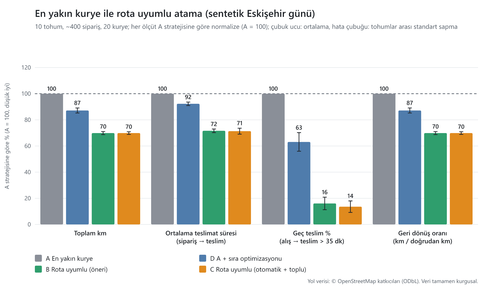</p>

Aynı **sentetik** Eskişehir gününde (20 kurye, ~400 sipariş, 10 tohum; gerçek yol ağı üzerinde OSRM süre ve mesafe matrisi) pilotun bugünkü yazılımının basitleştirilmiş modeli olan **"en yakın kurye"** (A) ile **rota uyumlu atama**nın (B: öneri modu) karşılaştırması:

| Ölçüt | En yakın kurye (A) | Rota uyumlu (B) | Fark |
|---|---:|---:|---:|
| Toplam km | 1886 | 1318 | **-%30** |
| Geç teslim (alıştan teslime > 35 dk) | %19,9 | %3,2 | **-%84** |
| Ort. teslimat süresi (sipariş → teslim) | 38,6 dk | 27,6 dk | -%28 |
| Geri dönüş oranı (km / doğrudan km) | 1,80 | 1,26 | -%30 |

> **Dürüst okuma:** bu bir **sentetik simülasyondur**, gerçek saha sonucu değildir. Taban çizgisi A basitleştirilmiş bir modeldir; trafik, sürücü davranışı ve yönetici yükü yoktur; talep gerçek siparişlerden değil üretilmiş dağılımdan gelir. İşletmenin hazır olma anı **biliniyorsa** kilometre farkı küçülür (B: -%8, otomatik + toplu pencere C: -%14) ama geç teslim farkı büyür (%0,7). Sayılar tek başına değil, iki tabloyla birlikte okunmalıdır. Tam yöntem, senaryo, hipotezler (biri yalnızca kısmen doğrulandı) ve sınırlamalar: [benchmark raporu](docs/benchmark/README.md).

## Problem ve çözüm

Restoranlar, Yemeksepeti veya Trendyol gibi platformların teslimat komisyonlarından kaçınmak için kendi teslimatlarını yapmak ister. Bunu genellikle paket başı ücretle çalışan yerel **kurye firmaları** üstlenir. Bu firmalar ise tipik olarak şu sorunlarla karşılaşır:

| Problem | Bu projenin yaklaşımı |
|---|---|
| Kuryeler ödemelerin (hakediş) neye göre hesaplandığına güvenmiyor | Paket bazlı, kuryenin kendi ekranında görebildiği şeffaf hakediş |
| Siparişler telefonla / mesajla dağıtılıyor, adil dağılım yok | Sipariş havuzu, yarıçap filtresi ve adil atama |
| Adres girişi yavaş ve hatalı | Hizmet bölgesiyle sınırlı adres otomatik tamamlama (Google Places veya açık kaynak Photon) ve haritada iğneyle düzeltme |
| Kurye uygulamaları ucuz telefonlarda yavaş, pil tüketiyor ve konumu kaçırıyor | Android ve iOS için tek kod (React Native + Expo), kalıcı kuyruklu toplu konum gönderimi, pil optimizasyonu rehberi |
| Kuryenin konumu kesilince fark edilmiyor | Heartbeat tabanlı konum kesilme uyarısı |
| Kapıda nakit tahsilat takibi zor | Kasa / nakit mutabakatı |

Ürün; **sınırsız işletme** (restoran) tanımlanabilen, **20-25 eşzamanlı motorlu kuryeyi** rahatça yönetebilen bir kurye firması yazılımı olarak tasarlanıyor.

## Özellikler

Durum: ✅ tamamlandı (İterasyon 1-2), ⏳ planlandı. Ayrıntılı kapsam için [YOL-HARITASI.md](docs/YOL-HARITASI.md).

### ⭐ Rota uyumlu akıllı atama

> Yeni paket, kuryeye **yakınlığına** göre değil, kuryenin **rotasına kattığı sapma süresine** göre atanır ("Rotası üzerinde, +3 dk" ile "Ters yön, +9 dk" arasındaki fark). Her kurye paketlerini haritada numaralı duraklar ve optimal sırayla görür; yönetici önerilen en iyi kuryeleri tek tıkla atar, kontrollü ret ve devir akışı yanlış atamaları görünür kılar. Pilot müşteriden gelen sahadaki geri bildirimle (ters yöndeki paketler, kuryelerin paketi bırakması, yöneticinin elle yeniden dağıtımı) şekillendi; **İterasyon 2'nin ana hedefiydi ve çalışıyor**: [ADR-0009](docs/kararlar/0009-rota-uyumlu-atama.md), rota motoru [ADR-0011](docs/kararlar/0011-osrm-motosiklet-profili-ve-rota-altyapisi.md) (OSRM motosiklet profili + VROOM). Ölçüm: [Sonuçlar](#sonuçlar).

- ✅ Kurye başına canlı rota: gerçek yolları izleyen çizgi, numaralı duraklar, ETA; yeni paketle çizgi canlı yeniden kurulur
- ✅ Gerekçeli öneri: sapma dakikası, etiket ("Rotası üzerinde", "Ters yön"), gecikecek paketler, elenenler; kapasite, tazelik (35 dk) ve mevcut paket gecikme sınırı (8 dk) korunur
- ✅ Üç atama modu (öneri, akıllı havuz, otomatik), bekleyenler kuyruğu, **toplu atama** (aynı restoranın siparişleri aynı kuryede gruplanır)
- ✅ Rota motoru düşerse açık işaretli yaklaşık mod ve elle atamaya geri dönüş
- ✅ Simülasyon benchmark'ı: "en yakın kurye" ile karşılaştırma ([sonuçlar](#sonuçlar))

### 🗺️ Kendi harita yığınımız ve çevrimdışı çalışma (İterasyon 3a)

> Harita karoları, stiller, rota motoru ve adres arama **Eskişehir OSM çıkarımından kendi sunucumuzda** üretilir: panelde ve uygulamada üçüncü taraf harita, yazı tipi veya adres servisine **sıfır istek** (ağ sekmesi kanıtlı). Kurye uygulaması 4,4 MB'lık Eskişehir paketini indirir (sha256 doğrulamalı, kaldığı yerden sürer), **uçak modunda** harita, "Rotam" ve adım adım navigasyon çalışır; "Aldım" / "Teslim ettim" eylemleri cihazda kuyruğa girer, bağlantı gelince `Idempotency-Key` ile **tam bir kez** gönderilir (cihaz zamanıyla); başka kuryeye geçmiş pakette açık bir "senkron çakışması" kartı çıkar. Haftalık OSM güncellemesi kapılı, sıfır kesintili mavi / yeşil geçişle yapılır. Kararlar: [ADR-0016](docs/kararlar/0016-eskisehire-ozel-kendi-barindirdigimiz-harita-platformu.md), [ADR-0018](docs/kararlar/0018-harita-karo-ve-stil-sunumu.md), [ADR-0019](docs/kararlar/0019-kurye-cevrimdisi-harita-ve-navigasyon.md), [ADR-0020](docs/kararlar/0020-cevrimdisi-eylem-kuyrugu-ve-idempotency.md), [ADR-0021](docs/kararlar/0021-haftalik-osm-guncelleme-hatti.md), [ADR-0022](docs/kararlar/0022-uretim-dagitimi-ucretsiz-katman.md). Adres kalitesi (34 adres, 148 sorgu): <= 50 m isabet %71 -> %83 (sorgu normalleştirmesiyle), ayrıntı ve sınırlar: [adres kalitesi raporu](docs/benchmark/adres-kalitesi/README.md).

### 🧭 Saha verisinden öğrenme, hazır sinyali ve teslim doğrulama (İterasyon 3b)

> Adres defteri teslimlerin gerçek konumlarından **öğrenilen teslim noktalarını** tutar (kurye ve paket kimliği saklanmaz; ağırlıklı medyan + güven; yönetici noktayı sabitleyebilir). Restoran "paket hazır" bilgisini panelden, kuryeden ya da **girişsiz tek dokunuşluk işletme bağlantısından** (QR, kısa ömürlü opak jeton) bildirir; sistem işletme bazında hazırlık süresini öğrenip her pakete tahmin yazar. **Teslim geofence'i** kuryenin teslim noktasından uzakta "teslim ettim" demesini ölçer (varsayılan yalnızca ölçüm kipi), açıldığında gerekçeli geçersiz kılma ister ve çevrimdışı kuyrukla uyumludur. **Aynı restoran gruplama** (aynı alış ödülü, sonradan bağlama, ortak / ayrık değerlendirme) 30 tohumlu benchmark ile ölçüldü ve **varsayılan olarak kapalıdır**; önerilen ayarla pilot ölçeğinde aynı işletme oranını v2 taban çizgisine göre varsayılan günde +7,8, tepe günde +9,5 puan artırır (ayrıntı: [gruplama raporu](docs/benchmark/v2/gruplama.md)). Panel ve API kurgusal veriyle gerçek yığına karşı, kurye uygulaması emülatörde mock sunucuyla denendi; gerçek cihaz saha testi ve pilot ayarları açık.

- ✅ Öğrenilmiş teslim noktaları: adres defteri paneli (harita + liste, sabitle / sıfırla), kurye kartında "Öğrenilmiş teslim noktası (N teslim)" rozeti, navigasyon hedefi etkin nokta ([ADR-0017](docs/kararlar/0017-saha-verisinden-ogrenen-harita.md); öğrenme KVKK onayına kadar kapalı)
- ✅ Hazır sinyali: panel "Hazır" düğmesi, kuryede "Hazır değil" (süre çipleri) / "Hazır oldu", girişsiz işletme bağlantısı ve `/isletme` sayfası ([ADR-0025](docs/kararlar/0025-isletme-hazir-baglantisi.md)); hazırlık süresi tahmini
- ✅ Teslim geofence'i: ölçüm / zorlama kipleri, uyarı sayfası, gerekçeli geçersiz kılma, adres kalitesi metriği ([ADR-0026](docs/kararlar/0026-teslim-geofence-politikasi.md))
- ✅ Aynı restoran gruplama: motor ve benchmark hazır, kiracı ayarı kapalı; panelde dağıtım v2 ayar ekranı

### Sipariş ve paket yönetimi
- ✅ Sınırsız işletme tanımı, firma başına çok kiracılı yapı (İterasyon 1)
- ✅ Adres otomatik tamamlama (Photon / Google Places) ile paket ekleme (İterasyon 1)
- ✅ Sipariş havuzu: kurye paketi havuzdan kendisi alır (İterasyon 1)
- ✅ Elle atama ve yeniden atama (İterasyon 1)
- ✅ Kurye başına yarıçap filtresi (İterasyon 1)
- ✅ Sürükle-bırak atama ve büyük sapma / gecikme uyarısı (İterasyon 2)

### Kurye uygulaması (Android + iOS)
- ✅ Vardiya aç / kapat, havuzdan paket alma (İterasyon 1)
- ✅ Paket seçilince adres haritada açılır, tek dokunuşla navigasyon (İterasyon 1)
- ✅ "Rotam" ekranı: tam ekran harita, numaralı durak listesi, optimal sıra, rota değişince şerit ve titreşim (İterasyon 2)
- ✅ **Uygulama içi adım adım navigasyon**: eğik yön-yukarı harita, Türkçe sesli yönlendirme, yeniden rota, gündüz / gece teması, varışta kaydırarak onay ([ADR-0015](docs/kararlar/0015-uygulama-ici-navigasyon.md), İterasyon 2)
- ✅ **Yeni navigasyon görünümü** (marka kimliği B, [ADR-0027](docs/kararlar/0027-marka-kimligi-ve-navigasyon-gorsel-dili.md)): koyu krom + neon vurgu, büyük manevra kartı, yeni ikon seti, gündüz açık "gümüş" harita; harita rota yönüne döner (course-up) ve **akıcılık iyileştirildi** ([ADR-0024](docs/kararlar/0024-navigasyon-render-performansi.md)): emülatörde ortalama kare hızı 23,2 -> 27-34 fps, 100 ms üzeri takılma 71 -> 5-10 (60 fps'e ulaşılamadı; gerçek cihazda ölçülmedi) (İterasyon 3b)
- ✅ Öğrenilmiş teslim noktası rozeti, "Hazır değil" / "Hazır oldu", teslim geofence uyarısı ve gerekçeli geçersiz kılma (çevrimdışı kuyrukla) (İterasyon 3b)
- ✅ Kontrollü ret (gerekçeli) ve devir isteği (İterasyon 2)
- ✅ Kuryeler arası devir: yakındaki meslektaşa teklif, alıştan sonra kod / QR + konum ile fiziksel devir ([ADR-0010](docs/kararlar/0010-kuryeler-arasi-devir.md), İterasyon 2)
- ⏳ Push bildirim (FCM), OTA güncelleme ve iOS dağıtımı (İterasyon 2b)
- ⏳ Şeffaf hakediş ekranı (İterasyon 4)

### Yönetim paneli (Web)
- ✅ Canlı harita ve kurye konumları (İterasyon 1)
- ✅ Konum kesilme uyarısı (İterasyon 1)
- ✅ Rota çizgileri ve numaralı duraklar, öneri paneli, sürükle-bırak atama, bekleyenler ve toplu öneri, rota motoru durumu şeridi (İterasyon 2)
- ✅ Devirler sekmesi, atama ve devir ayarları, metrikler sayfası (İterasyon 2)
- ✅ Adres defteri, hazır düğmesi ve hazırlık tahmini, işletme bağlantısı (QR), geofence rozetleri, adres kalitesi ile hazırlık / bekleme metrikleri, teslim / hazırlık ve dağıtım v2 ayarları (İterasyon 3b)
- ⏳ Hakediş ve raporlar (İterasyon 4)
- ⏳ Kasa / nakit mutabakatı (İterasyon 4)
- ⏳ ETA gösterimi müşteriye (İterasyon 4)

### Entegrasyonlar ve genişlemeler
- ⏳ İşletme paneli: restoranların kendi siparişlerini girmesi (İterasyon 5+)
- ⏳ POS entegrasyonu, ilk hedef Adisyo (İterasyon 5+)
- ⏳ Platform entegrasyonları ve SoftPOS (İterasyon 5+)
- ⏳ Paket başı faturalama (İterasyon 5+)

## Ekran görüntüleri

Aşağıdaki görüntüler gerçek API, gerçek rota motoru (OSRM + VROOM) ve kurgusal Eskişehir demo verisiyle alınmıştır (kişisel veri içermez). Harita verisi © OpenStreetMap katkıcıları (ODbL).

### Yönetim paneli: rota uyumlu atama

<table>
  <tr>
    <td colspan="2" align="center">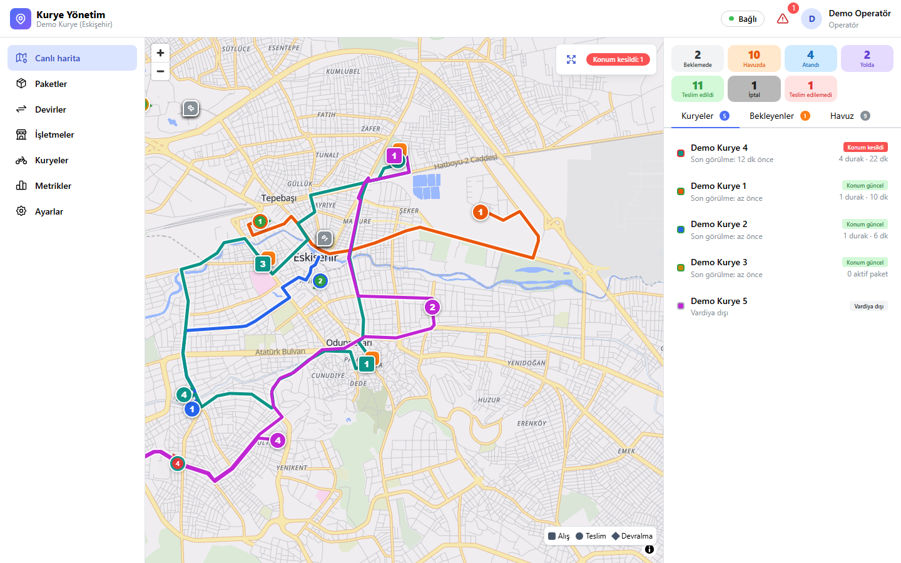<br><sub>Canlı harita: her kuryenin renkli rota çizgisi gerçek yolları izler, duraklar numaralı (alış kare, teslim daire)</sub></td>
  </tr>
  <tr>
    <td align="center">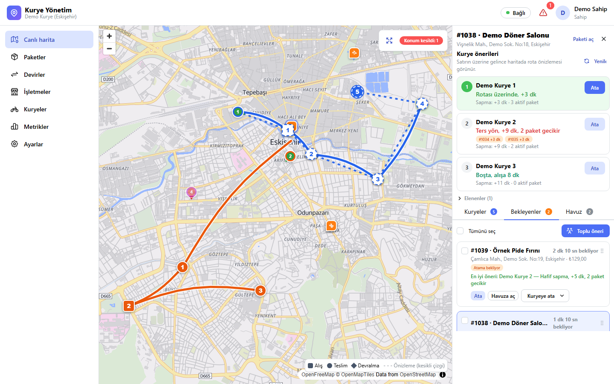<br><sub>Kurye önerileri: "Rotası üzerinde, +3 dk" ile "Ters yön, +6 dk"; satıra gelince rotaya yerleştirme önizlemesi</sub></td>
    <td align="center">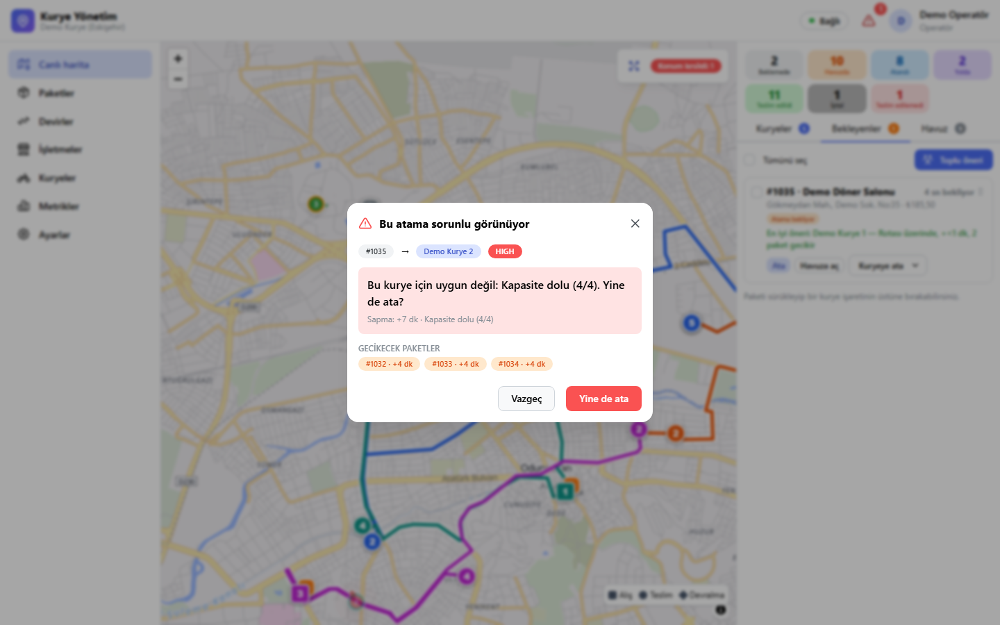<br><sub>Paketi ters yöndeki kuryenin üstüne sürükleyince sapma uyarısı</sub></td>
  </tr>
  <tr>
    <td align="center">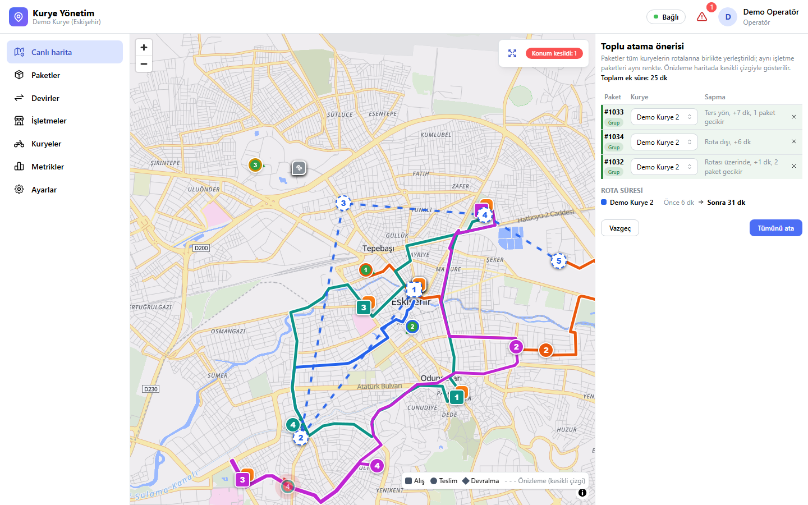<br><sub>Toplu öneri: aynı restoranın üç siparişi tek kuryede gruplanır, "önce / sonra" süresi</sub></td>
    <td align="center">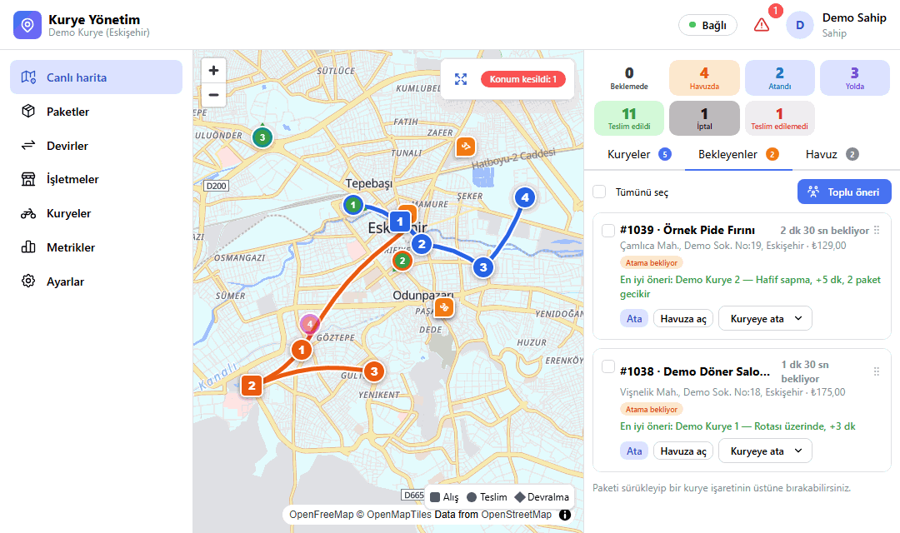<br><sub>Atama: kuryenin rotası canlı olarak yeniden kurulur (eski çizgi söner, yenisi çizilir, numaralar yenilenir)</sub></td>
  </tr>
</table>

<details>
<summary>Diğer panel ekranları (İterasyon 1, devirler, mobil görünüm)</summary>

<table>
  <tr>
    <td colspan="2" align="center"><br><sub>Canlı harita: kurye konumları, durum özeti, "Konum kesildi" uyarısı ve havuzdaki paketler</sub></td>
  </tr>
  <tr>
    <td align="center"><br><sub>Paket listesi: durum, işletme, kurye ve tarih filtreleri</sub></td>
    <td align="center"><br><sub>Paket ayrıntısı ve olay geçmişi (kim, ne zaman, ne yaptı)</sub></td>
  </tr>
  <tr>
    <td align="center"><br><sub>Yeni paket: adres otomatik tamamlama ve haritada iğne</sub></td>
    <td align="center">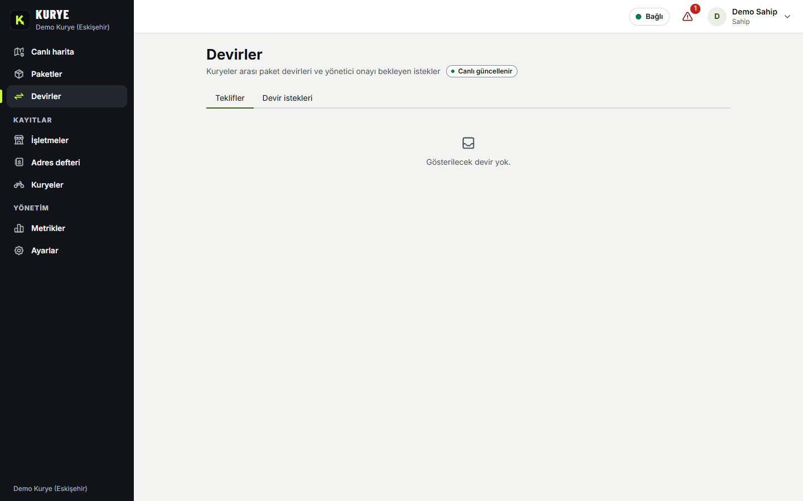<br><sub>Devirler sekmesi: açık teklifler, onaylar, canlı olaylar</sub></td>
  </tr>
  <tr>
    <td colspan="2" align="center">&nbsp;&nbsp;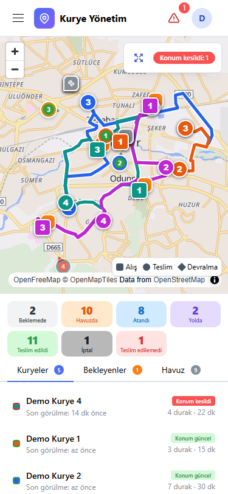<br><sub>Panel telefon ekranında da çalışır (duyarlı tasarım)</sub></td>
  </tr>
</table>

</details>

### Kendi harita yığınımız ve çevrimdışı çalışma (İterasyon 3a)

Aşağıdaki görüntüler emülatörde, **gerçek API + kendi karolarımız + kendi Photon'umuz + gerçek OSRM** ile alınmıştır (kurgusal veri, kişisel veri yok).

<table>
  <tr>
    <td colspan="2" align="center">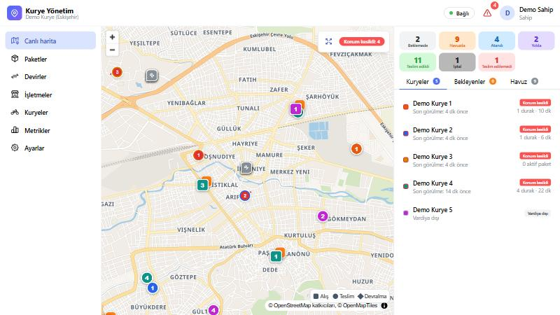<br><sub>Panel: canlı harita kendi PMTiles karolarımız ve stilimizle; ağ sekmesinde yalnızca yerel istekler</sub></td>
  </tr>
  <tr>
    <td align="center">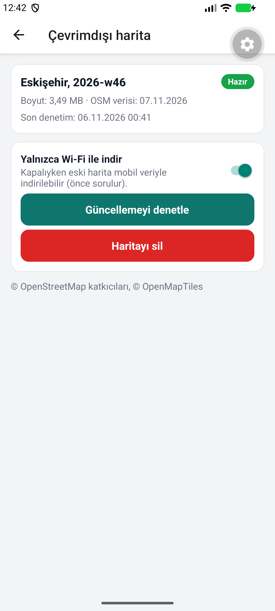<br><sub>Çevrimdışı harita paketi: sürüm, boyut, sha256 doğrulaması</sub></td>
    <td align="center">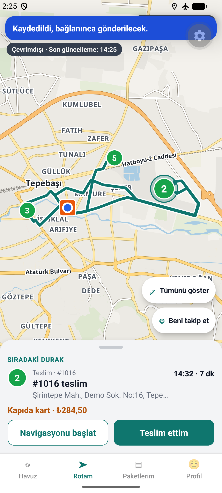<br><sub>Uçak modu: harita yerelden çizilir, "Aldım" kuyruğa alınır ("Çevrimdışı · Son güncelleme")</sub></td>
  </tr>
  <tr>
    <td align="center">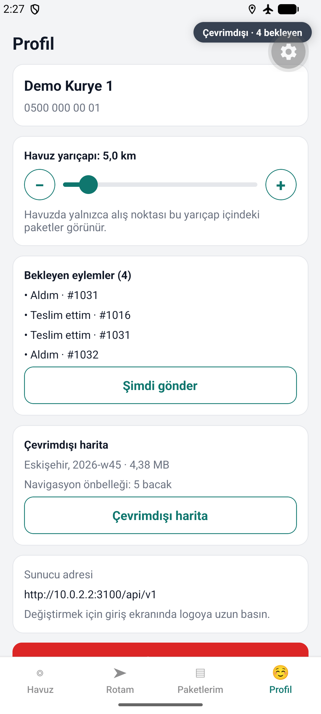<br><sub>Dört bekleyen eylem ve 5 bacaklık navigasyon önbelleği</sub></td>
    <td align="center">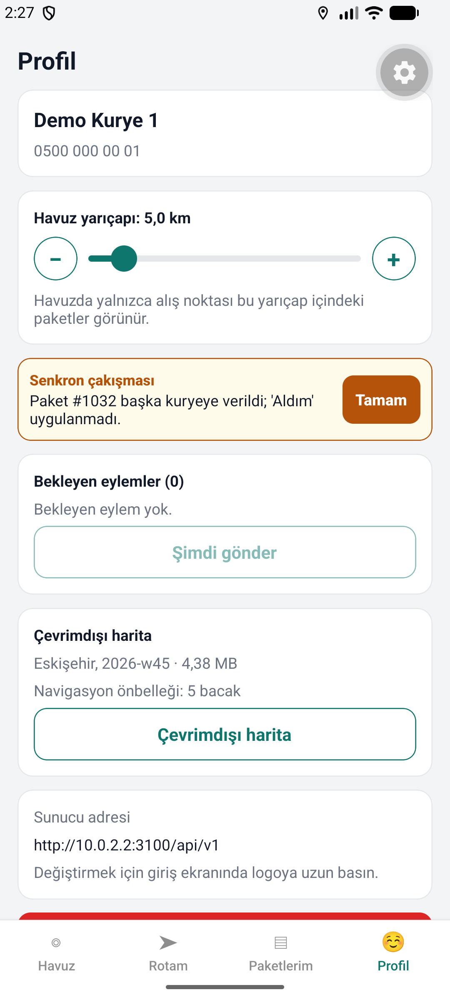<br><sub>Bağlantı gelince kuyruk boşalır; başka kuryeye verilen pakette açık çakışma iletisi</sub></td>
  </tr>
  <tr>
    <td align="center">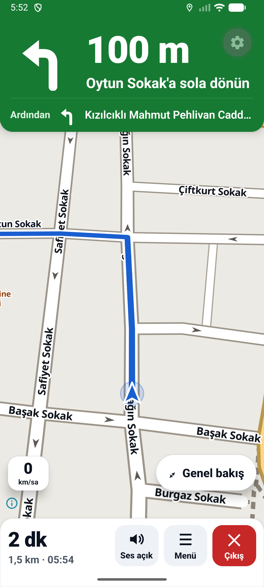<br><sub>Sunucu erişilemezken önbellekteki bacakla adım adım navigasyon</sub></td>
    <td align="center">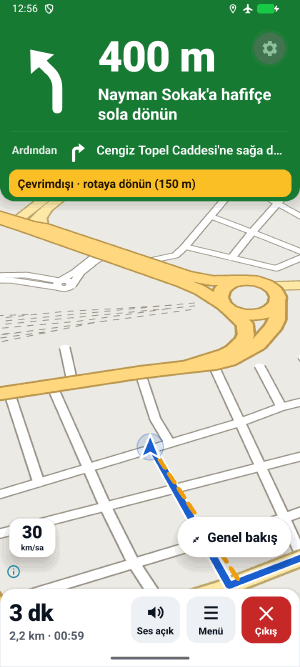<br><sub>Çevrimdışı navigasyon: yoldan çıkınca "rotaya dön" kılavuzu</sub></td>
  </tr>
  <tr>
    <td colspan="2" align="center">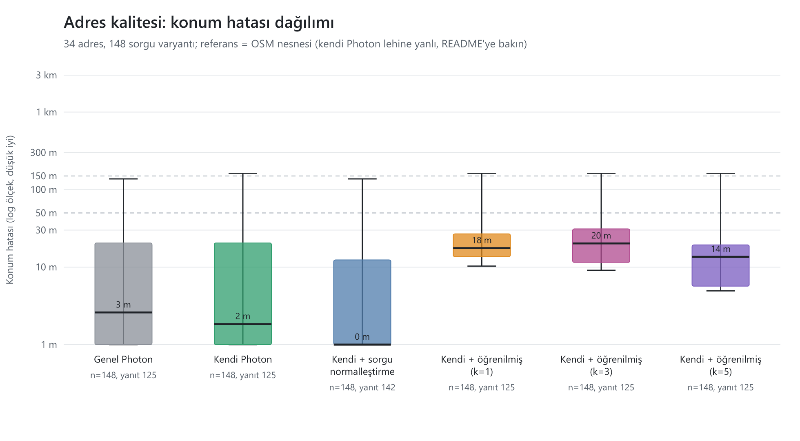<br><sub>Adres kalitesi testi: genel Photon, kendi Photon, sorgu normalleştirme ve simüle öğrenilmiş nokta</sub></td>
  </tr>
</table>

### İterasyon 3b: öğrenme, hazır sinyali, geofence

Görüntüler kurgusal seed verisiyle alındı (kişisel veri yok). Panel görüntülerinde harita altlığı sahte API'de boş zemindir; kurye görüntüleri emülatörde, mock sunucuyla alındı.

<table>
  <tr>
    <td align="center">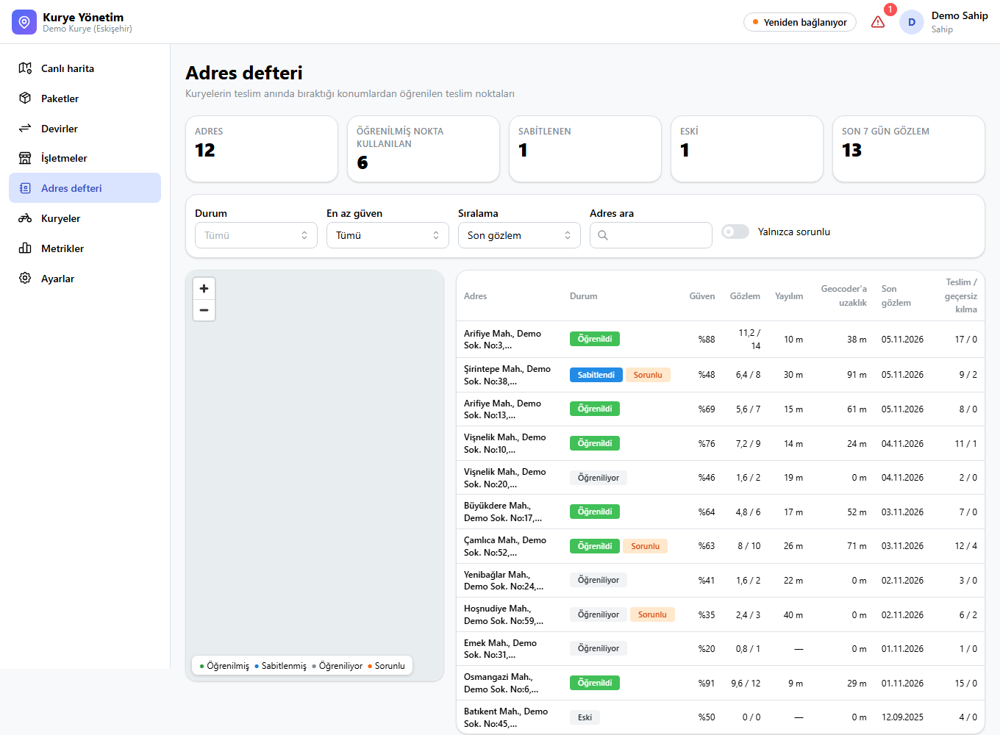<br><sub>Adres defteri: öğrenilmiş / sabitlenmiş teslim noktaları, güven ve özet</sub></td>
    <td align="center">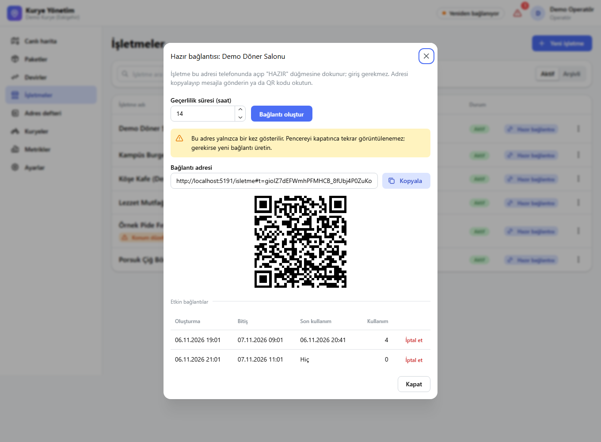<br><sub>İşletme "hazır" bağlantısı: QR + URL, bir kez gösterim</sub></td>
  </tr>
  <tr>
    <td align="center">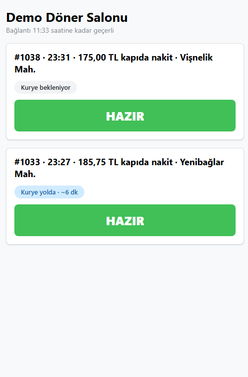<br><sub>Girişsiz işletme sayfası: yalnızca o işletmenin açık paketleri, büyük HAZIR düğmesi</sub></td>
    <td align="center">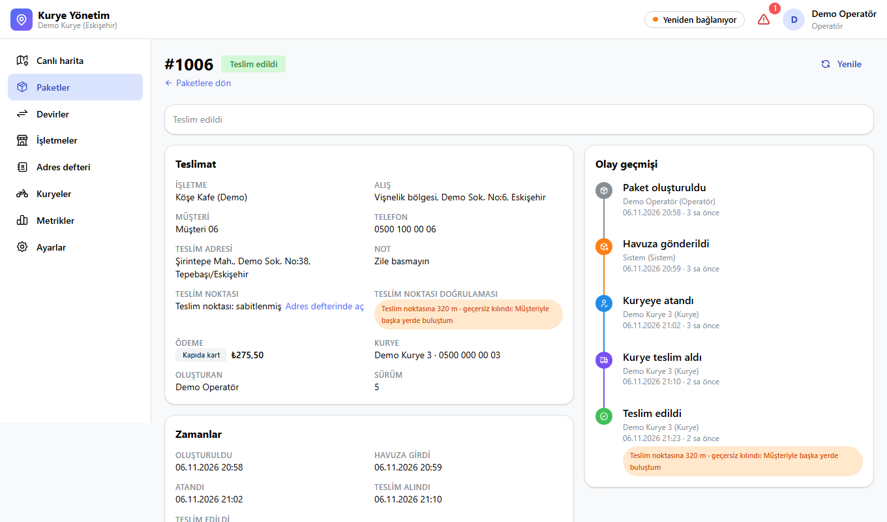<br><sub>Paket ayrıntısında teslim geofence rozeti (ölçüm kipi)</sub></td>
  </tr>
  <tr>
    <td align="center">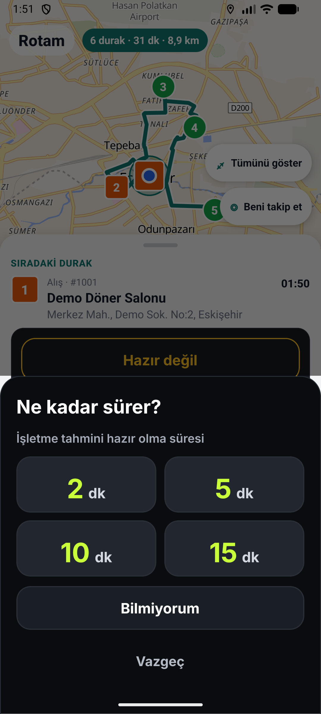<br><sub>Kurye: "Hazır değil" süre çipleri</sub></td>
    <td align="center">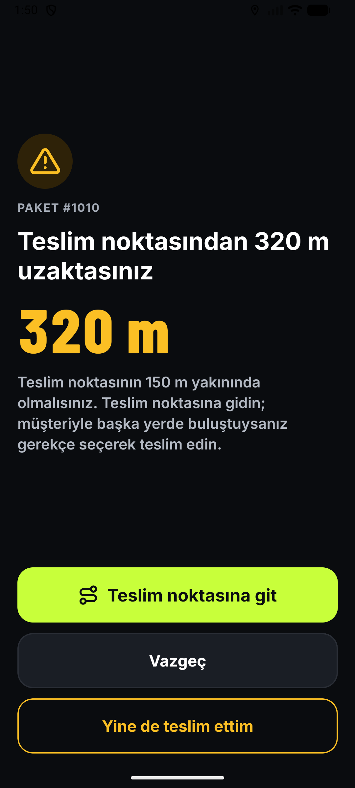<br><sub>Kurye: teslim noktasından uzakta uyarı sayfası</sub></td>
  </tr>
</table>

### Kurye uygulaması (Android)

<table>
  <tr>
    <td align="center">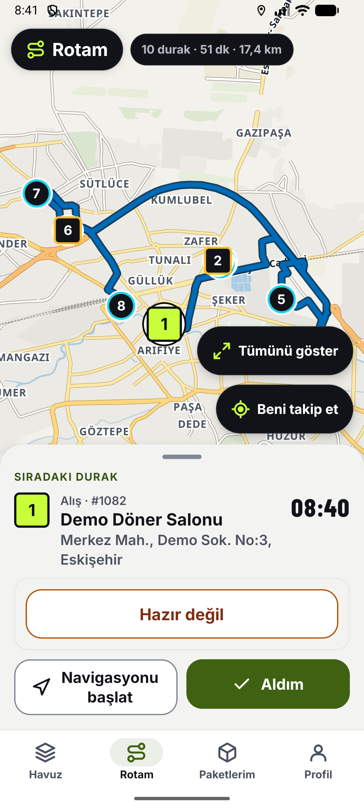<br><sub>Rotam: tam ekran harita, numaralı duraklar, alt çekmecede liste</sub></td>
    <td align="center">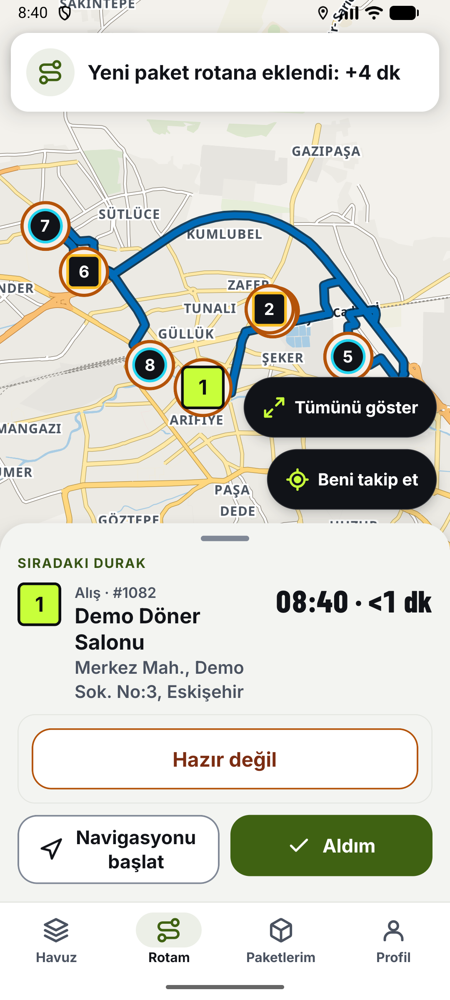<br><sub>Yeni paket rotaya eklenince şerit: "Yeni paket rotana eklendi"</sub></td>
    <td align="center">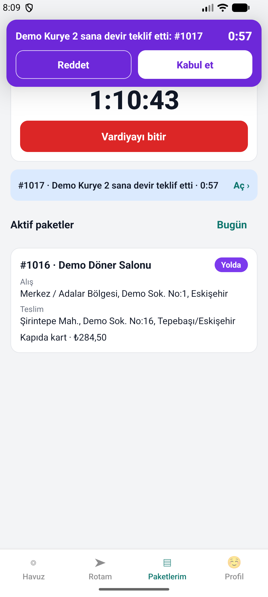<br><sub>Devir teklifi: geri sayım, kabul / ret</sub></td>
    <td align="center">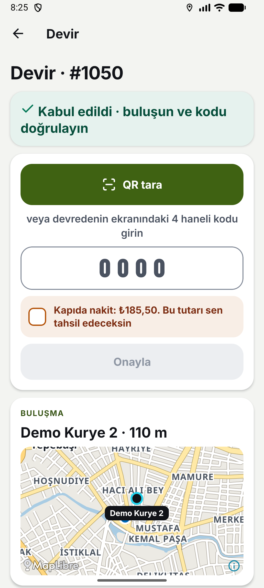<br><sub>Devir buluşması: karşı kurye 10 m, 4 haneli kod / QR ile onay</sub></td>
  </tr>
</table>

**Uygulama içi navigasyon** ([ADR-0015](docs/kararlar/0015-uygulama-ici-navigasyon.md)): marka görsel diliyle (ADR-0027: koyu krom, neon vurgu, gündüz açık "gümüş" harita) büyük manevra kartı, yön-yukarı kamera, Türkçe sesli yönlendirme, otomatik yeniden rota, gündüz / gece teması, koridor etiketleri ve varışta kaydırarak onay. Emülatörde GPS oynatılarak alındı (kurgusal veri). Tasarım maketleri ve marka belirteçleri: [docs/tasarim/navigasyon](docs/tasarim/navigasyon/README.md), [docs/tasarim/marka](docs/tasarim/marka/README.md). Akıcılık ölçümü emülatörde yapıldı (ort. kare hızı 23,2 -> 27-34 fps); 60 fps'e ulaşılamadı, gerçek cihaz testi açık.

<table>
  <tr>
    <td align="center">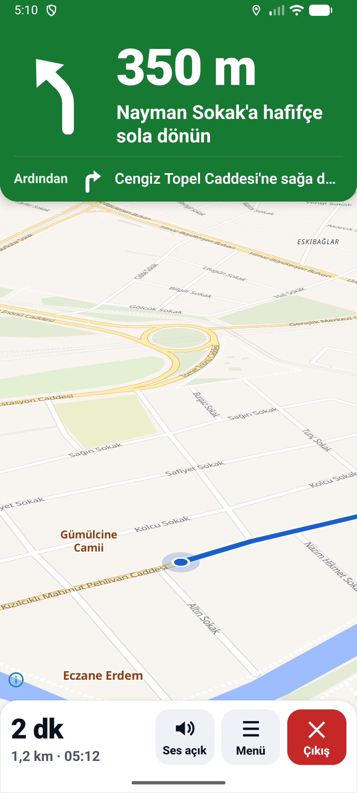<br><sub>Gündüz teması</sub></td>
    <td align="center">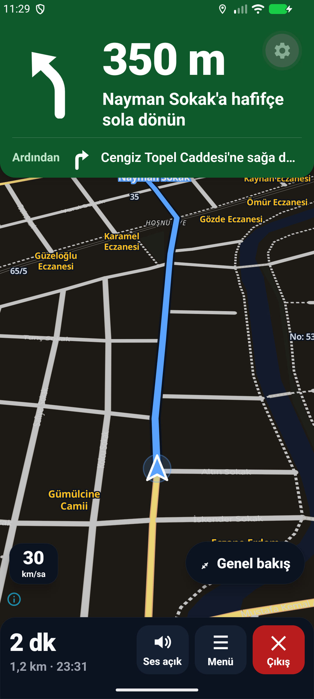<br><sub>Gece teması (sistem koyu temasına ya da saate uyar)</sub></td>
    <td align="center">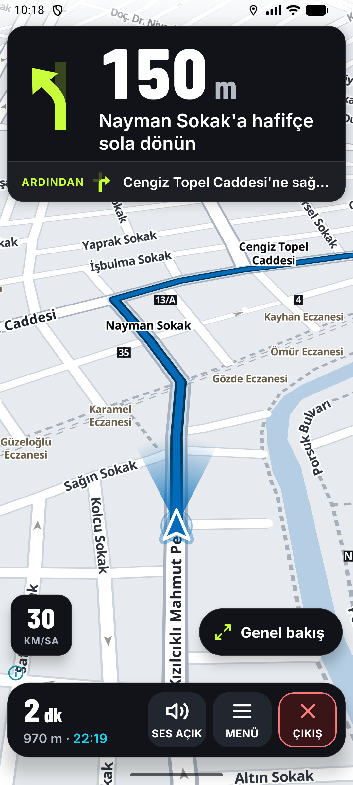<br><sub>Koridor etiketleri: önündeki yol</sub></td>
    <td align="center">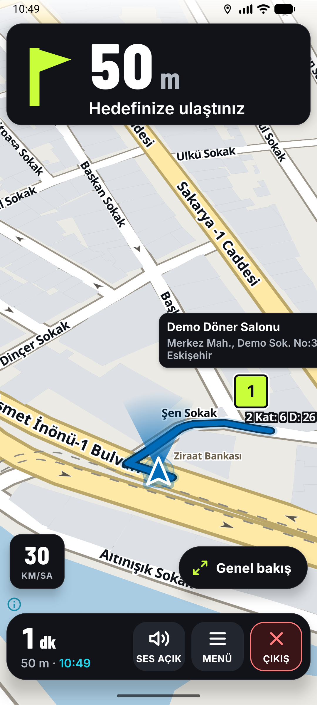<br><sub>Hedef ayrıntısı (bina, adres)</sub></td>
  </tr>
  <tr>
    <td align="center">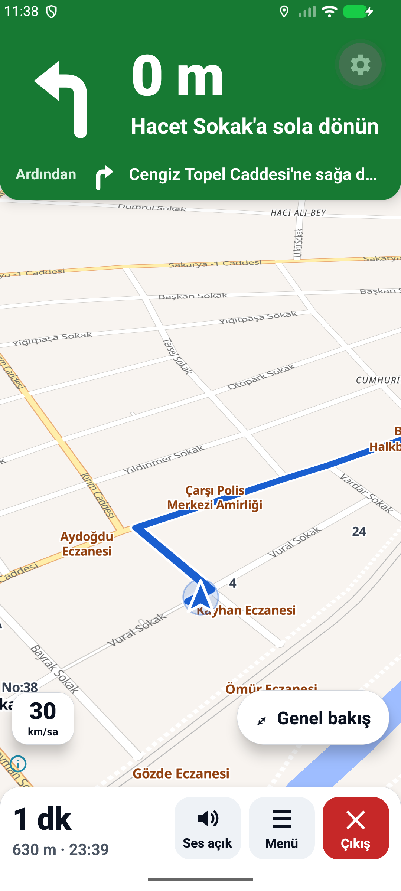<br><sub>Yoldan çıkınca yeniden rota</sub></td>
    <td align="center">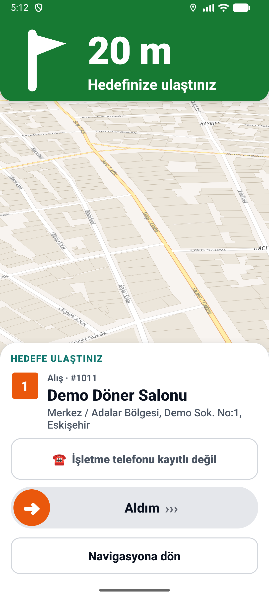<br><sub>Varış: Ara + kaydırarak onay</sub></td>
    <td align="center" colspan="2">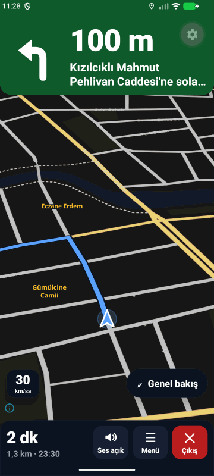<br><sub>Sürüş: rota yönünde dönen harita (course-up)</sub></td>
  </tr>
</table>

<details>
<summary>İterasyon 1 kurye ekranları</summary>

<table>
  <tr>
    <td align="center"><br><sub>Vardiya aç / kapat</sub></td>
    <td align="center"><br><sub>Havuz: yarıçap içindeki paketler</sub></td>
    <td align="center"><br><sub>Paket ayrıntısı ve harita</sub></td>
    <td align="center"><br><sub>Paket yolda: müşteriye git, teslim ettim</sub></td>
  </tr>
</table>

</details>

## Tasarım

Kurye uygulamasının navigasyon ekranı için üç görsel varyant ([A Sade, B Koyu / premium, C Marka / canlı](docs/tasarim/navigasyon/README.md)) statik HTML maketleri olarak hazırlandı; ürün sahibi **B**'yi seçti ve bu, ürünün marka dili oldu ([ADR-0027](docs/kararlar/0027-marka-kimligi-ve-navigasyon-gorsel-dili.md)). Maketler indirilip tarayıcıda çift tıklayarak açılır (yazı tipleri için çevrimiçi Google Fonts kullanır; bağlantı yoksa sistem yazı tiplerine düşer).

- [Seçim kaydı](docs/tasarim/navigasyon/secim.md) ve [varyant karşılaştırması](docs/tasarim/navigasyon/README.md)
- Maketler: [üç varyant yan yana (`index.html`)](docs/tasarim/navigasyon/index.html), [seçilen B'nin son hali (`b-v1.html`)](docs/tasarim/navigasyon/b-v1.html)
- Belirteçler: [navigasyon `tokens.json`](docs/tasarim/navigasyon/tokens.json), [marka kimliği](docs/tasarim/marka/README.md) ve [marka `tokens.json`](docs/tasarim/marka/tokens.json) (neon `#C8FF3A`, açık zeminde `#3F6212`; koyu zeminde her metin >= 7:1 kontrast)
- Navigasyon akıcılığı: [ADR-0024](docs/kararlar/0024-navigasyon-render-performansi.md) (emülatörde ort. kare hızı 23,2 -> 27-34 fps; 60 fps elde edilmedi)

## Mimari

Mimari özeti; ayrıntılar [docs/MIMARI.md](docs/MIMARI.md) ve [karar kayıtlarında](docs/kararlar/README.md).


### Öne çıkan mimari kararlar

| ADR | Karar |
|---|---|
| [0001](docs/kararlar/0001-hibrit-harita-mimarisi.md) | Hibrit harita mimarisi (Google Places + OSRM/VROOM) |
| [0002](docs/kararlar/0002-kurye-uygulamasi-react-native-expo.md) | Kurye uygulaması: React Native + Expo, tek kod Android + iOS |
| [0003](docs/kararlar/0003-dagitim-apk-self-update.md) | Dağıtım: Android APK + OTA, iOS TestFlight / özel uygulama |
| [0004](docs/kararlar/0004-cok-kiracili-mimari.md) | Çok kiracılı (multi-tenant) mimari, satır düzeyinde güvenlik |
| [0005](docs/kararlar/0005-konum-takibi-ve-kvkk.md) | Konum takibi ve KVKK |
| [0006](docs/kararlar/0006-hizmet-bolgesi-eskisehir.md) | Hizmet bölgesi: Eskişehir pilotu, çok şehre hazır tasarım |
| [0007](docs/kararlar/0007-backend-ve-web-yigini.md) | Backend ve web yığını: uçtan uca TypeScript monorepo |
| [0008](docs/kararlar/0008-acik-kaynak-harita.md) | Açık kaynak harita (MapLibre + OpenFreeMap), sağlayıcı arkasında adres arama |
| [0009](docs/kararlar/0009-rota-uyumlu-atama.md) | Rota uyumlu atama: kurye başına canlı rota, sapma süresine dayalı uygunluk, üç atama modu |
| [0010](docs/kararlar/0010-kuryeler-arasi-devir.md) | Kuryeler arası devir: yakındaki meslektaşa teklif, alıştan sonra fiziksel buluşma ve kanıt (kod + konum) |

## Teknoloji yığını

> Kararlar ve gerekçeleri: [ADR'ler](docs/kararlar/README.md).

| Katman | Teknoloji | Durum |
|---|---|---|
| Kurye uygulaması | React Native + Expo (TypeScript), tek kod Android + iOS; expo-location, MapLibre React Native | Kabul edildi |
| Yönetim paneli | React, TypeScript, Vite, Mantine, TanStack Query, MapLibre GL JS | Kabul edildi |
| Backend | NestJS (Fastify), Drizzle ORM, zod; npm workspaces monorepo | Kabul edildi |
| API sözleşmesi | OpenAPI 3.1 (contract-first) + JSON WebSocket protokolü, üretilen TS tipleri | Kabul edildi |
| Veritabanı | PostgreSQL 16 + PostGIS; satır düzeyinde güvenlik (RLS) İterasyon 2b'de | Kabul edildi |
| Önbellek / pub-sub | Redis | Kabul edildi |
| Gerçek zamanlı | Düz WebSocket (panel + kurye); push (FCM/APNs) İterasyon 2b'de | Kabul edildi |
| Harita | MapLibre + kendi PMTiles karolarımız ve stillerimiz (OpenStreetMap; ücretsiz, anahtarsız; OpenFreeMap yalnızca geliştirme yedeği) | Kabul edildi |
| Adres | API üzerinden Photon veya Google Places (New), hizmet bölgesi kısıtlı | Kabul edildi |
| Rota ve optimizasyon | OSRM (motosiklet profili) + VROOM, kendi barındırdığımız Eskişehir çıkarımı; atama motoru saf TypeScript (en ucuz yerleştirme, regret-2 toplu atama) | Çalışıyor |
| Dağıtım | Android APK + OTA (expo-updates); iOS TestFlight / Custom App | Kabul edildi |
| Barındırma | Türkiye'de VPS | Taslak |

## Yol haritası

| İterasyon | Odak | Durum |
|---|---|---|
| 0 | Planlama ve araştırma | ✅ Tamamlandı (müşteri keşfi sürüyor) |
| 1 | Çekirdek: kimlik / tenant, işletme, paket, havuz, yarıçap filtresi, kurye app, canlı harita, konum kesildi uyarısı | ✅ Tamamlandı |
| 2 | **Rota uyumlu atama:** gerçek rota motoru (OSRM + VROOM), rota uyumlu öneri / toplu atama, bekleyenler, ret ve kuryeler arası devir, "Rotam", uygulama içi navigasyon, benchmark | ✅ Tamamlandı |
| 2b | Platform ve sağlamlaştırma: push (FCM), iOS / TestFlight, RLS, OTA, aynı restoranın mevcut rotadaki paketiyle gruplanması, gerçek cihaz saha testi | ⏳ |
| 3a | **Eskişehir'e özel harita platformu (kendi yığınımız):** kendi karoları ve stilleri, kendi Photon adres arama, haftalık OSM güncelleme hattı (mavi / yeşil), kurye uygulamasında çevrimdışı harita, navigasyon ve eylem kuyruğu (idempotent), üretim hazırlığı ([ADR-0016](docs/kararlar/0016-eskisehire-ozel-kendi-barindirdigimiz-harita-platformu.md), [ADR-0018](docs/kararlar/0018-harita-karo-ve-stil-sunumu.md)-[ADR-0022](docs/kararlar/0022-uretim-dagitimi-ucretsiz-katman.md)) | ✅ Tamamlandı (açık: gerçek cihaz, iOS, FCM, RLS, çevrimdışı ETA soluklaştırma, sürüm derlemesi) |
| 3b | **Saha verisinden öğrenme ve teslim doğrulama:** öğrenilmiş teslim noktaları, restoran hazır sinyali ve işletme bağlantısı, teslim geofence'i, aynı restoran gruplama (varsayılan kapalı), yeni navigasyon görünümü ve akıcılık ([ADR-0017](docs/kararlar/0017-saha-verisinden-ogrenen-harita.md), [ADR-0024](docs/kararlar/0024-navigasyon-render-performansi.md)-[ADR-0027](docs/kararlar/0027-marka-kimligi-ve-navigasyon-gorsel-dili.md)) | ✅ Tamamlandı (açık: gerçek cihaz, pilot ayar kararları) |
| 3c | Öğrenilmiş hızlar, ETA hatası önce / sonra (pilot verisi >= 4 hafta gerekir) | ⏳ |
| 4 | Hakediş, kasa mutabakatı, ETA gösterimi | ⏳ |
| 5+ | İşletme paneli, POS / platform entegrasyonları, SoftPOS, faturalama | ⏳ |

Ayrıntılar: [docs/YOL-HARITASI.md](docs/YOL-HARITASI.md)

## Yapay zekâ destekli geliştirme süreci

Bu proje, **insan ürün sahibi + yapay zekâ ajanları** modeliyle geliştiriliyor; bu, projenin en ayırt edici yanlarından biri:

- **Claude Opus orkestratör ajan** gereksinim analizini, mimariyi ve görev kırılımını yönetir; kendi bağlamını küçük tutar.
- **Claude Sonnet alt ajanlar** kısa, kapsamı net görev brief'leriyle uygulamayı yapar, test eder ve en fazla 250 kelimelik özet döner.
- **Ortak hafıza depodadır:** kararlar ADR olarak, mimari ve süreç dokümanlar olarak yazılıdır; ajanlar her seferinde baştan anlatılmaz.
- **İnsan döngüdedir:** mimari kararlar, müşteri varsayımları ve birleştirme (merge) insan onayıyla yapılır.
- Her iterasyon pilot müşteriye bir demo ile kapanır ve bu vitrin güncellenir.

Ayrıntılar: [docs/GELISTIRME-SURECI.md](docs/GELISTIRME-SURECI.md)

## Bu depoda neler var?

```text
kurye-yonetim-sistemi-showcase/
├── README.md
└── docs/
    ├── MIMARI.md              # Mimari, veri modeli, akışlar
    ├── YOL-HARITASI.md        # İterasyonlar ve ilerleme
    ├── benchmark/             # Simülasyon benchmark raporu ve grafiği
    ├── GELISTIRME-SURECI.md   # AI destekli çalışma düzeni
    ├── kararlar/              # Mimari karar kayıtları (ADR)
    └── assets/                # Ekran görüntüleri ve GIF'ler
```

Kaynak kod bu depoda **bulunmaz**; ticari bir ürün olduğu için özel depoda tutulur ve mülakatlarda talep üzerine gösterilebilir.

## Geliştirici

**Kadir Kacır** · [LinkedIn](https://www.linkedin.com/in/kadir-kac%C4%B1r-247412325/)

Ürün sahibi ve proje yöneticisi olarak gereksinimleri pilot müşteriyle toplayıp önceliklendiriyor, mimari kararları onaylıyor ve projeyi yapay zekâ ajanlarıyla (Claude Opus orkestratör + Claude Sonnet uygulama ajanları) uçtan uca yürütüyor. Kaynak kod ve teknik detaylar mülakatlarda istek üzerine gösterilebilir.

## Lisans

**Tüm hakları saklıdır.** Bu depo açık kaynak değildir; yalnızca portföy ve inceleme amacıyla herkese açıktır. İzinsiz kullanım, kopyalama veya dağıtım yapılamaz.
