# Kurye Yönetim Sistemi — Proje Vitrini

> Restoranların platform komisyonu ödemeden kendi teslimatını yapabilmesi için, kurye firmalarına yönelik çok kiracılı (multi-tenant) kurye yönetim platformu: mobil kurye uygulaması (Android + iOS), web yönetim paneli ve backend.

**✅ İterasyon 1 tamamlandı · İterasyon 2 (rota uyumlu atama) planlandı**

Pilot bölge: Eskişehir; tasarım çok şehirli kullanıma hazırdır ([ADR-0006](docs/kararlar/0006-hizmet-bolgesi-eskisehir.md)).

> **Bu bir vitrin (showcase) reposudur.** Ürün ticari olduğu için **kaynak kod özel (private) bir depoda tutulur** ve burada yer almaz. Bu depo; proje özetini, mimariyi, karar kayıtlarını (ADR), yapay zekâ destekli geliştirme sürecini, yol haritasını ve ekran görüntülerini içerir. Kaynak kod, mülakatlarda talep üzerine gösterilebilir. Vitrin, her iterasyon sonunda özel depodan güncellenir.

**English summary:** Kurye Yönetim Sistemi is a multi-tenant courier management platform for Turkish courier firms that deliver for many restaurants for a per-package fee. It consists of a React Native + Expo Android courier app (background location, sideloaded APK), a React admin web panel with a live map and a NestJS/PostgreSQL+PostGIS backend. It is developed through an AI-orchestrated workflow (Claude Opus orchestrator + Sonnet sub-agents) with a human product owner; see [docs/GELISTIRME-SURECI.md](docs/GELISTIRME-SURECI.md). **This is a showcase repository:** the source code lives in a private repository because this is a commercial product, and can be demonstrated on request during interviews. This repository contains the architecture, decision records (ADRs), development process, roadmap and screenshots. Iteration 1 (core) is complete: the screenshots below come from the running system. Iteration 2 (route-aware assignment, courier-to-courier handover) is planned.

---

## İçindekiler

- [Problem ve çözüm](#problem-ve-çözüm)
- [Özellikler](#özellikler)
- [Ekran görüntüleri](#ekran-görüntüleri)
- [Mimari](#mimari)
- [Teknoloji yığını](#teknoloji-yığını)
- [Yol haritası](#yol-haritası)
- [Yapay zekâ destekli geliştirme süreci](#yapay-zekâ-destekli-geliştirme-süreci)
- [Bu depoda neler var?](#bu-depoda-neler-var)
- [Geliştirici](#geliştirici)
- [Lisans](#lisans)

## Problem ve çözüm

Restoranlar, Yemeksepeti veya Trendyol gibi platformların teslimat komisyonlarından kaçınmak için kendi teslimatlarını yapmak ister. Bunu genellikle paket başı ücretle çalışan yerel **kurye firmaları** üstlenir. Bu firmalar ise tipik olarak şu sorunlarla karşılaşır:

| Problem | Bu projenin yaklaşımı |
|---|---|
| Kuryeler ödemelerin (hakediş) neye göre hesaplandığına güvenmiyor | Paket bazlı, kuryenin kendi ekranında görebildiği şeffaf hakediş |
| Siparişler telefonla / mesajla dağıtılıyor, adil dağılım yok | Sipariş havuzu, yarıçap filtresi ve adil atama |
| Adres girişi yavaş ve hatalı | Hizmet bölgesiyle sınırlı adres otomatik tamamlama (Google Places veya açık kaynak Photon) ve haritada iğneyle düzeltme |
| Kurye uygulamaları ucuz telefonlarda yavaş, pil tüketiyor ve konumu kaçırıyor | Android ve iOS için tek kod (React Native + Expo), kalıcı kuyruklu toplu konum gönderimi, pil optimizasyonu rehberi |
| Kuryenin konumu kesilince fark edilmiyor | Heartbeat tabanlı konum kesilme uyarısı |
| Kapıda nakit tahsilat takibi zor | Kasa / nakit mutabakatı |

Ürün; **sınırsız işletme** (restoran) tanımlanabilen, **20-25 eşzamanlı motorlu kuryeyi** rahatça yönetebilen bir kurye firması yazılımı olarak tasarlanıyor.

## Özellikler

Durum: ✅ tamamlandı (İterasyon 1), ⏳ planlandı. Ayrıntılı kapsam için [YOL-HARITASI.md](docs/YOL-HARITASI.md).

### ⭐ Rota uyumlu akıllı atama

> Yeni paket, kuryeye **yakınlığına** göre değil, kuryenin **rotasına kattığı sapma süresine** göre atanır ("Rotası üzerinde, +2 dk" ile "Ters yön, +14 dk" arasındaki fark). Her kurye paketlerini haritada numaralı duraklar ve optimal sırayla görür; yönetici önerilen en iyi 3 kuryeyi tek tıkla atar, kontrollü ret ve devir akışı yanlış atamaları görünür kılar. Pilot müşteriden gelen sahadaki geri bildirimle (ters yöndeki paketler, kuryelerin paketi bırakması, yöneticinin elle yeniden dağıtımı) şekillendi; **İterasyon 2'nin ana hedefidir**. Karar: [ADR-0009](docs/kararlar/0009-rota-uyumlu-atama.md). Başarı, "en yakın kurye" ile karşılaştıran bir simülasyon benchmark'ı ile ölçülecek ve sonuç grafiği burada yayınlanacak.

### Sipariş ve paket yönetimi
- ✅ Sınırsız işletme tanımı, firma başına çok kiracılı yapı (İterasyon 1)
- ✅ Adres otomatik tamamlama (Photon / Google Places) ile paket ekleme (İterasyon 1)
- ✅ Sipariş havuzu: kurye paketi havuzdan kendisi alır (İterasyon 1)
- ✅ Elle atama ve yeniden atama (İterasyon 1)
- ✅ Kurye başına yarıçap filtresi (İterasyon 1)

### Kurye uygulaması (Android + iOS)
- ✅ Vardiya aç / kapat, havuzdan paket alma (İterasyon 1)
- ✅ Paket seçilince adres haritada açılır, tek dokunuşla navigasyon (İterasyon 1)
- ⏳ "Rotam" ekranı: numaralı duraklar (liste + harita), optimal sıra, rota değişince bildirim (İterasyon 2)
- ⏳ Kontrollü ret (gerekçeli) ve devir isteği (İterasyon 2)
- ⏳ Kuryeler arası devir: yakındaki meslektaşa teklif, alıştan sonra kod + konum ile fiziksel devir ([ADR-0010](docs/kararlar/0010-kuryeler-arasi-devir.md), İterasyon 2)
- ⏳ OTA güncelleme (expo-updates) ve iOS dağıtımı (İterasyon 2)
- ⏳ Şeffaf hakediş ekranı (İterasyon 4)

### Yönetim paneli (Web)
- ✅ Canlı harita ve kurye konumları (İterasyon 1)
- ✅ Konum kesilme uyarısı (İterasyon 1)
- ⏳ Hakediş ve raporlar (İterasyon 4)
- ⏳ Kasa / nakit mutabakatı (İterasyon 4)
- ⏳ Rota çizgileri, öneri paneli, sürükle-bırak atama ve sapma uyarısı (İterasyon 2)
- ⏳ ETA gösterimi (İterasyon 4)

### Entegrasyonlar ve genişlemeler
- ⏳ İşletme paneli: restoranların kendi siparişlerini girmesi (İterasyon 5+)
- ⏳ POS entegrasyonu (İterasyon 5+)
- ⏳ Platform entegrasyonları ve SoftPOS (İterasyon 5+)
- ⏳ Paket başı faturalama (İterasyon 5+)

## Ekran görüntüleri

Aşağıdaki görüntüler gerçek API ve kurgusal Eskişehir demo verisiyle alınmıştır (kişisel veri içermez).

### Yönetim paneli

<table>
  <tr>
    <td colspan="2" align="center">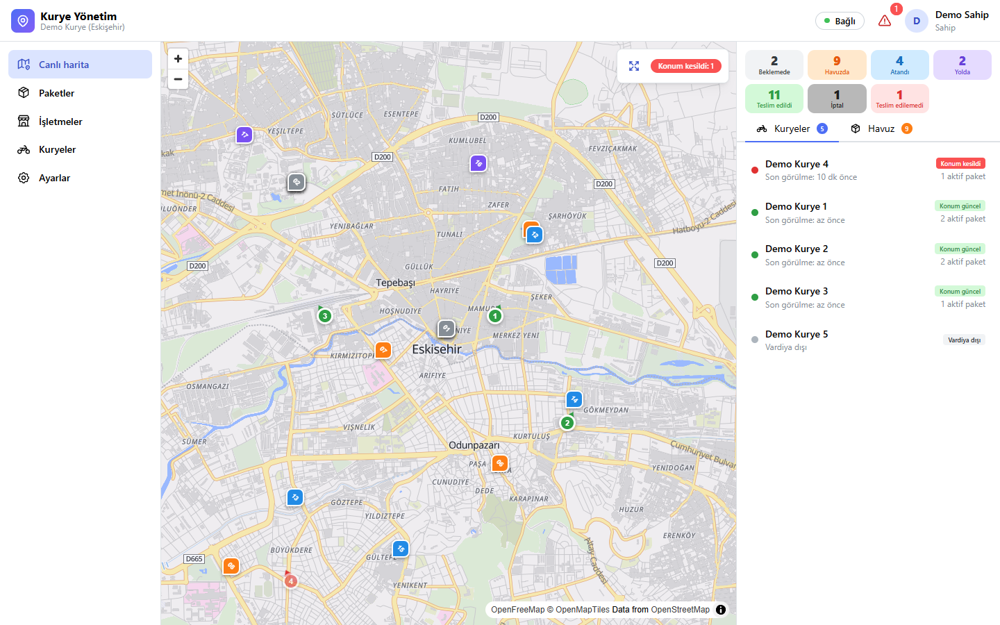<br><sub>Canlı harita: kurye konumları, durum özeti, "Konum kesildi" uyarısı ve havuzdaki paketler</sub></td>
  </tr>
  <tr>
    <td align="center">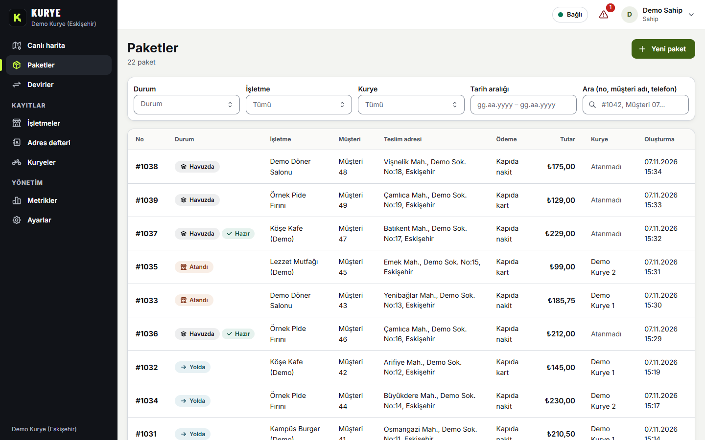<br><sub>Paket listesi: durum, işletme, kurye ve tarih filtreleri</sub></td>
    <td align="center">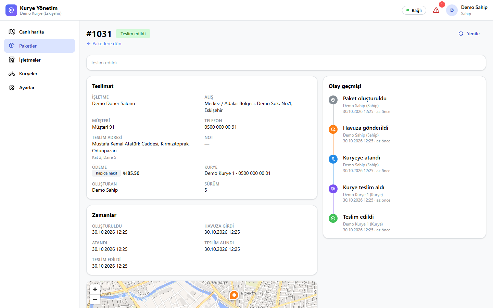<br><sub>Paket ayrıntısı ve olay geçmişi (kim, ne zaman, ne yaptı)</sub></td>
  </tr>
  <tr>
    <td align="center">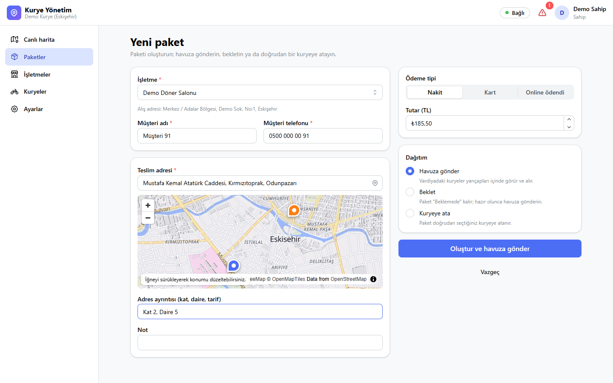<br><sub>Yeni paket: adres otomatik tamamlama ve haritada iğne</sub></td>
    <td align="center">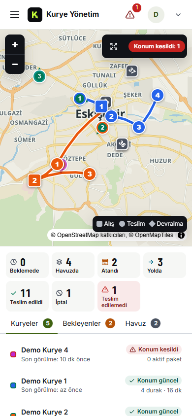&nbsp;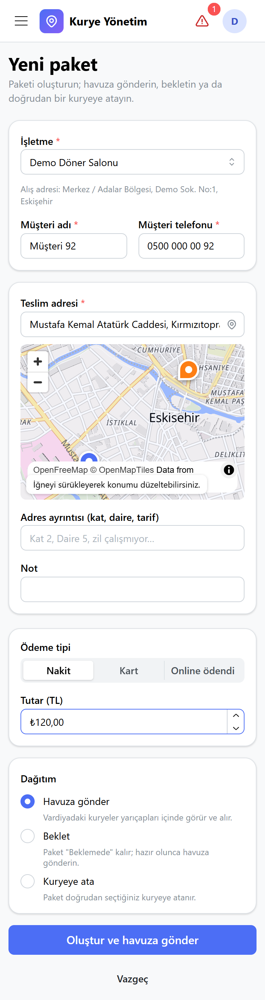<br><sub>Panel telefon ekranında da çalışır (duyarlı tasarım)</sub></td>
  </tr>
</table>

### Kurye uygulaması (Android)

<table>
  <tr>
    <td align="center">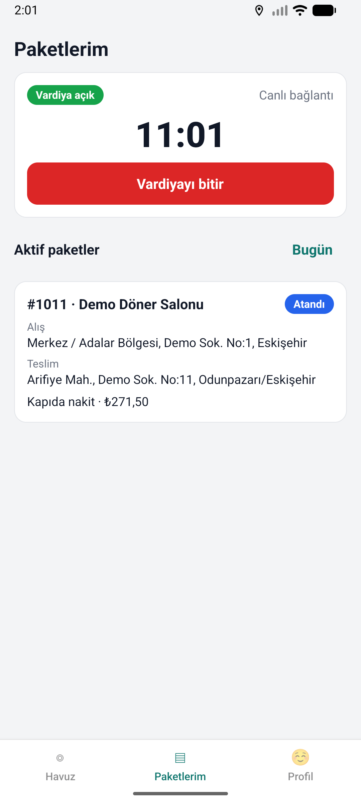<br><sub>Vardiya aç / kapat</sub></td>
    <td align="center">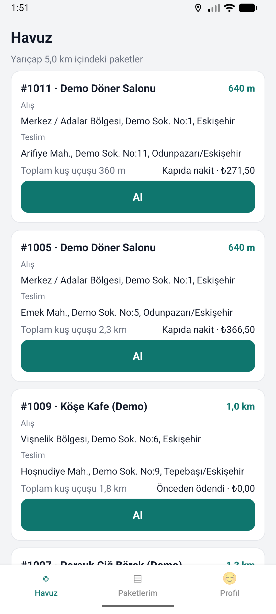<br><sub>Havuz: yarıçap içindeki paketler</sub></td>
    <td align="center">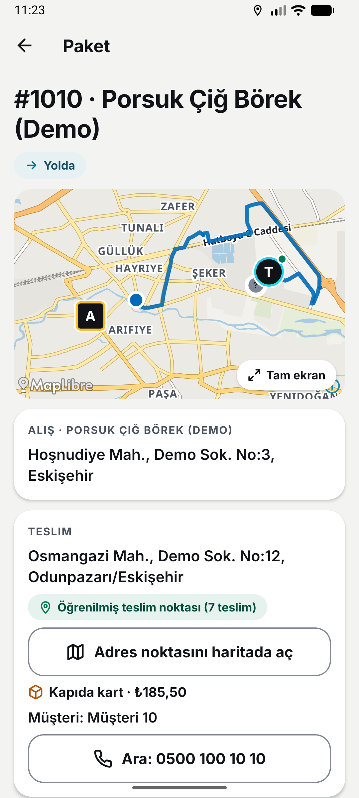<br><sub>Paket ayrıntısı ve harita</sub></td>
    <td align="center">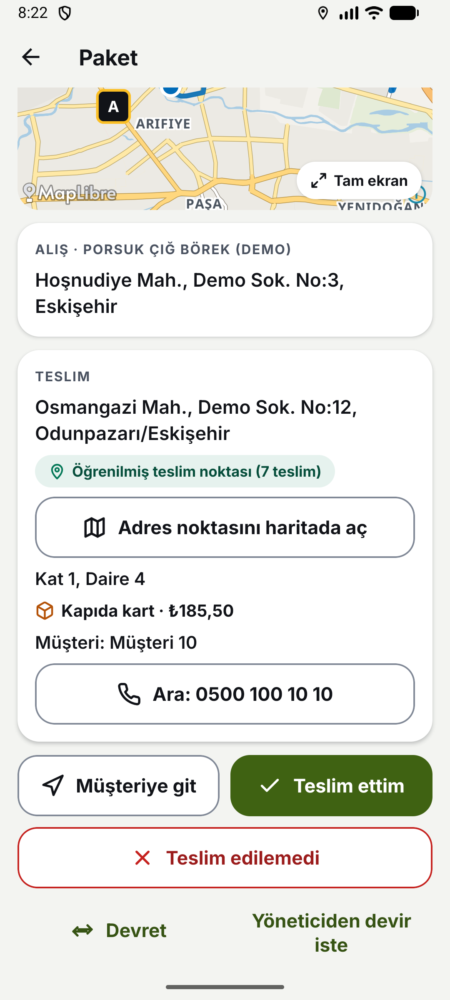<br><sub>Paket yolda: müşteriye git, teslim ettim</sub></td>
  </tr>
</table>

## Mimari

Mimari özeti; ayrıntılar [docs/MIMARI.md](docs/MIMARI.md) ve [karar kayıtlarında](docs/kararlar/README.md).

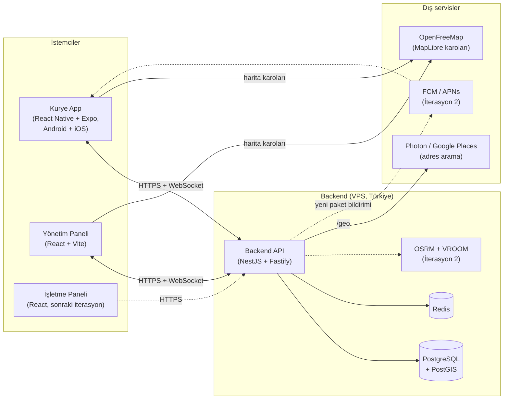

### Öne çıkan mimari kararlar

| ADR | Karar |
|---|---|
| [0001](docs/kararlar/0001-hibrit-harita-mimarisi.md) | Hibrit harita mimarisi (Google Places + OSRM/VROOM) |
| [0002](docs/kararlar/0002-kurye-uygulamasi-react-native-expo.md) | Kurye uygulaması: React Native + Expo, tek kod Android + iOS |
| [0003](docs/kararlar/0003-dagitim-apk-self-update.md) | Dağıtım: Android APK + OTA, iOS TestFlight / özel uygulama |
| [0004](docs/kararlar/0004-cok-kiracili-mimari.md) | Çok kiracılı (multi-tenant) mimari, satır düzeyinde güvenlik |
| [0005](docs/kararlar/0005-konum-takibi-ve-kvkk.md) | Konum takibi ve KVKK |
| [0006](docs/kararlar/0006-hizmet-bolgesi-eskisehir.md) | Hizmet bölgesi: Eskişehir pilotu, çok şehre hazır tasarım |
| [0007](docs/kararlar/0007-backend-ve-web-yigini.md) | Backend ve web yığını: uçtan uca TypeScript monorepo |
| [0008](docs/kararlar/0008-acik-kaynak-harita.md) | Açık kaynak harita (MapLibre + OpenFreeMap), sağlayıcı arkasında adres arama |
| [0009](docs/kararlar/0009-rota-uyumlu-atama.md) | Rota uyumlu atama: kurye başına canlı rota, sapma süresine dayalı uygunluk, üç atama modu |
| [0010](docs/kararlar/0010-kuryeler-arasi-devir.md) | Kuryeler arası devir: yakındaki meslektaşa teklif, alıştan sonra fiziksel buluşma ve kanıt (kod + konum) |

## Teknoloji yığını

> Kararlar ve gerekçeleri: [ADR'ler](docs/kararlar/README.md).

| Katman | Teknoloji | Durum |
|---|---|---|
| Kurye uygulaması | React Native + Expo (TypeScript), tek kod Android + iOS; expo-location, MapLibre React Native | Kabul edildi |
| Yönetim paneli | React, TypeScript, Vite, Mantine, TanStack Query, MapLibre GL JS | Kabul edildi |
| Backend | NestJS (Fastify), Drizzle ORM, zod; npm workspaces monorepo | Kabul edildi |
| API sözleşmesi | OpenAPI 3.1 (contract-first) + JSON WebSocket protokolü, üretilen TS tipleri | Kabul edildi |
| Veritabanı | PostgreSQL 16 + PostGIS; satır düzeyinde güvenlik (RLS) İterasyon 2'de | Kabul edildi |
| Önbellek / pub-sub | Redis | Kabul edildi |
| Gerçek zamanlı | Düz WebSocket (panel + kurye); push (FCM/APNs) İterasyon 2'de | Kabul edildi |
| Harita | MapLibre + OpenFreeMap (ücretsiz, anahtarsız) | Kabul edildi |
| Adres | API üzerinden Photon veya Google Places (New), hizmet bölgesi kısıtlı | Kabul edildi |
| Rota ve optimizasyon | OSRM + VROOM (self-hosted, İterasyon 2) | Kabul edildi |
| Dağıtım | Android APK + OTA (expo-updates); iOS TestFlight / Custom App | Kabul edildi |
| Barındırma | Türkiye'de VPS | Taslak |

## Yol haritası

| İterasyon | Odak | Durum |
|---|---|---|
| 0 | Planlama ve araştırma | ✅ Tamamlandı (müşteri keşfi sürüyor) |
| 1 | Çekirdek: kimlik / tenant, işletme, paket, havuz, yarıçap filtresi, kurye app, canlı harita, konum kesildi uyarısı | ✅ Tamamlandı |
| 2 | **Ana hedef: rota uyumlu atama** (duraklar, rota optimizasyonu, öneri / otomatik atama, ret ve devir); push bildirim, iOS dağıtımı, OTA / self-update | ⏳ |
| 3 | **Eskişehir'e özel harita platformu:** kendi karoları, adres arama ve haftalık OSM güncellemesi; çevrimdışı harita ve eylem kuyruğu; saha verisinden öğrenen teslim noktaları ve hızlar ([ADR-0016](docs/kararlar/0016-eskisehire-ozel-kendi-barindirdigimiz-harita-platformu.md), [ADR-0017](docs/kararlar/0017-saha-verisinden-ogrenen-harita.md)) | 📝 Plan hazır |
| 4 | Hakediş, kasa mutabakatı, ETA gösterimi | ⏳ |
| 5+ | İşletme paneli, POS / platform entegrasyonları, SoftPOS, faturalama | ⏳ |

Ayrıntılar: [docs/YOL-HARITASI.md](docs/YOL-HARITASI.md)

## Yapay zekâ destekli geliştirme süreci

Bu proje, **insan ürün sahibi + yapay zekâ ajanları** modeliyle geliştiriliyor; bu, projenin en ayırt edici yanlarından biri:

- **Claude Opus orkestratör ajan** gereksinim analizini, mimariyi ve görev kırılımını yönetir; kendi bağlamını küçük tutar.
- **Claude Sonnet alt ajanlar** kısa, kapsamı net görev brief'leriyle uygulamayı yapar, test eder ve en fazla 250 kelimelik özet döner.
- **Ortak hafıza depodadır:** kararlar ADR olarak, mimari ve süreç dokümanlar olarak yazılıdır; ajanlar her seferinde baştan anlatılmaz.
- **İnsan döngüdedir:** mimari kararlar, müşteri varsayımları ve birleştirme (merge) insan onayıyla yapılır.
- Her iterasyon pilot müşteriye bir demo ile kapanır ve bu vitrin güncellenir.

Ayrıntılar: [docs/GELISTIRME-SURECI.md](docs/GELISTIRME-SURECI.md)

## Bu depoda neler var?

```text
kurye-yonetim-sistemi-showcase/
├── README.md
└── docs/
    ├── MIMARI.md              # Mimari, veri modeli, akışlar
    ├── YOL-HARITASI.md        # İterasyonlar ve ilerleme
    ├── GELISTIRME-SURECI.md   # AI destekli çalışma düzeni
    ├── kararlar/              # Mimari karar kayıtları (ADR)
    └── assets/                # Ekran görüntüleri ve GIF'ler
```

Kaynak kod bu depoda **bulunmaz**; ticari bir ürün olduğu için özel depoda tutulur ve mülakatlarda talep üzerine gösterilebilir.

## Geliştirici

**Kadir Kacır** · [LinkedIn](https://www.linkedin.com/in/kadir-kac%C4%B1r-247412325/)

Ürün sahibi ve proje yöneticisi olarak gereksinimleri pilot müşteriyle toplayıp önceliklendiriyor, mimari kararları onaylıyor ve projeyi yapay zekâ ajanlarıyla (Claude Opus orkestratör + Claude Sonnet uygulama ajanları) uçtan uca yürütüyor. Kaynak kod ve teknik detaylar mülakatlarda istek üzerine gösterilebilir.

## Lisans

**Tüm hakları saklıdır.** Bu depo açık kaynak değildir; yalnızca portföy ve inceleme amacıyla herkese açıktır. İzinsiz kullanım, kopyalama veya dağıtım yapılamaz.
