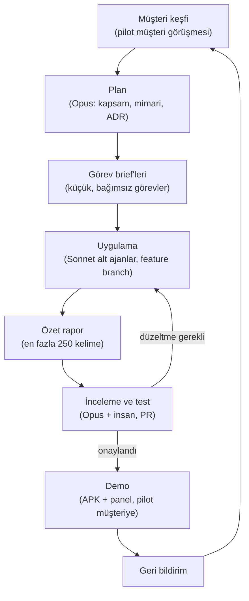

# Geliştirme Süreci

Bu proje, **insan ürün sahibi** ile **yapay zekâ ajanlarının** birlikte çalıştığı bir iş akışıyla geliştirilir. Amaç yalnızca kod üretmek değil; kararları, gerekçeleri ve ilerlemeyi depoda izlenebilir tutmaktır.

## Roller

| Rol | Kim | Sorumluluk |
|---|---|---|
| Ürün sahibi / karar verici | İnsan geliştirici | Öncelikleri belirler, pilot müşteriyle konuşur, ADR'leri onaylar, PR'ları birleştirir |
| Orkestratör ajan | Claude Opus 5.5 | Gereksinim analizi, mimari, görev kırılımı, sonuçları inceleme; kendi bağlamını küçük tutar |
| Uygulayıcı alt ajanlar | Claude Sonnet 5.5 (yüksek effort) | Tek bir görev brief'ini uygular, test eder, kısa özet döner |
| Zor tasarım alt ajanları | Claude Opus alt ajanları | Zor mimari / algoritma sorunları (ör. arka plan konum güvenilirliği, rota optimizasyonu) |

## Çalışma ilkeleri

- **Orkestratör bağlamını küçük tutar.** Uzun kod çıktıları orkestratöre taşınmaz; alt ajanlar en fazla 250 kelimelik özet döner.
- **Ortak hafıza depodadır.** Ajanlar her seferinde baştan anlatılmaz; `CLAUDE.md`, [`MIMARI.md`](MIMARI.md) ve [karar kayıtları](kararlar/README.md) okunur.
- **Kararlar yazılı.** Önemli her teknik karar bir ADR olur; karar değişirse ADR güncellenir.
- **İnsan döngüde.** Mimari kararlar, müşteriyle ilgili varsayımlar ve birleştirme (merge) insan onayıyla yapılır.
- **Küçük, kapsamı net görevler.** Her görev brief'i hedef, kapsam dışı, ilgili dokümanlar ve kabul kriterlerini içerir.

## İterasyon döngüsü



### Görev brief'i şablonu

```text
Başlık:        kısa ve eylem odaklı
Hedef:         neden gerekli, hangi kullanıcı sorununu çözüyor
Kapsam:        yapılacaklar (madde madde)
Kapsam dışı:   dokunulmayacak alanlar
Okunacak:      ilgili doküman / ADR / dosya yolları
Kabul kriteri: doğrulanabilir maddeler
Rapor:         en fazla 250 kelime (değişiklik, dosyalar, doğrulama, açık sorunlar)
```

## Git kuralları

| Konu | Kural |
|---|---|
| Ana dal | `main`, her zaman çalışır durumda |
| Dal adları | `feature/<kısa-ad>`, `fix/<kısa-ad>`, gerekirse `docs/<kısa-ad>` |
| Commit mesajları | Conventional Commits, Türkçe açıklama: `feat: sipariş havuzu listesi eklendi` |
| Tipler | `feat:`, `fix:`, `docs:`, `chore:` (gerekirse `refactor:`, `test:`) |
| Pull request | Her özellik için bir PR; açıklama ne, neden ve nasıl doğrulandığını içerir |
| Gizli bilgi | `.env`, keystore, Google API anahtarı gibi dosyalar asla commit edilmez |

## Definition of Done

Bir görev ancak şunların hepsi sağlanınca tamamlanmış sayılır:

- [ ] Proje derleniyor / build alınıyor
- [ ] Testler geçiyor
- [ ] Docs ve ilgili ADR güncellendi (karar değiştiyse)
- [ ] UI değiştiyse README'deki ekran görüntüsü / GIF güncellendi
- [ ] Demo verisi (seed) ile uçtan uca çalışıyor
- [ ] Depoda gizli bilgi veya kişisel veri yok
- [ ] **Güvenlik:** `npm run security` yeşil (güvenlik regresyon testleri: kimlik + rol matrisi, kiracılar arası erişim, JWT kurcalama, işletme bağlantısı, hız sınırı, üretim başlıkları; ardından `npm audit --omit=dev --audit-level=high`). Yeni uç ekleyen görev, sözleşmeye `x-roles` yazar ve kiracıya ait yeni kaynak için kiracılar arası 404 testini ekler. Çalışma zamanı bağımlılığında yeni **high/critical** `npm audit` bulgusu ancak PR açıklamasında "sömürülebilir mi, neden kabul edildi, ne zaman kapanacak" notuyla kabul edilir. Girişsiz (herkese açık) uç, sır / jeton işleme veya log alanı değişikliği ayrıca güvenlik incelemesinden geçer.
- [ ] Vitrin senkronu yapıldı (iterasyon sonunda `scripts/sync-showcase.ps1`; aşağıya bakın)
- [ ] Alt ajan özet raporu verildi ve incelendi

## Vitrin (public) repo

Kaynak kod ticari olduğu için bu depo **private** kalır. İş başvurularında göstermek üzere ayrı, herkese açık bir **vitrin reposu** tutulur: <https://github.com/Kadir0642/kurye-yonetim-sistemi-showcase>. Vitrinde yalnızca proje özeti, mimari, ADR'ler, süreç, yol haritası ve ekran görüntüleri / GIF'ler bulunur; kaynak kod, araştırma (`docs/research`) ve `CLAUDE.md` bulunmaz.

- **Ne yayınlanır:** `showcase/manifest.txt` içinde listelenen dosyalar ve `showcase/README.md` (vitrinin ana sayfası). Manifest'teki her şey **herkese açık** olur.
- **Nasıl güncellenir:** her iterasyon sonunda `.\scripts\sync-showcase.ps1` çalıştırılır (varsayılan hedef: depo klasörünün yanındaki `kurye-yonetim-sistemi-showcase`). Script dosyaları kopyalar, vitrinde bulunmayan dosyalara giden linkleri düz metne çevirir, denylist ve gizli bilgi taraması yapar, değişiklik varsa commit eder. Yayınlamak için `-Push` verilir; önce `git log` / `git diff` ile gözden geçirmek önerilir.
- **İterasyon sonunda:** yeni ekran görüntüsü / GIF'leri `docs/assets/` altına koy, `showcase/README.md` içindeki özellik durumlarını ve yol haritasını güncelle, sonra senkronu çalıştır.

## Neden bu yaklaşım?

- **Ölçeklenebilir bağlam:** Orkestratör ayrıntıya boğulmaz, alt ajanlar dar kapsamda yüksek kalite üretir.
- **İzlenebilirlik:** Her karar ve değişiklik depoda; bir okuyucu projenin neden böyle olduğunu görebilir.
- **Müşteriye yakınlık:** Her iterasyon çalışan bir demo ile biter; geri bildirim bir sonraki planı şekillendirir.
