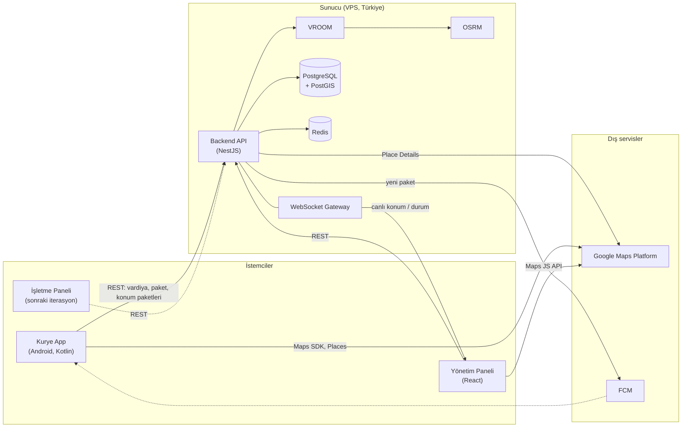
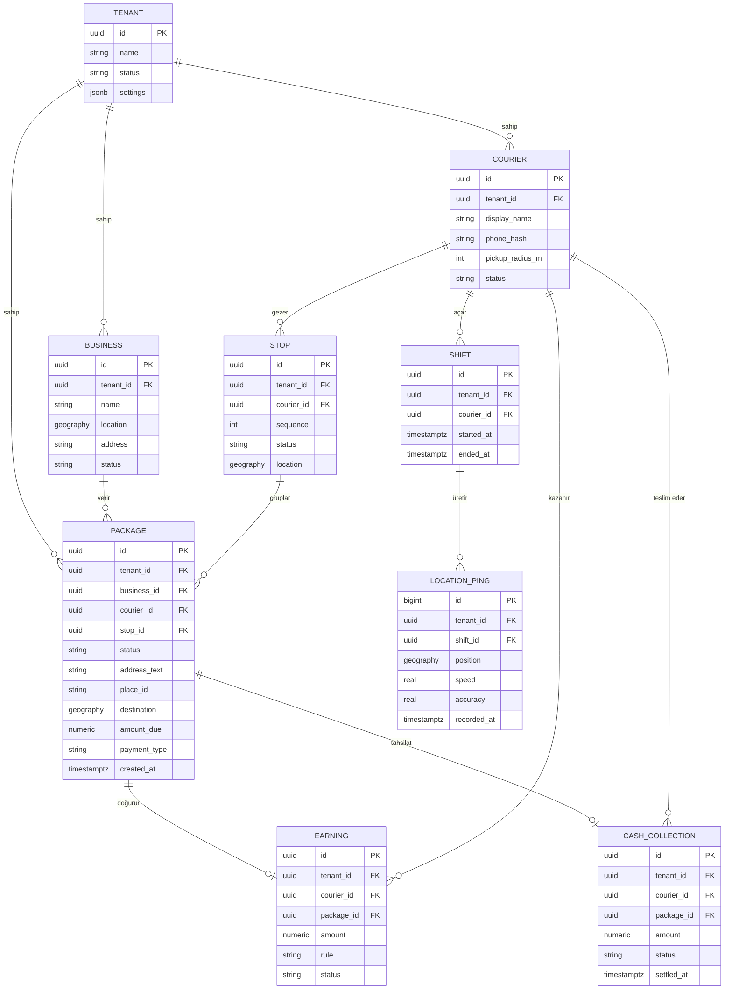
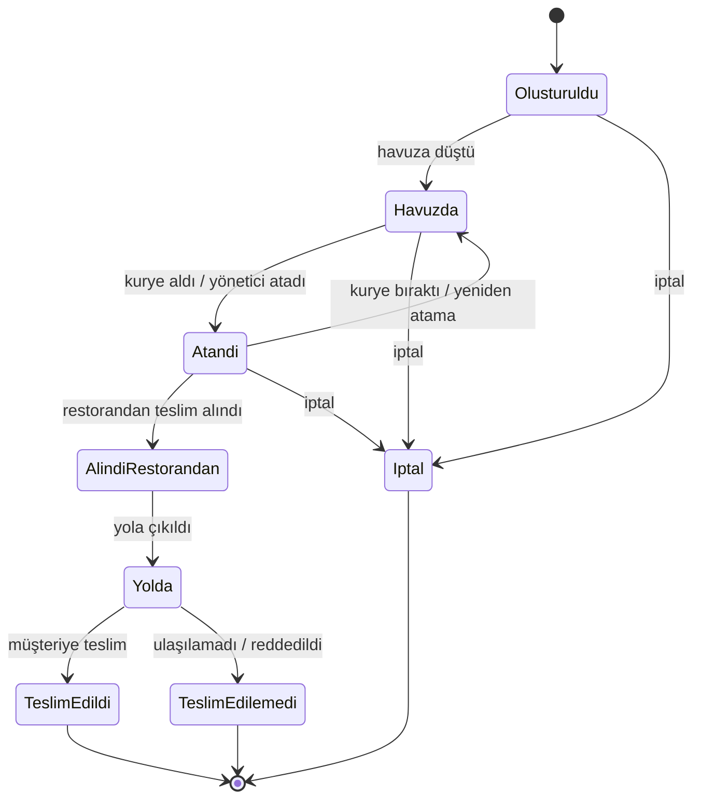
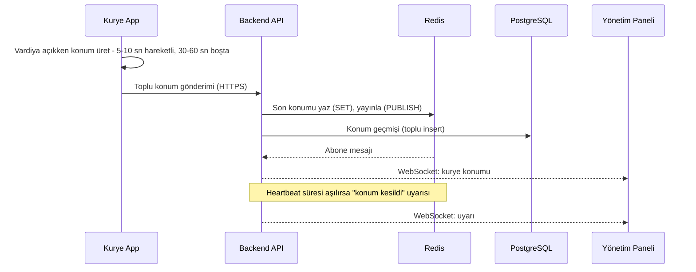

# Mimari (Taslak)

> Durum: **Taslak / Önerildi.** Pilot müşteri keşfi tamamlanmadığından aşağıdaki kararlar değişebilir. Gerekçeler için [karar kayıtları](kararlar/README.md), dayanak için araştırma raporları.

## 1. Bileşenler

| Bileşen | Teknoloji (önerilen) | Sorumluluk |
|---|---|---|
| Kurye uygulaması | Kotlin + Jetpack Compose | Vardiya, konum servisi, havuz, harita, navigasyon başlatma, teslim, hakediş görünümü |
| Yönetim paneli | React + TypeScript (Vite) | İşletme / kurye / paket yönetimi, canlı harita, atama, raporlar |
| İşletme paneli (sonra) | React + TypeScript | Restoranların kendi siparişlerini girmesi |
| Backend API | NestJS (TypeScript) | İş mantığı, kimlik, tenant izolasyonu, WebSocket, bildirim |
| Veritabanı | PostgreSQL + PostGIS | Kalıcı veri, mekânsal sorgular (`ST_DWithin`), RLS |
| Önbellek | Redis | Son konum, pub/sub, hız sınırlama |
| Rota motoru | OSRM + VROOM (self-hosted) | Mesafe matrisi, durak optimizasyonu |
| Harita ve adres | Google Maps Platform | Places Autocomplete, Place Details Essentials, Maps SDK |
| Push | FCM (high-priority data message) | Yeni paket bildirimi |

## 2. Sistem diyagramı

## 3. Çok kiracılı veri modeli (taslak)

Kiracı (tenant) = kurye firması. İşletmeler, kuryeler ve paketler kiracıya bağlıdır; tüm tablolarda `tenant_id` bulunur ve PostgreSQL satır düzeyi güvenlik (RLS) ile izole edilir ([ADR-0004](kararlar/0004-cok-kiracili-mimari.md)).

Notlar:
- `LOCATION_PING` büyük hacimli olduğundan gün bazlı partition (veya TimescaleDB) düşünülüyor; saklama süresi KVKK'ya göre sınırlı ([ADR-0005](kararlar/0005-konum-takibi-ve-kvkk.md)).
- Google kullanım şartları nedeniyle `place_id` kalıcı saklanabilir, koordinat önbelleği sınırlıdır ([ADR-0001](kararlar/0001-hibrit-harita-mimarisi.md)).
- Alan adları taslaktır; kesin şema İterasyon 1'de çıkarılacak.

## 4. Paket yaşam döngüsü

Durum adları (kod karşılıkları): `CREATED`, `IN_POOL`, `ASSIGNED`, `PICKED_UP`, `EN_ROUTE`, `DELIVERED`, `FAILED`, `CANCELLED`. Ekranlarda Türkçe etiketler kullanılır. `PICKED_UP` sonrası iptal kuralı (ücret, iade) müşteriyle netleştirilecek.

## 5. Canlı takip veri akışı

Ölçek tahmini: 25 kurye, 5-10 sn aralık, yaklaşık 3-5 mesaj/sn; bu hacim için MQTT gereksizdir (araştırma).

## 6. Yeni paket ve navigasyon akışı (özet)

1. İşletme / yönetici paket girer; adres Places Autocomplete (session token) ile seçilir, Place Details Essentials ile doğrulanır.
2. Paket `IN_POOL` durumuna geçer; yarıçap içindeki vardiyadaki kuryelere FCM high-priority data message gönderilir (PostGIS `ST_DWithin`).
3. Kurye paketi alır; adres harita üzerinde açılır, tek dokunuşla `google.navigation:` intent'i ile navigasyon başlar.
4. Çok paketli durumlarda duraklar OSRM + VROOM ile sıralanır; her durak için ayrı navigasyon başlatılır (durum takibi için), isteğe bağlı çok duraklı Maps URL'si (en fazla 9 ara nokta, parçalı).

## 7. Güvenlik ve gizlilik ilkeleri

- Tenant izolasyonu RLS ile; her istekte `tenant_id` bağlamı.
- Konum yalnızca açık vardiyada; aydınlatma metni ve açık rıza metni ayrı ([ADR-0005](kararlar/0005-konum-takibi-ve-kvkk.md)).
- Gizli anahtarlar depoda tutulmaz; yapılandırma ortam değişkenleriyle.
- Depoda müşteri / kurye kişisel verisi yok; demo verisi tamamen kurgusal.

## 8. Açık sorular

Pilot müşteri keşfi henüz yapılmadı; aşağıdakiler cevap bekliyor.

| # | Soru | Etkilediği karar |
|---|---|---|
| 1 | Kurye telefonları kimin (şirket mi, kurye mi)? Düşük uç cihaz modelleri ve Android sürümleri? | ADR-0002, ADR-0003 |
| 2 | Cihazlarda Google Play Services var mı (Huawei vb.)? | ADR-0005, FCM yedek planı |
| 3 | Hakediş hesabı: paket başı sabit mi, mesafe / saat bazlı mı, prim ve kesinti var mı? | Earning modeli |
| 4 | Kapıda ödeme oranı ve kasa teslim süreci nasıl işliyor? | CashCollection modeli |
| 5 | Atama: havuz mu, elle mi, karma mı? "Adil" tanımı nedir? | Atama algoritması |
| 6 | Restoranlar paketleri kendileri mi girecek, yoksa yalnızca firma mı? | İşletme paneli zamanlaması |
| 7 | Hangi POS sistemleri kullanılıyor (Adisyo var mı)? | Entegrasyon önceliği |
| 8 | Teslim kanıtı gerekli mi (fotoğraf, kod, imza)? | Package / teslim akışı |
| 9 | Paket iptal ve iade kuralları (alındıktan sonra iptal ücreti vb.) | Yaşam döngüsü |
| 10 | Konum verisi saklama süresi ve VERBİS yükümlülüğü | ADR-0005 |
| 11 | Google ToS: koordinat önbellekleme ve Google verisini Google dışı harita ile kullanma sınırları | ADR-0001 (açık risk) |
| 12 | Türkiye OSM adres / yol kalitesi pilot bölgede yeterli mi? | ADR-0001 (OSRM) |
| 13 | Android developer verification: Türkiye ve kurumsal dağıtım durumu | ADR-0003 |
| 14 | Faturalama modeli: paket başı mı, abonelik mi? | Faturalama (İterasyon 4+) |
