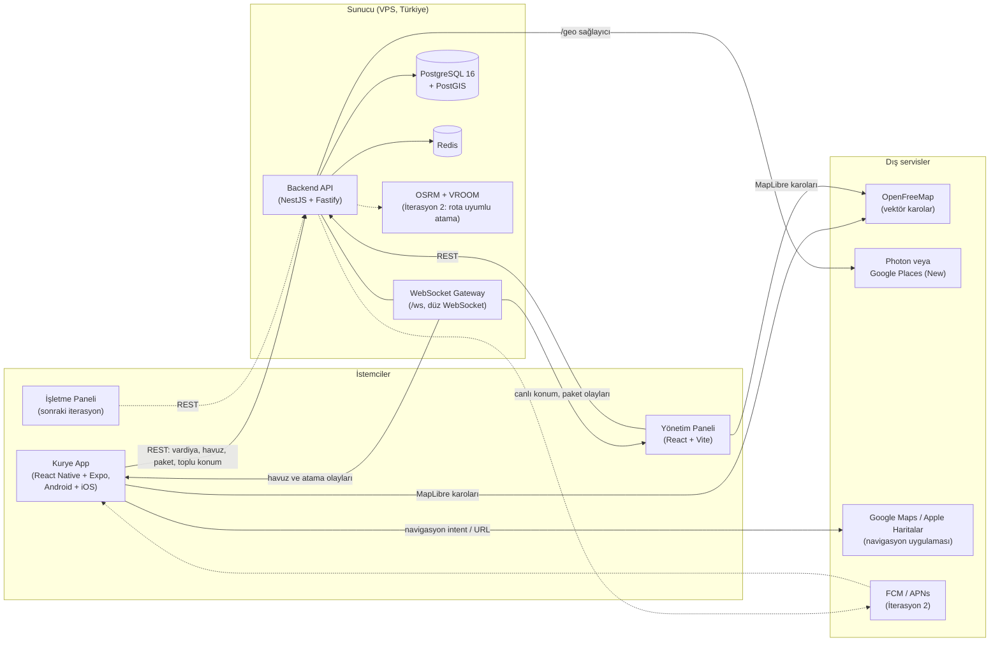
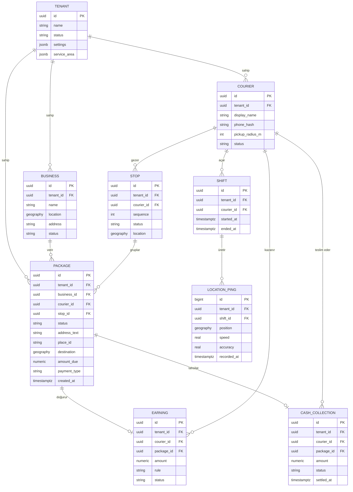
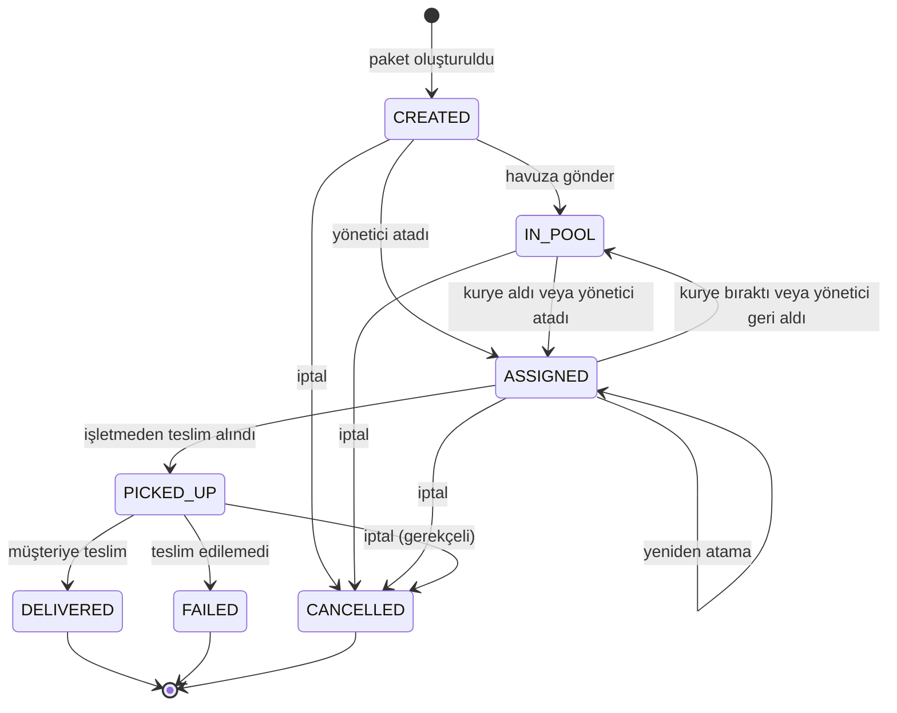
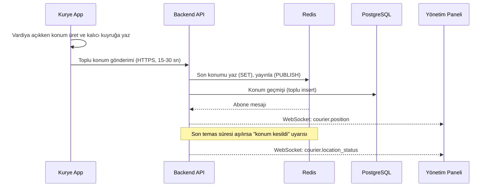
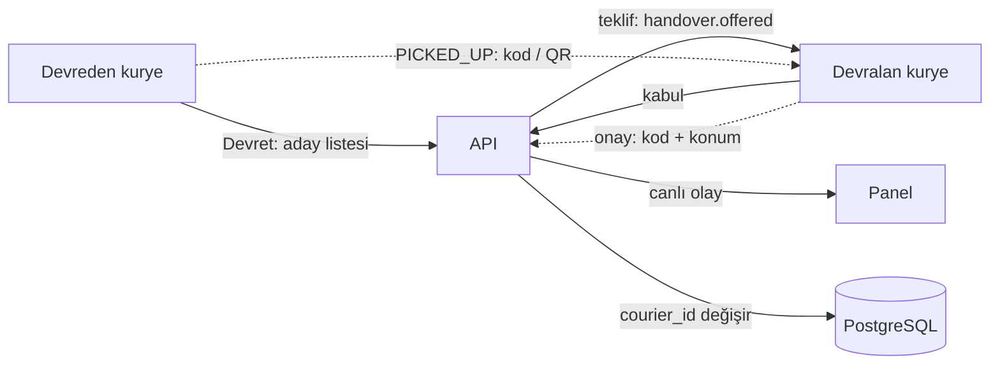

# Mimari

> Durum: **İterasyon 1 için kabul edildi** (2026-10-30). Yığın ve harita kararları [ADR-0007](kararlar/0007-backend-ve-web-yigini.md) ve [ADR-0008](kararlar/0008-acik-kaynak-harita.md), kurye uygulaması [ADR-0002](kararlar/0002-kurye-uygulamasi-react-native-expo.md), rota uyumlu atama (İterasyon 2 ana hedefi) [ADR-0009](kararlar/0009-rota-uyumlu-atama.md), kuryeler arası devir [ADR-0010](kararlar/0010-kuryeler-arasi-devir.md). İterasyon 1'in kesin şeması, durum makinesi ve protokolleri: İterasyon 1 spesifikasyonu. Pilot müşteri keşfi sürdüğü için ileriki iterasyonlara ait bölümler değişebilir. Gerekçeler için [karar kayıtları](kararlar/README.md), dayanak için araştırma raporları.

## 1. Bileşenler

| Bileşen | Teknoloji | Sorumluluk |
|---|---|---|
| Kurye uygulaması | React Native + Expo (TypeScript), tek kod Android + iOS | Vardiya, arka plan konum (expo-location + task manager), havuz, harita (MapLibre), navigasyon devri, teslim; ileride hakediş görünümü |
| Yönetim paneli | React + Vite + TypeScript, Mantine, TanStack Query, MapLibre GL JS | İşletme / kurye / paket yönetimi, canlı harita, atama; ileride raporlar |
| İşletme paneli (sonra) | React + TypeScript | Restoranların kendi siparişlerini girmesi |
| Ortak sözleşme | OpenAPI 3.1 + WebSocket protokolü (`packages/contracts`) | Üç bileşenin paylaştığı TS tipleri (contract-first) |
| Backend API | NestJS (Fastify), Drizzle ORM, zod | İş mantığı, kimlik, tenant izolasyonu, WebSocket, adres sağlayıcıları, arka plan işleri |
| Veritabanı | PostgreSQL 16 + PostGIS | Kalıcı veri, mekânsal sorgular (`ST_DWithin`); RLS İterasyon 2'de ([ADR-0004](kararlar/0004-cok-kiracili-mimari.md)) |
| Önbellek | Redis | Son konum, "konum kesildi" takibi, WebSocket pub/sub fan-out, hız sınırlama |
| Harita gösterimi | MapLibre + OpenFreeMap vektör karoları | Ücretsiz, anahtarsız ([ADR-0008](kararlar/0008-acik-kaynak-harita.md)) |
| Adres arama | API `/geo` → Google Places (New) (anahtar varsa) veya Photon | Otomatik tamamlama, hizmet bölgesi kısıtı ([ADR-0006](kararlar/0006-hizmet-bolgesi-eskisehir.md)) |
| Rota motoru (İterasyon 2) | OSRM + VROOM (self-hosted, docker compose) | OSRM: süre matrisi (`table`) ve rota çizgisi; VROOM: durak sıralaması (pickup-delivery, kapasite, zaman penceresi). Pilotta yalnızca Eskişehir OSM çıkarımı |
| Yönlendirme servisi (İterasyon 2) | API içinde `routing` modülü: saf yerleştirme/skor fonksiyonları + OSRM/VROOM istemcileri | Kurye başına canlı rota ve durak listesi, en ucuz yerleştirme ile sapma süresi, aday kurye öneri/skoru, kararlılık kuralları ([ADR-0009](kararlar/0009-rota-uyumlu-atama.md)) |
| Atama motoru (İterasyon 2) | API içinde `assignment` modülü | Üç mod (`ONERI`, `AKILLI_HAVUZ`, `OTOMATIK`), ret ve devir akışı (yönetici onaylı devir isteği + kuryeler arası devir), atama metrikleri; tasarım: rota uyumlu atama, kuryeler arası devir |
| Push (İterasyon 2) | FCM / APNs | Yeni paket bildirimi; İterasyon 1'de vardiya açıkken WebSocket kullanılır |

## 2. Sistem diyagramı

## 3. Çok kiracılı veri modeli (taslak)

Kiracı (tenant) = kurye firması. İşletmeler, kuryeler ve paketler kiracıya bağlıdır; tüm tablolarda `tenant_id` bulunur. İterasyon 1'de izolasyon uygulama katmanında ve bileşik yabancı anahtarlarla (`(tenant_id, id)`) sağlanır; PostgreSQL satır düzeyi güvenlik (RLS) İterasyon 2'de eklenir ([ADR-0004](kararlar/0004-cok-kiracili-mimari.md)). Aşağıdaki diyagram uzun vadeli modeldir; İterasyon 1'in kesin tabloları SPEC §3'tedir.

Notlar:
- `LOCATION_PING` büyük hacimli olduğundan gün bazlı partition (veya TimescaleDB) düşünülüyor; saklama süresi KVKK'ya göre sınırlı ([ADR-0005](kararlar/0005-konum-takibi-ve-kvkk.md)).
- Google kullanım şartları nedeniyle `place_id` kalıcı saklanabilir, koordinat önbelleği sınırlıdır ([ADR-0001](kararlar/0001-hibrit-harita-mimarisi.md)).
- `TENANT.service_area` hizmet bölgesini veri olarak tutar (poligon / bbox, şehir adı, varsayılan harita merkezi ve yakınlaştırma); kodda şehre özgü sabit yoktur. Pilot: Eskişehir ([ADR-0006](kararlar/0006-hizmet-bolgesi-eskisehir.md)). İşletme bazlı adres defteri (telefon → `place_id` + adres metni) aynı ADR kapsamındadır.
- Alan adları taslaktır. İterasyon 1 şeması: SPEC §3. Örneğin kurye profili `users` + `couriers` olarak ayrılır, paket alış adresini işletmeden kopyalar ve `version` ile iyimser eşzamanlılık kullanır.

## 4. Paket yaşam döngüsü

Kim hangi geçişi tetikleyebilir, hangi olay ve zaman damgası yazılır: SPEC §5.

Durum kodları: `CREATED` (Beklemede), `IN_POOL` (Havuzda), `ASSIGNED` (Atandı), `PICKED_UP` (Yolda), `DELIVERED` (Teslim edildi), `FAILED` (Teslim edilemedi), `CANCELLED` (İptal). Önceki taslaktaki `EN_ROUTE` kaldırıldı; `PICKED_UP` "yolda" anlamına gelir. Havuzdan alma yarışa dayanıklıdır (tek koşullu UPDATE). `PICKED_UP` sonrası iptalin ücret kuralı müşteriyle netleştirilecek.

## 5. Canlı takip veri akışı

Ölçek tahmini: 25 kurye, 5-10 sn aralık, yaklaşık 3-5 mesaj/sn; bu hacim için MQTT gereksizdir (araştırma).

## 6. Yeni paket ve navigasyon akışı (özet)

1. Yönetici paket girer. Adres API'nin `/geo` uçlarıyla otomatik tamamlanır: anahtar varsa Google Places (New) ve session token, yoksa Photon; hizmet bölgesiyle sınırlıdır. Gerekirse haritada iğne sürüklenerek düzeltilir.
2. Paket `IN_POOL` durumuna geçer. Vardiyadaki kuryelere WebSocket `pool.updated` olayı gider; uygulama, alış noktası kendi yarıçapı içindeyse titreşimle uyarır. Push (FCM/APNs) İterasyon 2'dedir.
3. Kurye havuzu yarıçap filtresiyle (PostGIS `ST_DWithin`, alış noktasına göre) görür ve paketi alır. Paket uygulamada MapLibre haritasında açılır; tek dokunuşla navigasyon başlar:
   - Android: `google.navigation:` intent'i (iki teker modu), olmazsa `geo:`.
   - iOS: Google Maps veya Apple Haritalar.
4. Çok paketli durumlarda duraklar OSRM + VROOM ile sıralanır (İterasyon 2, [bölüm 6.1](#61-rota-uyumlu-atama-iterasyon-2)). Her durak için ayrı navigasyon başlatılır (durum takibi için); isteğe bağlı olarak çok duraklı Maps URL'si kullanılır (en fazla 9 ara nokta, parçalı).

### 6.1 Rota uyumlu atama (iterasyon 2)

İterasyon 2'de paket ataması "kuryeye en yakın" yerine **"kuryenin rotasına en az sapma ekleyen"** ölçütüyle yapılır ([ADR-0009](kararlar/0009-rota-uyumlu-atama.md)). Özet akış:

1. Yeni paket (alış R, teslim D) için PostGIS ile aday kuryeler süzülür: vardiyada, kapasite uygun, R'ye veya rotalarına yakın.
2. Her aday için (R, D) çifti mevcut durak dizisine en ucuz yerleştirilir (OSRM `table` matrisi); uygulanabilirlik (kapasite, alıştan teslime azami süre) ve skor (sapma + gecikme + bekleme + adalet) hesaplanır.
3. Moda göre: öneri paneli (`ONERI`), rotaya uyan havuz (`AKILLI_HAVUZ`) veya otomatik atama / bekleyenler kuyruğu (`OTOMATIK`).
4. Atamadan sonra VROOM nihai sırayı kurar; kilitli sıradaki durak ve kazanç eşiği rotanın oynamasını önler.
5. Kurye "Rotam" ekranında numaralı durakları görür; panelde rota çizgileri ve öneriler görünür. Alıştan önce gerekçeli ret, alıştan sonra iki devir yolu vardır: yönetici onaylı devir isteği ve kuryeler arası devir ([bölüm 6.2](#62-kuryeler-arası-devir-iterasyon-2)).

Tasarım, algoritma, veri modeli taslağı ve benchmark planı: iterasyon-2/ROTA-UYUMLU-ATAMA.md. Yeni tablolar (`courier_routes`, `route_stops`, `assignment_suggestions`, `package_rejections`, `handover_requests`, `handover_offers`) yukarıdaki diyagramdaki `STOP` kavramının yerini alır.

### 6.2 Kuryeler arası devir (iterasyon 2)

Pilot müşterinin isteği: bir kurye, kendisine atanmış paketi, konumunun yakınındaki vardiyada olan bir meslektaşına devredebilsin ([ADR-0010](kararlar/0010-kuryeler-arasi-devir.md)). Özet akış:

1. Kurye pakette "Devret"e dokunur. Aday listesi PostGIS ile (`ST_DWithin`, son konumlar) süzülür: vardiyada, STALE değil, kapasitesi var, `handover_radius_m` (varsayılan 1500 m) içinde. Sıralama önce mesafe; rota skoru varsa "350 m · rotasına +2 dk".
2. **Alıştan önce (`ASSIGNED`):** devralana `handover_offer_timeout_s` (60 sn) süreli teklif gider; kabulde paket koşullu UPDATE ile atomik yeniden atanır, ret ve zaman aşımında devredende kalır.
3. **Alıştan sonra (`PICKED_UP`):** kurye buluşması gerekir. Onayda iki kurye `handover_meet_radius_m` (150 m) içinde olmalı, devralan devredenin telefonundaki kısa ömürlü QR / 4 haneli kodu girer. Taze kalma süresi orijinal alıştan işler; `CASH` pakette tahsilat sorumluluğu devralana geçer ve kasa için kaydedilir.
4. Yönetici her devri WebSocket olayı ve denetim kaydıyla canlı görür; `handover_requires_dispatcher_approval` açıksa onay da gerekir. Paket başı 2, kurye başı günde 10 devir sınırı vardır.
5. Yönetici onaylı devir isteği (ADR-0009) ikinci devir yolu olarak kalır: kurye devralanı seçemiyor veya devam edemiyorsa yönetici seçer, buluşma ve kanıt adımları aynıdır.

Tasarım, veri modeli (`handover_offers`), API eskizi, uç durumlar ve KVKK notları: iterasyon-2/KURYE-DEVIR.md. Paket durum makinesine yeni durum eklenmez (§4).

## 7. Güvenlik ve gizlilik ilkeleri

- Tenant izolasyonu: her istekte JWT'den gelen `tenant_id` bağlamı, depo katmanında zorunlu filtre ve bileşik yabancı anahtarlar; RLS İterasyon 2'de.
- Kimlik: kısa ömürlü JWT access token + rotasyonlu, tek kullanımlık refresh token (yeniden kullanım tespiti).
- Konum yalnızca açık vardiyada; aydınlatma metni ve açık rıza metni ayrı ([ADR-0005](kararlar/0005-konum-takibi-ve-kvkk.md)).
- Gizli anahtarlar depoda tutulmaz; yapılandırma ortam değişkenleriyle.
- Depoda müşteri / kurye kişisel verisi yok; demo verisi tamamen kurgusal.

## 8. Açık sorular

Pilot müşteri keşfi henüz yapılmadı; aşağıdakiler cevap bekliyor.

| # | Soru | Etkilediği karar |
|---|---|---|
| 1 | Kurye telefonları kimin (şirket mi, kurye mi)? Düşük uç cihaz modelleri ve Android sürümleri? | ADR-0002, ADR-0003 |
| 2 | Cihazlarda Google Play Services var mı (Huawei vb.)? Kuryelerin ne kadarı iPhone kullanıyor? | ADR-0002, ADR-0005, FCM yedek planı |
| 3 | Hakediş hesabı: paket başı sabit mi, mesafe / saat bazlı mı, prim ve kesinti var mı? | Earning modeli |
| 4 | Kapıda ödeme oranı ve kasa teslim süreci nasıl işliyor? | CashCollection modeli |
| 5 | Atama: havuz mu, elle mi, karma mı? "Adil" tanımı nedir? | Atama algoritması |
| 6 | Restoranlar paketleri kendileri mi girecek, yoksa yalnızca firma mı? | İşletme paneli zamanlaması |
| 7 | Hangi POS sistemleri kullanılıyor (Adisyo var mı)? | Entegrasyon önceliği |
| 8 | Teslim kanıtı gerekli mi (fotoğraf, kod, imza)? | Package / teslim akışı |
| 9 | Paket iptal ve iade kuralları (alındıktan sonra iptal ücreti vb.) | Yaşam döngüsü |
| 10 | Konum verisi saklama süresi ve VERBİS yükümlülüğü | ADR-0005 |
| 11 | Google ToS: koordinat önbellekleme ve Google verisini Google dışı harita ile kullanma sınırları | ADR-0001 (açık risk) |
| 12 | Eskişehir OSM adres / yol kalitesi yeterli mi? (~30 örnek adresle test) | ADR-0001, ADR-0006 |
| 13 | Android developer verification: Türkiye ve kurumsal dağıtım durumu | ADR-0003 |
| 14 | Faturalama modeli: paket başı mı, abonelik mi? | Faturalama (İterasyon 4+) |
| 15 | iOS üretim dağıtımı: firmanın D-U-N-S numarası / Apple Business Manager hesabı var mı (Custom App), yoksa listelenmemiş App Store uygulaması mı? | ADR-0003 |
| 16 | KVKK aydınlatma ve açık rıza metinlerinin hukuken onaylı içeriği | ADR-0005 |
| 17 | Bir kurye aynı anda en çok kaç paket taşır? (varsayılan 4) | ADR-0009: `max_active_packages_per_courier`, kapasite kısıtı |
| 18 | Kabul edilebilir sapma kaç dakika? (varsayılan 5 dk) | ADR-0009: sapma eşiği, otomatik atama ve akıllı havuz |
| 19 | Müşteriye söz verilen teslimat süresi / alıştan teslime azami süre nedir? (varsayılan 35 dk) | ADR-0009: taze kalma kısıtı, geç teslim tanımı |
| 20 | Sipariş girilirken restoranın hazırlık süresi biliniyor mu? | ADR-0009: `ready_at`, kuryenin alış beklemesi |
| 21 | Otomatik atama mı, yönetici önerisi mi tercih edilir? (varsayılan: öneri) | ADR-0009: atama modu varsayılanı |
| 22 | Kaç ret hakkı olacak ve sonucu ne olacak? | ADR-0009: ret politikası ve uyarı eşiği |
| 23 | Kurye tek turda birden fazla restoranlardan paket toplar mı? | ADR-0009: çoklu alış, yerleştirme ve kapasite |
| 24 | Kuryeler arası devir hangi mesafede yapılıyor? (varsayılan aday yarıçapı 1500 m) | ADR-0010: `handover_radius_m` |
| 25 | Devirde yönetici onayı istenir mi, yoksa yalnızca bilgi mi? (varsayılan: bilgi) | ADR-0010: `handover_requires_dispatcher_approval` |
| 26 | Alınmış paketin devrinde kapıda nakit sorumluluğu ve kasa teslimi nasıl işliyor? | ADR-0010: nakit sorumluluk devri, İterasyon 3 kasa |
| 27 | Günlük kaç devir normal? Şehir içi GPS ile 150 m buluşma yarıçapı güvenilir mi? | ADR-0010: devir sınırları, `handover_meet_radius_m` |
