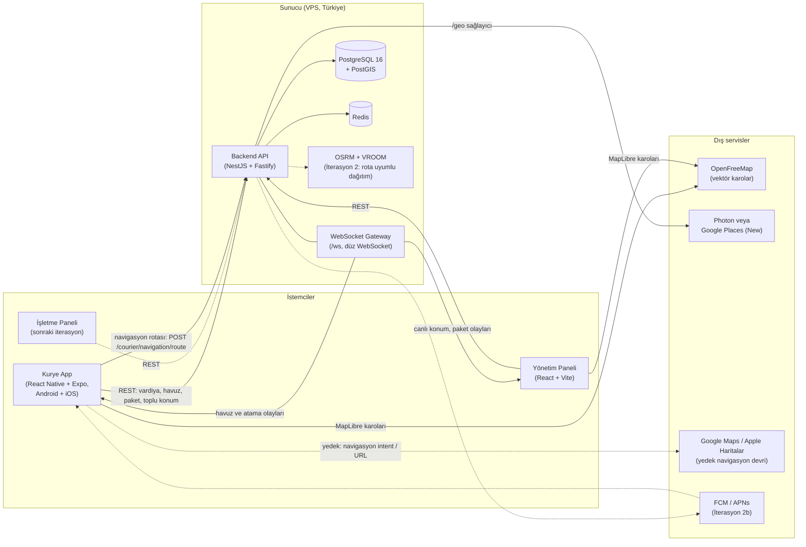
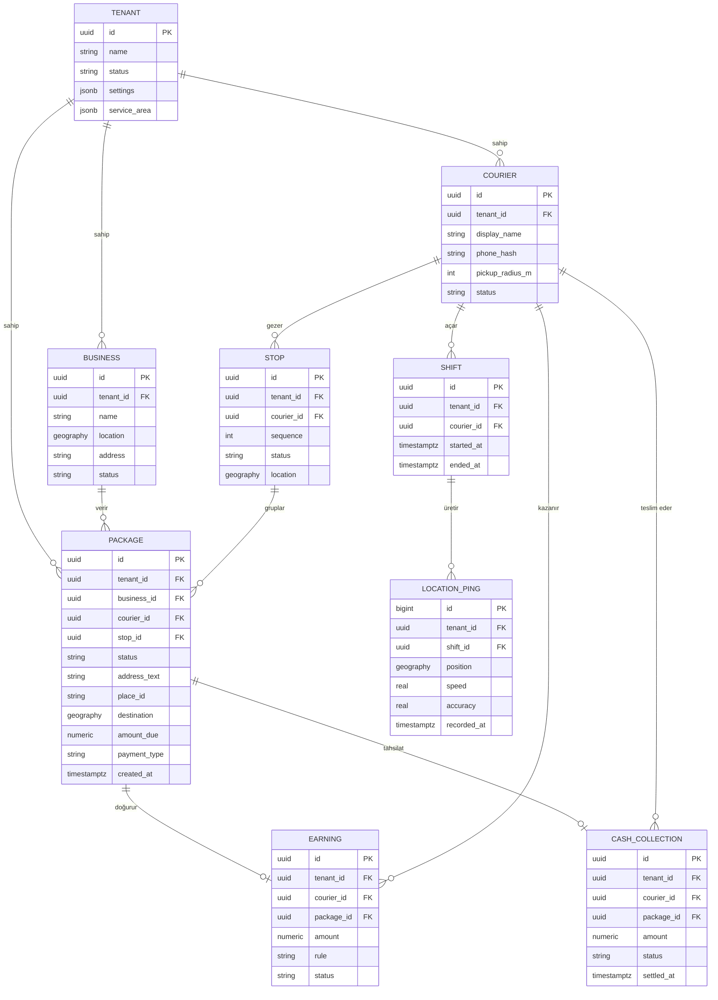
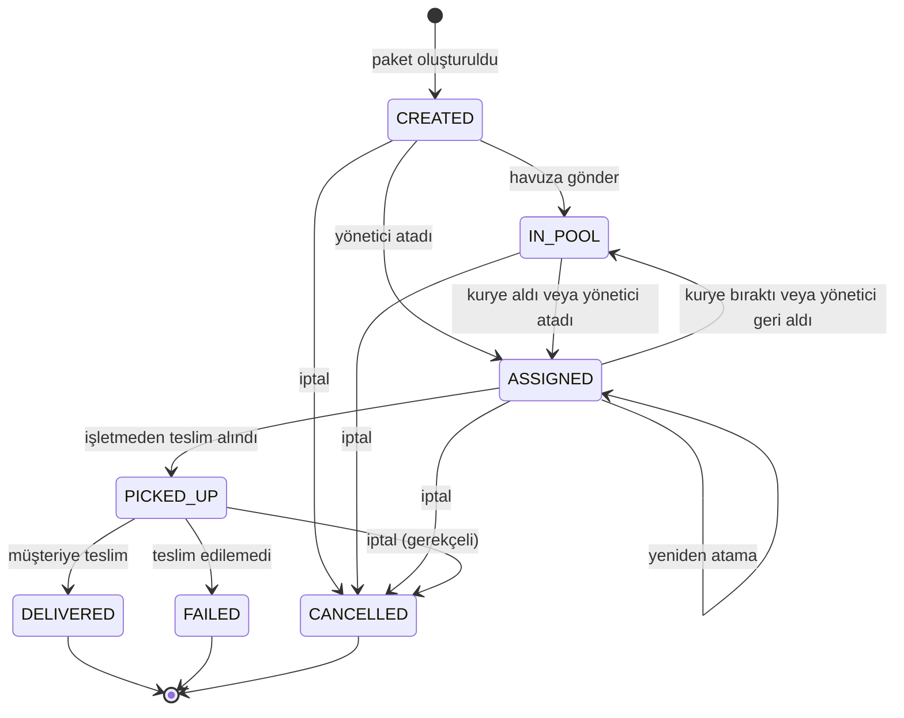
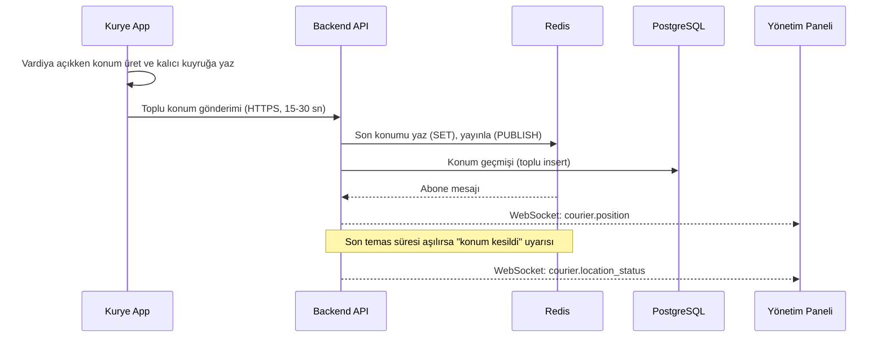
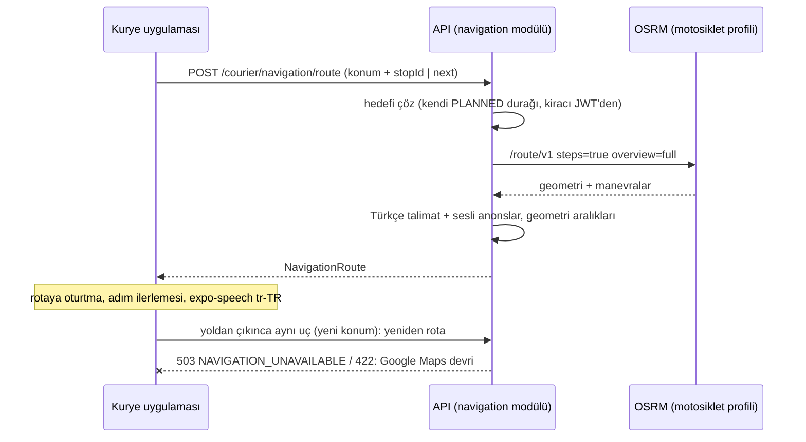
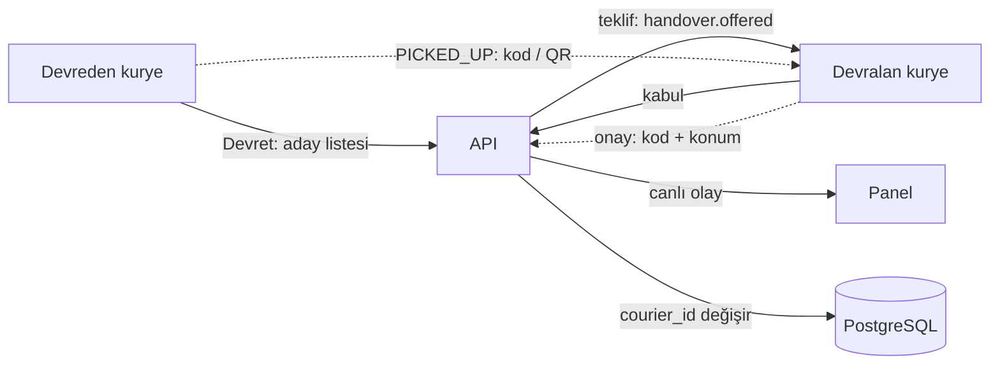
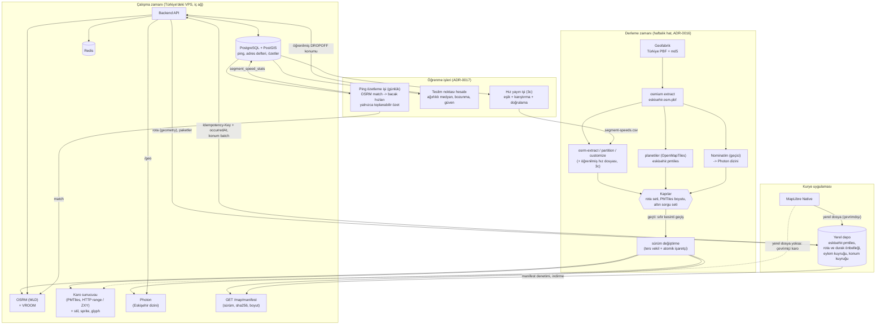

# Mimari

> Durum: **İterasyon 1 için kabul edildi** (2026-10-30); **İterasyon 2 spesifikasyonu onaya sunuldu** (2026-11-02): iterasyon-2/SPEC.md, [ADR-0011](kararlar/0011-osrm-motosiklet-profili-ve-rota-altyapisi.md), [ADR-0012](kararlar/0012-rls-iterasyon-2b-ye-ertelendi.md), [ADR-0013](kararlar/0013-rota-motoru-siniri-ve-yaklasik-mod.md), [ADR-0014](kararlar/0014-toplu-atama-regret-ekleme.md). Yığın ve harita kararları [ADR-0007](kararlar/0007-backend-ve-web-yigini.md) ve [ADR-0008](kararlar/0008-acik-kaynak-harita.md), kurye uygulaması [ADR-0002](kararlar/0002-kurye-uygulamasi-react-native-expo.md), rota uyumlu atama (İterasyon 2 ana hedefi) [ADR-0009](kararlar/0009-rota-uyumlu-atama.md), kuryeler arası devir [ADR-0010](kararlar/0010-kuryeler-arasi-devir.md), uygulama içi navigasyon [ADR-0015](kararlar/0015-uygulama-ici-navigasyon.md). İterasyon 1'in kesin şeması, durum makinesi ve protokolleri: İterasyon 1 spesifikasyonu. Pilot müşteri keşfi sürdüğü için ileriki iterasyonlara ait bölümler değişebilir. Gerekçeler için [karar kayıtları](kararlar/README.md), dayanak için araştırma raporları.

## 1. Bileşenler

| Bileşen | Teknoloji | Sorumluluk |
|---|---|---|
| Kurye uygulaması | React Native + Expo (TypeScript), tek kod Android + iOS | Vardiya, arka plan konum (expo-location + task manager), havuz, harita (MapLibre), uygulama içi adım adım navigasyon (İterasyon 2, [ADR-0015](kararlar/0015-uygulama-ici-navigasyon.md); yedek: Google Maps devri), teslim; ileride hakediş görünümü |
| Yönetim paneli | React + Vite + TypeScript, Mantine, TanStack Query, MapLibre GL JS | İşletme / kurye / paket yönetimi, canlı harita, atama; ileride raporlar |
| İşletme paneli (sonra) | React + TypeScript | Restoranların kendi siparişlerini girmesi |
| Ortak sözleşme | OpenAPI 3.1 + WebSocket protokolü (`packages/contracts`) | Üç bileşenin paylaştığı TS tipleri (contract-first) |
| Backend API | NestJS (Fastify), Drizzle ORM, zod | İş mantığı, kimlik, tenant izolasyonu, WebSocket, adres sağlayıcıları, arka plan işleri |
| Veritabanı | PostgreSQL 16 + PostGIS | Kalıcı veri, mekânsal sorgular (`ST_DWithin`); RLS İterasyon 2b'de ([ADR-0004](kararlar/0004-cok-kiracili-mimari.md), [ADR-0012](kararlar/0012-rls-iterasyon-2b-ye-ertelendi.md)) |
| Önbellek | Redis | Son konum, "konum kesildi" takibi, WebSocket pub/sub fan-out, hız sınırlama; İterasyon 2: akıllı havuz uygunluk önbelleği, toplu atama penceresi, iş kilitleri |
| Harita gösterimi | MapLibre + OpenFreeMap vektör karoları | Ücretsiz, anahtarsız ([ADR-0008](kararlar/0008-acik-kaynak-harita.md)); İterasyon 3'te kendi karolarımız ([§9](#9-harita-platformu-iterasyon-3), [ADR-0016](kararlar/0016-eskisehire-ozel-kendi-barindirdigimiz-harita-platformu.md)) |
| Adres arama | API `/geo` → Google Places (New) (anahtar varsa) veya Photon | Otomatik tamamlama, hizmet bölgesi kısıtı ([ADR-0006](kararlar/0006-hizmet-bolgesi-eskisehir.md)); İterasyon 3'te kendi Photon örneğimiz ([§9](#9-harita-platformu-iterasyon-3)) |
| Rota altyapısı (İterasyon 2) | OSRM (MLD, depodaki `motorcycle.lua` profili) + VROOM, Docker compose `routing` profili | OSRM: süre matrisi (`table`) ve rota çizgisi; VROOM: kurye başına nihai durak sırası (pickup-delivery, kapasite, zaman penceresi). Yalnızca Eskişehir OSM çıkarımı, tek komutla üretilir ([ADR-0011](kararlar/0011-osrm-motosiklet-profili-ve-rota-altyapisi.md)) |
| Rota motoru (İterasyon 2) | API içinde `src/routing`: Nest / DB / Redis bilmeyen saf kütüphane; arayüzü `@kurye/contracts/routing-engine` | En ucuz yerleştirme, uygulanabilirlik (kapasite, tazelik, mevcut paket gecikme sınırı), skor ve Türkçe gerekçe, toplu atama (regret-2), kararlılık kuralları, süreç içi kesin sıralayıcı, OSRM yokken yaklaşık mod ([ADR-0009](kararlar/0009-rota-uyumlu-atama.md), [ADR-0013](kararlar/0013-rota-motoru-siniri-ve-yaklasik-mod.md), [ADR-0014](kararlar/0014-toplu-atama-regret-ekleme.md)) |
| Dağıtım alanı (İterasyon 2) | API içinde `routes` ve `dispatch` modülleri | Kurye rotalarının kaydı ve yeniden sıralanması, öneriler, üç mod (`ONERI`, `AKILLI_HAVUZ`, `OTOMATIK`), bekleyenler kuyruğu, toplu atama, gerekçeli ret, atama metrikleri (SPEC) |
| Devir alanı (İterasyon 2) | API içinde `handover` modülü | Yönetici onaylı devir isteği ve kuryeler arası devir, kod / QR, buluşma doğrulaması, nakit sorumluluğu, devir metrikleri (kuryeler arası devir) |
| Push (İterasyon 2b) | FCM / APNs | Yeni paket, rota değişikliği, devir teklifi bildirimi; o zamana kadar vardiya açıkken / uygulama önündeyken WebSocket |

## 2. Sistem diyagramı

## 3. Çok kiracılı veri modeli (taslak)

Kiracı (tenant) = kurye firması. İşletmeler, kuryeler ve paketler kiracıya bağlıdır; tüm tablolarda `tenant_id` bulunur. İterasyon 1 ve 2'de izolasyon uygulama katmanında ve bileşik yabancı anahtarlarla (`(tenant_id, id)`) sağlanır; PostgreSQL satır düzeyi güvenlik (RLS) İterasyon 2b'de eklenir ([ADR-0004](kararlar/0004-cok-kiracili-mimari.md), [ADR-0012](kararlar/0012-rls-iterasyon-2b-ye-ertelendi.md)). Aşağıdaki diyagram uzun vadeli modeldir; İterasyon 1'in kesin tabloları SPEC §3'tedir.

Notlar:
- `LOCATION_PING` büyük hacimli olduğundan gün bazlı partition (veya TimescaleDB) düşünülüyor; saklama süresi KVKK'ya göre sınırlı ([ADR-0005](kararlar/0005-konum-takibi-ve-kvkk.md)).
- Google kullanım şartları nedeniyle `place_id` kalıcı saklanabilir, koordinat önbelleği sınırlıdır ([ADR-0001](kararlar/0001-hibrit-harita-mimarisi.md)).
- `TENANT.service_area` hizmet bölgesini veri olarak tutar (poligon / bbox, şehir adı, varsayılan harita merkezi ve yakınlaştırma); kodda şehre özgü sabit yoktur. Pilot: Eskişehir ([ADR-0006](kararlar/0006-hizmet-bolgesi-eskisehir.md)). İşletme bazlı adres defteri (telefon → `place_id` + adres metni) aynı ADR kapsamındadır.
- Alan adları taslaktır. İterasyon 1 şeması: SPEC §3. Örneğin kurye profili `users` + `couriers` olarak ayrılır, paket alış adresini işletmeden kopyalar ve `version` ile iyimser eşzamanlılık kullanır.

## 4. Paket yaşam döngüsü

Kim hangi geçişi tetikleyebilir, hangi olay ve zaman damgası yazılır: SPEC §5.

Durum kodları: `CREATED` (Beklemede), `IN_POOL` (Havuzda), `ASSIGNED` (Atandı), `PICKED_UP` (Yolda), `DELIVERED` (Teslim edildi), `FAILED` (Teslim edilemedi), `CANCELLED` (İptal). Önceki taslaktaki `EN_ROUTE` kaldırıldı; `PICKED_UP` "yolda" anlamına gelir. Havuzdan alma yarışa dayanıklıdır (tek koşullu UPDATE). `PICKED_UP` sonrası iptalin ücret kuralı müşteriyle netleştirilecek.

## 5. Canlı takip veri akışı

Ölçek tahmini: 25 kurye, 5-10 sn aralık, yaklaşık 3-5 mesaj/sn; bu hacim için MQTT gereksizdir (araştırma).

## 6. Yeni paket ve navigasyon akışı (özet)

1. Yönetici paket girer. Adres API'nin `/geo` uçlarıyla otomatik tamamlanır: anahtar varsa Google Places (New) ve session token, yoksa Photon; hizmet bölgesiyle sınırlıdır. Gerekirse haritada iğne sürüklenerek düzeltilir.
2. Paket `IN_POOL` durumuna geçer. Vardiyadaki kuryelere WebSocket `pool.updated` olayı gider; uygulama, alış noktası kendi yarıçapı içindeyse titreşimle uyarır. Push (FCM/APNs) İterasyon 2b'dedir.
3. Kurye havuzu yarıçap filtresiyle (PostGIS `ST_DWithin`, alış noktasına göre) görür ve paketi alır. Paket uygulamada MapLibre haritasında açılır; tek dokunuşla navigasyon başlar:
   - **İterasyon 2: uygulama içi adım adım navigasyon** ([ADR-0015](kararlar/0015-uygulama-ici-navigasyon.md), [bölüm 6.3](#63-uygulama-içi-navigasyon-iterasyon-2)).
   - **Yedek (İterasyon 1 davranışı; rota motoru erişilemezse veya kurye isterse):** Android `google.navigation:` intent'i (iki teker modu), olmazsa `geo:`; iOS Google Maps veya Apple Haritalar.
4. Çok paketli durumlarda duraklar OSRM + VROOM ile sıralanır (İterasyon 2, [bölüm 6.1](#61-rota-uyumlu-atama-iterasyon-2)). Her durak için ayrı navigasyon başlatılır (durum takibi için); isteğe bağlı olarak çok duraklı Maps URL'si kullanılır (en fazla 9 ara nokta, parçalı).

### 6.1 Rota uyumlu atama (iterasyon 2)

> Kesin tasarım: İterasyon 2 teknik spesifikasyonu. Bu, müşterinin en yüksek önceliğidir (SPEC §1.1).

İterasyon 2'de paket ataması "kuryeye en yakın" yerine **"kuryenin rotasına en az sapma ekleyen"** ölçütüyle yapılır ([ADR-0009](kararlar/0009-rota-uyumlu-atama.md)). Özet akış:

1. Yeni paket (alış R, teslim D) için PostGIS ile aday kuryeler süzülür: vardiyada, kapasite uygun, R'ye veya rotalarına yakın.
2. Her aday için (R, D) çifti mevcut durak dizisine en ucuz yerleştirilir (OSRM `table` matrisi); uygulanabilirlik (kapasite, alıştan teslime azami süre) ve skor (sapma + gecikme + bekleme + adalet) hesaplanır.
3. Moda göre: öneri paneli (`ONERI`), rotaya uyan havuz (`AKILLI_HAVUZ`) veya otomatik atama / bekleyenler kuyruğu (`OTOMATIK`).
4. Atamadan sonra VROOM nihai sırayı kurar; kilitli sıradaki durak, kazanç eşiği, soğuma süresi ve mevcut paket başına gecikme sınırı (varsayılan 8 dk) rotanın oynamasını ve mevcut paketlerin bozulmasını önler.
5. Birden çok yeni paket aynı anda geldiğinde (aynı restorandan art arda siparişler, yoğun saat) **toplu atama** tüm kuryelerin mevcut rotalarına birlikte yerleştirir (regret-2); aynı restoranın teslimleri birbirine yakın siparişleri uygunsa tek kuryeye gruplanır ([ADR-0014](kararlar/0014-toplu-atama-regret-ekleme.md)). **Dağıtım v2 (Faz 2: bayrak arkasında, varsayılan kapalı):** 60 sn kayan ufuk + gecikmeli atama + regret-3; kuryeler arası ALNS yalnızca gölge kipte (öneri kaydedilir, uygulanmaz) ([ADR-0023](kararlar/0023-dagitim-algoritmasi-v2.md), DAGITIM-ALGORITMASI-V2, ayarlar: [bölüm 6.1.1](#611-dağıtım-v2-ayarları-adr-0023-faz-2)).
6. OSRM / VROOM erişilemezse sistem durmaz: süreler kuş uçuşu tahmine düşer, otomatik atama askıya alınır, İterasyon 1 havuz / elle atama davranışı açık bir uyarıyla sürer ([ADR-0013](kararlar/0013-rota-motoru-siniri-ve-yaklasik-mod.md)).
7. Kurye "Rotam" ekranında numaralı durakları görür; panelde rota çizgileri ve öneriler görünür. Alıştan önce gerekçeli ret, alıştan sonra iki devir yolu vardır: yönetici onaylı devir isteği ve kuryeler arası devir ([bölüm 6.2](#62-kuryeler-arası-devir-iterasyon-2)).

#### 6.1.1 Dağıtım v2 ayarları (ADR-0023, Faz 2)

İki katmanlı açılış: sunucu bayrağı (ortam değişkeni) **ve** kiracı ayarı birlikte açıksa v2 etkindir (`settings.dispatch.active`). Biri kapalıysa davranış bugünküyle aynıdır (20 sn toplu pencere, regret-2, eşik altı otomatik). Açılış ve geri dönüş: çalışma kitabı §11.

| Ayar | Yer | Varsayılan | Aralık | Etkisi |
|---|---|---|---|---|
| `DISPATCH_V2` | Ortam | `false` | `true` / `false` | Ana anahtar. Kapalıyken veritabanındaki kiracı ayarına bakılmaz |
| `DISPATCH_V2_ALNS_SHADOW` | Ortam | `false` | `true` / `false` | v2 etkin kiracılarda gölge ALNS (her pencere + en çok 60 sn'de bir); öneriler `dispatch_shadow_runs` / `dispatch_shadow_moves` tablolarına yazılır, **atama değişmez** |
| `settings.dispatch.v2Enabled` | Kiracı (`PATCH /tenant`, OWNER) | `false` | | Firma bazında açılış |
| `settings.dispatch.windowS` | Kiracı | 60 | 30-60 sn | Pencere W: OTOMATİK modda yeni paket bu süre toplanır, sonra birlikte planlanır; bekletilen varsa pencere W sn'de bir yeniden açılır (bugünkü `assignment.batchWindowS` yerine) |
| `settings.dispatch.holdDetourMin` | Kiracı | 7 | 0-30 dk | Gecikmeli atama eşiği: birimin en iyi seçeneğinde paket başı sapma bunu aşarsa birim bekletilebilir. **Sapma v2 tanımıyla, paketin kendi alış + teslim servis süresi dahildir** (Faz 1 ayarı bu tanımla yapıldı) |
| `settings.dispatch.holdMaxMin` | Kiracı | 3 | 0-15 dk | En uzun bekletme: bir pencere daha beklemek sipariş yaşını bunun üstüne çıkaracaksa birim en iyi uygun kuryeye atanır (sapma eşiğinden bağımsız). 0 = bekletme yok |

Sabitler (ADR-0023; kiracı ayarı değildir): regret-3, aynı işletme birimleri (ADR-0014 madde 3), pencerede en çok 40 paket; sert kısıtlar bugünkü motorla aynıdır (kapasite, alıştan teslime `maxPickupToDeliveryMin`, yeni paket alış ETA `maxPickupEtaMin`, mevcut paket başına `maxAddedDelayPerPackageMin`). Gölge ALNS: 250 yineleme, 300 ms süre sınırı, taşıma başına en az 150 sn kazanç, paket başına 1 taşıma, alışa 5 dk kala dondurma. Yaklaşık modda (OSRM yok) pencere paketleri bugünkü gibi havuza açılır; gölge ALNS koşmaz.

Davranış özeti (v2 etkin, OTOMATİK): yeni paket "Atama bekliyor" ile bekleyenlerde görünür; pencere kapanınca (1) atanır (`ASSIGNED_AUTO`, `batch = true`, aynı işletme birimlerinde aynı `groupId`), (2) **"Pencere bekliyor"** (`WINDOW_HOLD`, olay verisinde en iyi seçeneğin sapması) veya (3) **"Uygun kurye yok"** (`NO_FEASIBLE`). Ret ve iade bugünkü anlık yoldan geçer; bekleyenlerin 60 sn'lik yeniden denemesi pencereye girer. Öneriler (ONERI / AKILLI_HAVUZ) anında üretilir; toplu öneri (`POST /dispatch/batch-plan`) v2 etkinken aynı v2 planlayıcısıyla, bekletmesiz üretilir. Gözlem: her pencere kararı `dispatch_windows` tablosuna ve yapılandırılmış günlüğe (`event = dispatch.v2.window`: aday sayısı, paket başına sonuç, sapma, bekletme nedeni) yazılır; özet `GET /metrics/dispatch-v2`.

Tasarım, algoritma, veri modeli taslağı ve benchmark planı: iterasyon-2/ROTA-UYUMLU-ATAMA.md. Yeni tablolar (`courier_routes`, `route_stops`, `assignment_suggestions`, `package_rejections`, `handover_requests`, `handover_offers`) yukarıdaki diyagramdaki `STOP` kavramının yerini alır.

### 6.3 Uygulama içi navigasyon (iterasyon 2)

> Karar: [ADR-0015](kararlar/0015-uygulama-ici-navigasyon.md). Görev: API tarafı N1, uygulama tarafı N2.

"Navigasyonu başlat" Google Maps'e atmak yerine uygulama içinde Google Maps gibi çalışan bir ekran açar: yeşil üst bant (manevra oku, mesafe, sokak adı, sonraki manevra), eğik ve yön-yukarı kamera, alt çubuk (kalan süre, km, varış saati, Çıkış), Türkçe sesli yönlendirme, yoldan çıkınca otomatik yeniden rota; varışta durak kartı açılır, işlemden sonra sonraki durağa navigasyon kendiliğinden başlar.

Sunucu durum tutmaz; Türkçe metinler yalnızca sunucuda üretilir. Sınırlar: canlı trafik, şerit ve hız sınırı yok (ADR-0015 madde 5).

### 6.2 Kuryeler arası devir (iterasyon 2)

Pilot müşterinin isteği: bir kurye, kendisine atanmış paketi, konumunun yakınındaki vardiyada olan bir meslektaşına devredebilsin ([ADR-0010](kararlar/0010-kuryeler-arasi-devir.md)). Özet akış:

1. Kurye pakette "Devret"e dokunur. Aday listesi PostGIS ile (`ST_DWithin`, son konumlar) süzülür: vardiyada, STALE değil, kapasitesi var, `handover_radius_m` (varsayılan 1500 m) içinde. Sıralama önce mesafe; rota skoru varsa "350 m · rotasına +2 dk".
2. **Alıştan önce (`ASSIGNED`):** devralana `handover_offer_timeout_s` (60 sn) süreli teklif gider; kabulde paket koşullu UPDATE ile atomik yeniden atanır, ret ve zaman aşımında devredende kalır.
3. **Alıştan sonra (`PICKED_UP`):** kurye buluşması gerekir. Onayda iki kurye `handover_meet_radius_m` (150 m) içinde olmalı, devralan devredenin telefonundaki kısa ömürlü QR / 4 haneli kodu girer. Taze kalma süresi orijinal alıştan işler; `CASH` pakette tahsilat sorumluluğu devralana geçer ve kasa için kaydedilir.
4. Yönetici her devri WebSocket olayı ve denetim kaydıyla canlı görür; `handover_requires_dispatcher_approval` açıksa onay da gerekir. Paket başı 2, kurye başı günde 10 devir sınırı vardır.
5. Yönetici onaylı devir isteği (ADR-0009) ikinci devir yolu olarak kalır: kurye devralanı seçemiyor veya devam edemiyorsa yönetici seçer, buluşma ve kanıt adımları aynıdır.

Tasarım, veri modeli (`handover_offers`), API eskizi, uç durumlar ve KVKK notları: iterasyon-2/KURYE-DEVIR.md. Paket durum makinesine yeni durum eklenmez (§4).

## 7. Güvenlik ve gizlilik ilkeleri

- Tenant izolasyonu: her istekte JWT'den gelen `tenant_id` bağlamı, depo katmanında zorunlu filtre ve bileşik yabancı anahtarlar; RLS İterasyon 2b'de ([ADR-0012](kararlar/0012-rls-iterasyon-2b-ye-ertelendi.md)).
- Rota motoru (OSRM / VROOM) yalnızca iç ağda çalışır; kurye konumu üçüncü taraf bir servise gönderilmez.
- Kimlik: kısa ömürlü JWT access token + rotasyonlu, tek kullanımlık refresh token (yeniden kullanım tespiti).
- Konum yalnızca açık vardiyada; aydınlatma metni ve açık rıza metni ayrı ([ADR-0005](kararlar/0005-konum-takibi-ve-kvkk.md)).
- Gizli anahtarlar depoda tutulmaz; yapılandırma ortam değişkenleriyle.
- Depoda müşteri / kurye kişisel verisi yok; demo verisi tamamen kurgusal.

## 8. Açık sorular

Pilot müşteri keşfi henüz yapılmadı; aşağıdakiler cevap bekliyor.

| # | Soru | Etkilediği karar |
|---|---|---|
| 1 | Kurye telefonları kimin (şirket mi, kurye mi)? Düşük uç cihaz modelleri ve Android sürümleri? | ADR-0002, ADR-0003 |
| 2 | Cihazlarda Google Play Services var mı (Huawei vb.)? Kuryelerin ne kadarı iPhone kullanıyor? | ADR-0002, ADR-0005, FCM yedek planı |
| 3 | Hakediş hesabı: paket başı sabit mi, mesafe / saat bazlı mı, prim ve kesinti var mı? | Earning modeli |
| 4 | Kapıda ödeme oranı ve kasa teslim süreci nasıl işliyor? | CashCollection modeli |
| 5 | Atama: havuz mu, elle mi, karma mı? "Adil" tanımı nedir? | Atama algoritması |
| 6 | Restoranlar paketleri kendileri mi girecek, yoksa yalnızca firma mı? | İşletme paneli zamanlaması |
| 7 | Hangi POS sistemleri kullanılıyor (Adisyo var mı)? | Entegrasyon önceliği |
| 8 | Teslim kanıtı gerekli mi (fotoğraf, kod, imza)? | Package / teslim akışı |
| 9 | Paket iptal ve iade kuralları (alındıktan sonra iptal ücreti vb.) | Yaşam döngüsü |
| 10 | Konum verisi saklama süresi ve VERBİS yükümlülüğü | ADR-0005 |
| 11 | Google ToS: koordinat önbellekleme ve Google verisini Google dışı harita ile kullanma sınırları | ADR-0001 (açık risk) |
| 12 | Eskişehir OSM adres / yol kalitesi yeterli mi? (~30 örnek adresle test) | ADR-0001, ADR-0006 |
| 13 | Android developer verification: Türkiye ve kurumsal dağıtım durumu | ADR-0003 |
| 14 | Faturalama modeli: paket başı mı, abonelik mi? | Faturalama (İterasyon 5+) |
| 15 | iOS üretim dağıtımı: firmanın D-U-N-S numarası / Apple Business Manager hesabı var mı (Custom App), yoksa listelenmemiş App Store uygulaması mı? | ADR-0003 |
| 16 | KVKK aydınlatma ve açık rıza metinlerinin hukuken onaylı içeriği | ADR-0005 |
| 17 | Bir kurye aynı anda en çok kaç paket taşır? (varsayılan 4) | ADR-0009: `max_active_packages_per_courier`, kapasite kısıtı |
| 18 | Kabul edilebilir sapma kaç dakika? (varsayılan 5 dk) | ADR-0009: sapma eşiği, otomatik atama ve akıllı havuz |
| 19 | Müşteriye söz verilen teslimat süresi / alıştan teslime azami süre nedir? (varsayılan 35 dk) | ADR-0009: taze kalma kısıtı, geç teslim tanımı |
| 20 | Sipariş girilirken restoranın hazırlık süresi biliniyor mu? | ADR-0009: `ready_at`, kuryenin alış beklemesi |
| 21 | Otomatik atama mı, yönetici önerisi mi tercih edilir? (varsayılan: öneri) | ADR-0009: atama modu varsayılanı |
| 22 | Kaç ret hakkı olacak ve sonucu ne olacak? | ADR-0009: ret politikası ve uyarı eşiği |
| 23 | Kurye tek turda birden fazla restoranlardan paket toplar mı? | ADR-0009: çoklu alış, yerleştirme ve kapasite |
| 24 | Kuryeler arası devir hangi mesafede yapılıyor? (varsayılan aday yarıçapı 1500 m) | ADR-0010: `handover_radius_m` |
| 25 | Devirde yönetici onayı istenir mi, yoksa yalnızca bilgi mi? (varsayılan: bilgi) | ADR-0010: `handover_requires_dispatcher_approval` |
| 26 | Alınmış paketin devrinde kapıda nakit sorumluluğu ve kasa teslimi nasıl işliyor? | ADR-0010: nakit sorumluluk devri, İterasyon 4 kasa (eski numara: 3) |
| 27 | Günlük kaç devir normal? Şehir içi GPS ile 150 m buluşma yarıçapı güvenilir mi? | ADR-0010: devir sınırları, `handover_meet_radius_m` |
| 28 | Yeni paket eklenirken mevcut bir paketin en çok kaç dakika gecikmesi kabul edilir? (varsayılan 8 dk) Aynı restorandan gelen siparişler tek kuryeye verilmeli mi? | ADR-0014: `maxAddedDelayPerPackageMin`, toplu atama gruplaması |
| 29 | Motosikletli kuryelerin gerçek süreleri OSRM tahmininden ne kadar farklı? (pilot konum izinden ölçülecek) | ADR-0011: `ROUTING_DURATION_FACTOR` kalibrasyonu |
| 30 | Pilot müşterinin kurye telefon modelleri ve Android sürümleri nedir? (Xiaomi / Samsung / düşük uç; GMS'siz cihaz var mı?) | İterasyon 3 P-8 cihaz matrisi, ADR-0005 |
| 31 | Pilotta restoranlar için "paket hazır" sinyali kaynağı hangisi olabilir: panel, kurye bildirimi, işletmeye özel tek dokunuşluk bağlantı? | İterasyon 3 3b-2, ADR-0009: `ready_at` |
| 32 | Teslim geofence'i 150 m, Eskişehir sokaklarında ve apartman / site yapısında uygun mu? Geçersiz kılma oranı ne çıkıyor? | İterasyon 3 3b-4 |
| 33 | Öğrenilmiş teslim noktası gözlemleri (90 gün), adres özetleri (12 ay) ve anonim hız özetleri için saklama süreleri hukuken uygun mu? | ADR-0017, ADR-0005, İterasyon 3 P-9 |
| 34 | Pilot ne zaman başlıyor? (öğrenilmiş hızlar için pilottan sonra en az 4 hafta veri gerekir) | İterasyon 3 takvimi, 3c-1 |
| 35 | İşletme "hazır" sayfasında teslim adresinin ilk parçası (`dropoffHint`) gösterilebilir mi? Bağlantı işletmeye nasıl iletilecek (elle; otomatik SMS / WhatsApp ücretli)? | ADR-0025, SPEC-3b §19 |
| 36 | Teslim geofence'i ne zaman ENFORCE'a alınır (tüm kuryeler 3b APK'sında, OBSERVE ölçümünden sonra)? Kurye bazlı geçersiz kılma raporu gerekli ve hukuken uygun mu? | ADR-0026, SPEC-3b §19 |
| 37 | Tahmini hazır zamanı `readyAt`'e otomatik yazılsın mı ve aynı işletme gruplaması ile dağıtım v2 pilotta açılsın mı (benchmark sonucuna göre)? | SPEC-3b §16, §19 |

## 9. Harita platformu (iterasyon 3)

> Kararlar: [ADR-0016](kararlar/0016-eskisehire-ozel-kendi-barindirdigimiz-harita-platformu.md) (kendi karo, geocoder ve güncelleme hattı), [ADR-0017](kararlar/0017-saha-verisinden-ogrenen-harita.md) (saha verisinden öğrenme). Plan: iterasyon-3/PLAN.md; 3a spesifikasyonu: iterasyon-3/SPEC-3a.md (ayrıntı §9.1). Bu bölüm **hedef mimaridir**; İterasyon 3 tamamlanana kadar §2'deki harici servisler (OpenFreeMap, genel Photon) geçerlidir.

İlke: çalışma zamanında üçüncü taraf harita servisi yoktur. Aynı Eskişehir OSM çıkarımı (`eskisehir.osm.pbf`) rotayı, karoları ve adres dizinini besler; üçü her hafta aynı sürümle yenilenir. Kuryenin telefonu karoyu ve rotayı yerelde saklar, eylemleri kalıcı bir kuyruğa yazar.

Ana noktalar:
- **Karo:** tek `eskisehir.pmtiles` dosyası; panel çevrimiçi okur, telefon dosyayı indirip yerelde okur. Sürüm kontrolü `GET /map/manifest` ile; yeniden indirme politikası PLAN 3a-4.
- **Adres arama:** API `GeoProvider` arayüzü değişmez; `PHOTON_BASE_URL` iç adrese döner. Öğrenilmiş teslim noktaları geocoder sonucunu `DROPOFF` konumu olarak geçersiz kılar ([ADR-0017](kararlar/0017-saha-verisinden-ogrenen-harita.md) A).
- **Rota:** OSRM / VROOM aynı kalır; hız dosyası ve zamansal çarpan 3c'de eklenir. Ping özetleme **ilk günden** çalışır, ham saklama (30 gün) uzamaz.
- **Çevrimdışı:** uygulama rotayı ve durakları yerelde saklar; eylemler kalıcı kuyrukta, UUID `Idempotency-Key` ve cihaz olay zamanıyla gönderilir (PLAN 3a-6). Bugün yalnızca konum kuyruğu kalıcıdır.
- **Atıf:** harita üzerinde "© OpenStreetMap katkıcıları, © OpenMapTiles".

### 9.1 İterasyon 3a ayrıntıları (spesifikasyon)

> Teknik spesifikasyon: iterasyon-3/SPEC-3a.md. Kararlar: [ADR-0018](kararlar/0018-harita-karo-ve-stil-sunumu.md) (karo ve stil sunumu), [ADR-0019](kararlar/0019-kurye-cevrimdisi-harita-ve-navigasyon.md) (çevrimdışı harita ve navigasyon), [ADR-0020](kararlar/0020-cevrimdisi-eylem-kuyrugu-ve-idempotency.md) (eylem kuyruğu ve idempotency), [ADR-0021](kararlar/0021-haftalik-osm-guncelleme-hatti.md) (haftalık hat), [ADR-0022](kararlar/0022-uretim-dagitimi-ucretsiz-katman.md) (üretim, ücretsiz katman). Sözleşme `packages/contracts` 0.3.0.

- **Sunum:** ayrı karo sunucusu yok; harita dosyaları API yolu altında (`/api/v1/map/manifest`, `/map/styles/{id}`, `/map/files|glyphs|sprites/{sürüm}/...`, Range ve değişmez önbellek). Üretimde aynı yolları Caddy diskten sunar. Sürüm dizini `MAP_DATA_DIR/releases/<yıl-wHafta>/` + atomik `current.json`.
- **Stiller:** `admin`, `courier`, `courier-nav-day`, `courier-nav-night`; şablon belirteçleri (`{{TILES_URL}}`, `{{GLYPHS_URL}}`, `{{SPRITE_URL}}`) çevrimiçi API'de, çevrimdışı uygulamada `file://` ile doldurulur. `MAP_STYLE_URL=self` ile panel ve eski uygulama sürümleri config'le geçer.
- **Çevrimdışı uygulama:** yerel PMTiles (`pmtiles://file://`; yedek MBTiles, son yedek OfflineManager, cihaz spike'ıyla kesinleşir), manifest + sha256 + atomik etkinleştirme; kalıcı rota / paket önbelleği; `POST /courier/route/legs` ile önceden saklanan navigasyon bacakları (çevrimdışıyken yeniden rota yok, "rotaya dön" kılavuzu).
- **Eylem kuyruğu:** `pickup`, `deliver`, `fail`, `reject`, vardiya bitirme, devir isteği iptali kuyruğa girer; sunucuda `idempotency_keys` (72 sa), `package_events.occurred_at`, reassign edilmiş pakete 409 PACKAGE_NOT_YOURS, `OFFLINE_ACTION_REJECTED` olayı ve panel `courier.sync_conflict`.
- **Hat:** bağımlılıksız Node orkestra; iç geçit (`routing-gw`, Caddy) arkasında mavi / yeşil OSRM ve Photon; geliştirme modu (`routing:up`) ve hat modu (`pipeline:up`) ayrı.
- **Ping toplama:** `ping_processing_days` defteri, `segment_speed_stats`, `travel_leg_samples` (kurye kimliği yok); `PING_AGGREGATION_ENABLED=false` varsayılan (KVKK onayıyla açılır).
- **Üretim:** tek VPS compose (Caddy 80/443 tek açık servis), saatlik şifreli `pg_dump` (RPO 1 sa), Uptime Kuma, yalın GitHub Actions; ücretli kalemler ürün sahibi kararı (SPEC-3a §18).

### 9.2 İterasyon 3b ayrıntıları (spesifikasyon)

> Teknik spesifikasyon: iterasyon-3/SPEC-3b.md. Kararlar: [ADR-0025](kararlar/0025-isletme-hazir-baglantisi.md) (işletme "hazır" bağlantısı), [ADR-0026](kararlar/0026-teslim-geofence-politikasi.md) (teslim geofence politikası); ADR-0017 ve ADR-0014'e güncelleme notları. Sözleşme `packages/contracts` 0.4.0.

- **Veri modeli** (migration `0005_iterasyon3b`): `address_book_entries` (HMAC adres anahtarı, öğrenilmiş / sabitlenmiş nokta, güven), `delivery_point_observations` (kurye kimliği ve saat yok, 90 gün), `business_pickup_points` + `pickup_point_observations` (işletme kapısı önerisi), `preparation_time_stats` (işletme x hafta-saati histogram), `business_ready_links` (jeton özeti); `packages` += etkin teslim noktası (`dropoff_target_location`), `ready_at_source`, `ready_signaled_at`, `ready_estimate`; `route_stops.arrived_at`.
- **Etkin teslim noktası:** rota, navigasyon ve geofence `COALESCE(dropoff_target_location, dropoff_location)` kullanır; öğrenme `DELIVERY_POINT_LEARNING_ENABLED` (KVKK onayıyla) açılır.
- **Hazır sinyali:** panel, kurye ve girişsiz işletme bağlantısı aynı `READY_SIGNALED` olayını ve `READY_AT_CHANGED` yeniden planını üretir; tahmin her pakete saklanır, `readyAt`'e yazılması kiracı ayarıdır.
- **Gruplama:** κ / bağlama `suggest` ve v2 kayan ufukta, τ ve işletme duyarlı kapanış yalnızca v2'de (`settings.dispatch.grouping`, varsayılan kapalı); v1 `planBatch` değişmez.
- **Geofence:** `OFF | OBSERVE | ENFORCE` (varsayılan OBSERVE), gerekçeli geçersiz kılma, öğrenmeden dışlama, adres kalitesi metriği (kurye kırılımı yok).
