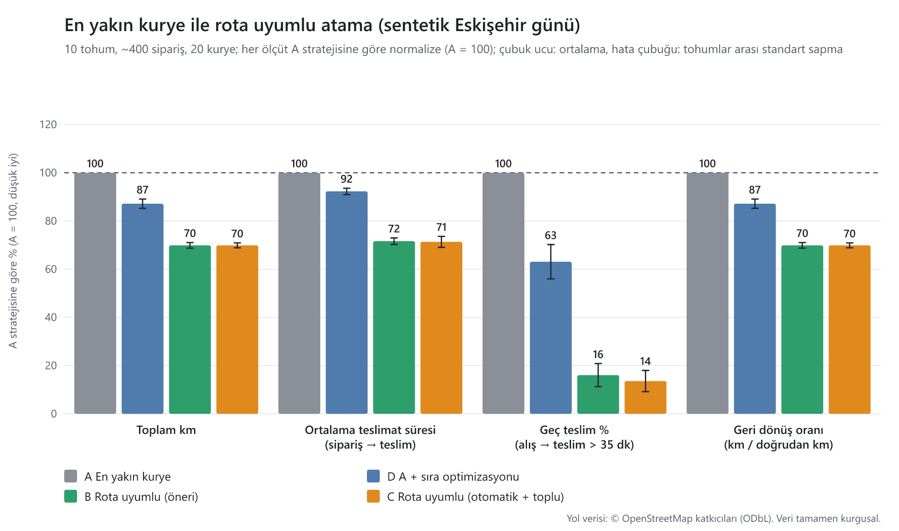
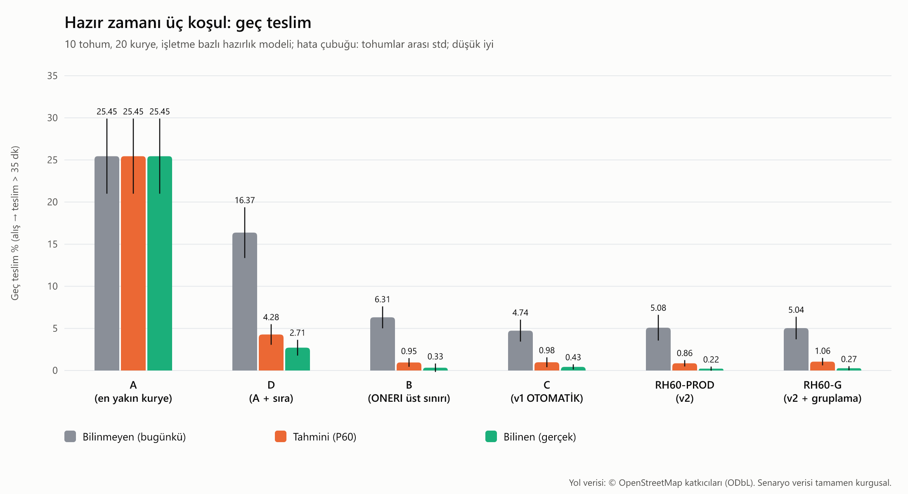
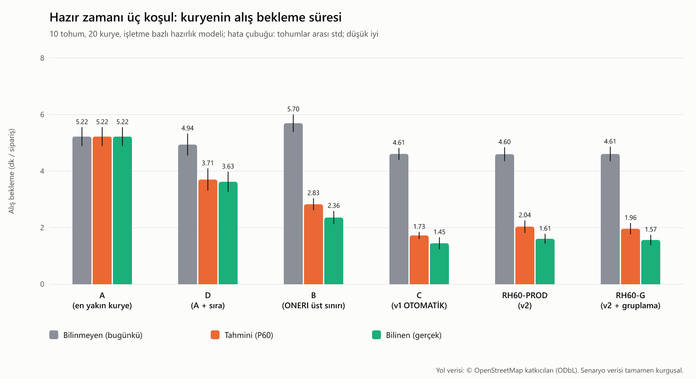

# Benchmark: "en yakın kurye" ile rota uyumlu atama

> Bu rapor `npm run benchmark` ile üretilir (tek komut, tekrar üretilebilir). Sayılar ölçülmeden belgeye girmez; hipotezle çelişen sonuçlar olduğu gibi yazılır.



## Özet

Sentetik bir Eskişehir günü (20 kurye, ~400 sipariş, 10 tohum). Her ölçüt 10 tohumun ortalaması ± standart sapmadır; A'ya göre farklar ortalamalar üzerindendir.

| Ölçüt | A | D | B | C |
|---|---:|---:|---:|---:|
| Toplam km | 1886.15 ± 112.55 | 1644.68 ± 114.08 | 1317.71 ± 72.94 | 1317.79 ± 72.06 |
| Ort. teslimat süresi (sipariş → teslim, dk) | 38.61 ± 1.10 | 35.62 ± 1.10 | 27.64 ± 0.71 | 27.52 ± 0.52 |
| Ort. alış → teslim (dk) | 23.91 ± 0.94 | 19.35 ± 0.77 | 12.42 ± 0.58 | 12.14 ± 0.40 |
| Geç teslim (alış → teslim > 35 dk, %) | 19.91 ± 2.09 | 12.53 ± 1.70 | 3.18 ± 0.98 | 2.66 ± 0.70 |
| Geri dönüş oranı (km / doğrudan km) | 1.80 ± 0.04 | 1.57 ± 0.05 | 1.26 ± 0.02 | 1.26 ± 0.02 |
| Ters dönüş (100 paket başına) | 102.81 ± 3.09 | 81.18 ± 4.02 | 63.71 ± 2.61 | 64.44 ± 3.09 |
| Yüklü oran (%) | 35.53 ± 2.08 | 31.74 ± 1.98 | 25.19 ± 1.55 | 24.51 ± 0.94 |
| Aynı işletme kümesi aynı kuryede (%) | 46.41 ± 7.12 | 45.52 ± 10.36 | 50.52 ± 9.89 | 59.69 ± 13.61 |

**A'ya göre yüzde fark** (negatif = daha iyi; yüklü oran ve aynı kuryeye düşme oranında yüksek = farklı anlam taşır, bkz. ölçüt tanımları):

| Ölçüt | D − A | B − A | C − A |
|---|---:|---:|---:|
| Toplam km | -12.8% | -30.1% | -30.1% |
| Ort. teslimat süresi (sipariş → teslim, dk) | -7.7% | -28.4% | -28.7% |
| Ort. alış → teslim (dk) | -19.1% | -48.0% | -49.2% |
| Geç teslim (alış → teslim > 35 dk, %) | -37.1% | -84.0% | -86.7% |
| Geri dönüş oranı (km / doğrudan km) | -12.8% | -30.1% | -30.1% |
| Ters dönüş (100 paket başına) | -21.0% | -38.0% | -37.3% |
| Yüklü oran (%) | -10.7% | -29.1% | -31.0% |
| Aynı işletme kümesi aynı kuryede (%) | -1.9% | +8.9% | +28.6% |

**Duyarlılık uyarısı:** yukarıdaki fark, stratejilerin hazır olma anını bilmediği varsayılan (pilotun bugünkü) durum içindir. İşletmenin hazır olma anı biliniyorsa (aşağıdaki duyarlılık koşusu) toplam km farkı A'ya göre B için -8.1%, C için -13.9%, geç teslim farkı B için -96.5%, C için -98.4% olur: kilometre kazancı belirgin biçimde küçülür, geç teslim kazancı büyür. Başlık sayıları bu yüzden tek başına değil, iki tabloyla birlikte okunmalıdır.

## Aynı işletme gruplaması (İterasyon 3b-3): gerçek etki v2 taban çizgisine göredir

Ayrıntılı rapor: [v2/gruplama.md](v2/gruplama.md) (30 tohum, eşleştirilmiş %95 GA, ablation). Dikkat: yukarıdaki tablolardaki A (NC) karşılaştırması gruplamanın etkisini **göstermez**; NC'ye göre +33 puanın hemen hemen tamamı dağıtım v2'nin kendisinden (60 sn pencere, regret-3) gelir. Gruplamanın gerçek etkisi RH60-PROD'a (v2, gruplamasız) göre farktır:

| Varyant (aynı işletme kümesi aynı kuryede) | Varsayılan gün | Tepe gün |
|---|---:|---:|
| RH60-PROD (v2, gruplamasız) | %74,4 | %60,4 |
| RH60-G, spec varsayılanları (κ 90, bağlama 120, τ 0,10), PROD'a göre | +1,4 puan [-1,1; 4,0] (anlamsız) | -1,2 puan [-3,3; 0,9] (anlamsız) |
| RH60-G-T, önerilen (κ 150, bağlama 240, τ 0,5), PROD'a göre | +7,8 puan [5,2; 10,4] ✱ | +9,5 puan [7,4; 11,6] ✱ |

Spec varsayılanlarında τ = 0,10 kazancı siler (tek başına PROD'a göre -4,0 / -5,7 puan ✱); κ ve sonradan bağlama tek başına +4-5 puan ✱. Önerilen bileşim toplam km'yi +%1,1 / +%1,2 ✱ ve geç teslimi +0,3 / +0,45 puan artırır. Tepe günde mutlak %75 hedefine ulaşılmadı (en iyi %71,4).

## Hipotezler ve sonuç

Hipotezler (ROTA-UYUMLU-ATAMA §16) hedeftir, sonuç değildir; aşağıda ölçülen değerlerle karşılaştırılır.

- **H1 (B, A'ya göre toplam km'de ve geç teslimde belirgin azalma sağlar):** doğrulandı (toplam km -30.1%, geç teslim -84.0%).
- **H2 (C, düşük yönetici yüküyle B'ye yakın kalır):** doğrulandı (C − B: toplam km +0.0%, geç teslim -0.5 puan). Yönetici yükü bu simülasyonda ölçülmedi.
- **H3 (D, yalnızca sıra optimizasyonunun yetmediğini gösterir):** doğrulandı (toplam km: D -12.8%, B -30.1%; atama kararı sıralamadan daha büyük pay taşıyor).
- **H4 (toplu pencere aynı işletme siparişlerini aynı kuryede toplar):** kısmen: fark var ama tohumlar arası standart sapma düzeyinde (aynı kuryeye düşme oranı: A: %46.4, D: %45.5, B: %50.5, C: %59.7; C − A = +13.3 puan).

## Strateji tanımları

| Kod | Strateji | Atama | Sıra |
|---|---|---|---|
| A | En yakın kurye (pilotun bugünkü yazılımı) | Kapasitesi uygun, vardiyadaki en yakın kurye (kuş uçuşu, anlık konum) | Eklenme sırası (FIFO: önce alışlar, sonra teslimler alış sırasıyla) |
| D | A + sıra optimizasyonu | A ile aynı | Motorun `planRoute` + EXACT sıralayıcısı (kararlılık kuralları açık) |
| B | Rota uyumlu, ONERI üst sınırı | Her zaman `suggest()` 1. aday | `planRoute` + EXACT |
| C | Rota uyumlu, OTOMATIK + toplu pencere | 20 sn pencerede gelenler `planBatch` ile; sapma ≤ 5 dk ise atanır, değilse kuyruk; 60 sn'de yeniden deneme; 3 dk sonra "yönetici" 1. adayı atar | `planRoute` + EXACT |

Uygun kurye yoksa sipariş bekler ve kurye olaylarında yeniden denenir (tüm stratejilerde aynı). Motor stratejileri (B, C, D) 15 dk bekleyen siparişi "yönetici elle atar" varsayımıyla kapasitesi olan en yakın kuryeye en az kötü yerleştirmeyle verir; gün sonunda (23:00 sonrası) bekleyen sipariş kalırsa tüm kuryeler mesai dışı da sipariş alabilir. Kimse sipariş reddetmez.

## Senaryo

- **Düğüm evreni** (tüm tohumlarda aynı, tamamen kurgusal): 40 işletme 4 kümede (Merkez / Adalar, Odunpazarı tarihi bölge, Kampüs / Tepebaşı, Vişnelik / Osmangazi; merkezler İterasyon 1 SPEC §14 semtleri), 600 teslim noktası (10 mahalle merkezi çevresinde, σ = 600 m Gauss, hizmet bölgesine kırpılmış, kümeye göre ağırlıklı), 20 kurye başlangıç noktası. Toplam 660 düğüm; gerçek OSRM (motosiklet profili) `table` ile süre ve mesafe matrisi.
- **Talep:** 11:00-23:00, ortalama ~400 sipariş, homojen olmayan Poisson; öğle (12:00-14:00) ve akşam (18:30-21:30) tepeleri. Tepe saatlerde siparişlerin ~%15'i aynı işletmeden 2-3'lü kümeler (0-60 sn arayla).
- **Hazırlık süresi:** 5-20 dk kesik lognormal. Varsayılan senaryoda stratejiler hazır olma anını **bilmez** (pilotun bugünkü durumu): kurye işletmede gerçek hazır olma anına kadar bekler. Duyarlılık koşusu aşağıdadır.
- **Kuryeler:** 20 (12 tam gün 11:00-23:00, 8 yoğun saat 11:30-14:30 ve 18:00-22:30); kapasite 4; servis 120 sn (alış; aynı noktada ardışık ikinci alış 60 sn) ve 90 sn (teslim).
- **Hareket gürültüsü:** gerçekleşen bacak süresi = matris süresi × lognormal(0, 0,15); gürültü (tohum, kurye, başlangıç, bitiş) üzerinden türetilir, böylece tüm stratejiler aynı rastgele sayıları görür.
- **Konum:** en yakın kurye seçimi bacak ortasındaki kuryenin enterpolasyonlu konumunu kullanır. Rota uyumlu stratejilerde sıradaki durak kilitlidir ve hesap o durağın tahmini bitişinden başlar (kalan süre kilitli durağın servis süresine yazılır).

Tohumlar: 1, 2, 3, 4, 5, 6, 7, 8, 9, 10.  
Matris özeti (sha256): `748bf740090acd3ee2cb481acf1c79db0aefc6861c7f2899e08bf6952776bfcd`.

| Tohum | Sipariş | Aynı işletme kümesi | Tepe saat payı |
|---:|---:|---:|---:|
| 1 | 417 | 20 | %75.1 |
| 2 | 365 | 16 | %75.6 |
| 3 | 395 | 22 | %71.1 |
| 4 | 420 | 22 | %75.0 |
| 5 | 383 | 14 | %71.8 |
| 6 | 410 | 27 | %76.6 |
| 7 | 371 | 18 | %74.1 |
| 8 | 397 | 21 | %77.1 |
| 9 | 415 | 16 | %72.3 |
| 10 | 391 | 25 | %75.2 |

## Ölçüt tanımları

| Ölçüt | Tanım |
|---|---|
| Toplam km | Tüm kuryelerin kat ettiği yol mesafesi (matris mesafeleri) |
| Ortalama teslimat süresi | Sipariş → teslim ve ayrıca alış → teslim |
| Geç teslim % | Alış → teslim > 35 dk olan paketler |
| Geri dönüş oranı | Kat edilen km / Σ doğrudan alış → teslim km |
| Ters dönüş | Ardışık bacaklar arası yön değişimi > 120° olan bacak sayısı (100 paket başına) |
| Yüklü oran | Kurye vardiya süresinin paket taşıyarak geçen payı |
| Aynı kuryeye düşme | Aynı işletmeden art arda gelen (2-3'lü) siparişlerin hepsinin aynı kuryeye düşme oranı |

## Duyarlılık: işletmenin hazır olma anı biliniyor

Aynı tohumlar; stratejiler (motor) `readyAt` bilgisini kullanır (bekleme maliyeti ve sıralama). A bilgiyi kullanmaz (en yakın kurye seçimi ve FIFO sıra hazır olma anından etkilenmez); D, B ve C kullanır.

| Ölçüt | A | D | B | C |
|---|---:|---:|---:|---:|
| Toplam km | 1886.15 ± 112.55 | 1720.36 ± 103.52 | 1734.05 ± 87.16 | 1624.49 ± 85.28 |
| Ort. teslimat süresi (sipariş → teslim, dk) | 38.61 ± 1.10 | 31.57 ± 0.76 | 26.31 ± 0.55 | 25.73 ± 0.34 |
| Ort. alış → teslim (dk) | 23.91 ± 0.94 | 15.40 ± 0.59 | 11.16 ± 0.46 | 10.36 ± 0.23 |
| Geç teslim (alış → teslim > 35 dk, %) | 19.91 ± 2.09 | 3.02 ± 1.12 | 0.70 ± 0.42 | 0.33 ± 0.27 |
| Geri dönüş oranı (km / doğrudan km) | 1.80 ± 0.04 | 1.64 ± 0.04 | 1.65 ± 0.05 | 1.55 ± 0.03 |
| Ters dönüş (100 paket başına) | 102.81 ± 3.09 | 88.14 ± 2.86 | 75.55 ± 3.48 | 74.10 ± 3.49 |
| Yüklü oran (%) | 35.53 ± 2.08 | 27.47 ± 1.61 | 22.80 ± 1.24 | 21.42 ± 1.21 |
| Aynı işletme kümesi aynı kuryede (%) | 46.41 ± 7.12 | 48.39 ± 14.92 | 32.90 ± 9.30 | 50.60 ± 10.36 |

| Ölçüt | D − A | B − A | C − A |
|---|---:|---:|---:|
| Toplam km | -8.8% | -8.1% | -13.9% |
| Ort. teslimat süresi (sipariş → teslim, dk) | -18.2% | -31.8% | -33.4% |
| Ort. alış → teslim (dk) | -35.6% | -53.3% | -56.7% |
| Geç teslim (alış → teslim > 35 dk, %) | -84.8% | -96.5% | -98.4% |
| Geri dönüş oranı (km / doğrudan km) | -8.8% | -8.0% | -13.8% |
| Ters dönüş (100 paket başına) | -14.3% | -26.5% | -27.9% |
| Yüklü oran (%) | -22.7% | -35.8% | -39.7% |
| Aynı işletme kümesi aynı kuryede (%) | +4.3% | -29.1% | +9.0% |

<!-- ready-3:begin -->
## Hazır zamanı: üç koşul (İterasyon 3b-2)

Hazır zamanının stratejilere nasıl bildirildiği üç koşulda karşılaştırılır; aynı gün, aynı tohum, aynı matris (10 tohum, varsayılan gün ~400 sipariş). Hazırlık süresi bu koşuda **işletme bazlı** modelle üretilir (`--prep business`): işletme medyanı U(6, 16) dk, tepe saatlerde × 1,2, lognormal σ = 0,35, [3, 30] dk kırpma. Varsayılan tablolar (yukarıdaki) bugünkü, işletmeden bağımsız 5-20 dk üreteciyle üretilmeye devam eder ve **değişmez**.

- **Bilinmeyen:** hazır anı stratejiye bildirilmez; kurye gelir ve hazır olana kadar bekler (bugünkü durum).
- **Tahmini:** `readyAt` = sipariş girişi + işletme × gün dilimi (tepe / tepe dışı) **P60** hazırlık süresi. Tahmin 14 eğitim gününden (tohum 1001-1014, rapor tohumları 1-10 ile ayrık) öğrenilir; bir kovada 10'dan az gözlem varsa kiracı varsayılanı 12 dk kullanılır. Stratejiler tahmini gerçek gibi kullanır; kurye gerçek hazır anına kadar bekler.
- **Bilinen:** `readyAt` = gerçek hazır anı.





Her hücre 10 tohumun ortalaması ± standart sapmasıdır.

| Strateji | Koşul | Geç teslim (%) | Alış bekleme (dk/sipariş) | Toplam km | Teslimat süresi (dk) | Aynı işletme aynı kuryede (%) |
|---|---|---:|---:|---:|---:|---:|
| **A (en yakın kurye)** | Bilinmeyen (bugünkü) | 25.45 ± 4.46 | 5.22 ± 0.33 | 1918.38 ± 116.72 | 43.68 ± 1.30 | 46.67 ± 6.16 |
| **A (en yakın kurye)** | Tahmini (P60) | 25.45 ± 4.46 | 5.22 ± 0.33 | 1918.38 ± 116.72 | 43.68 ± 1.30 | 46.67 ± 6.16 |
| **A (en yakın kurye)** | Bilinen (gerçek) | 25.45 ± 4.46 | 5.22 ± 0.33 | 1918.38 ± 116.72 | 43.68 ± 1.30 | 46.67 ± 6.16 |
| **D (A + sıra)** | Bilinmeyen (bugünkü) | 16.37 ± 3.02 | 4.94 ± 0.39 | 1673.52 ± 120.21 | 40.28 ± 1.01 | 47.57 ± 9.63 |
| **D (A + sıra)** | Tahmini (P60) | 4.28 ± 1.21 | 3.71 ± 0.39 | 1727.91 ± 127.06 | 35.04 ± 0.95 | 49.79 ± 8.10 |
| **D (A + sıra)** | Bilinen (gerçek) | 2.71 ± 0.94 | 3.63 ± 0.36 | 1716.10 ± 115.26 | 33.75 ± 0.70 | 50.52 ± 9.42 |
| **B (ONERI üst sınırı)** | Bilinmeyen (bugünkü) | 6.31 ± 1.30 | 5.70 ± 0.31 | 1308.21 ± 73.18 | 32.12 ± 0.51 | 46.87 ± 11.22 |
| **B (ONERI üst sınırı)** | Tahmini (P60) | 0.95 ± 0.51 | 2.83 ± 0.21 | 1853.31 ± 83.14 | 28.63 ± 0.48 | 29.91 ± 11.27 |
| **B (ONERI üst sınırı)** | Bilinen (gerçek) | 0.33 ± 0.49 | 2.36 ± 0.23 | 1823.37 ± 83.81 | 26.89 ± 0.58 | 28.06 ± 10.56 |
| **C (v1 OTOMATİK)** | Bilinmeyen (bugünkü) | 4.74 ± 1.30 | 4.61 ± 0.21 | 1311.81 ± 65.38 | 31.58 ± 0.49 | 60.49 ± 16.27 |
| **C (v1 OTOMATİK)** | Tahmini (P60) | 0.98 ± 0.59 | 1.73 ± 0.12 | 1711.76 ± 73.95 | 29.56 ± 0.54 | 42.19 ± 18.06 |
| **C (v1 OTOMATİK)** | Bilinen (gerçek) | 0.43 ± 0.30 | 1.45 ± 0.21 | 1719.04 ± 76.61 | 27.17 ± 0.33 | 39.98 ± 7.51 |
| **RH60-PROD (v2)** | Bilinmeyen (bugünkü) | 5.08 ± 1.52 | 4.60 ± 0.25 | 1307.41 ± 73.98 | 30.55 ± 0.75 | 72.67 ± 7.76 |
| **RH60-PROD (v2)** | Tahmini (P60) | 0.86 ± 0.38 | 2.04 ± 0.22 | 1652.94 ± 69.77 | 28.42 ± 0.32 | 51.52 ± 11.40 |
| **RH60-PROD (v2)** | Bilinen (gerçek) | 0.22 ± 0.25 | 1.61 ± 0.17 | 1658.53 ± 77.87 | 26.23 ± 0.29 | 53.36 ± 9.01 |
| **RH60-G (v2 + gruplama)** | Bilinmeyen (bugünkü) | 5.04 ± 1.33 | 4.61 ± 0.26 | 1318.06 ± 71.99 | 30.74 ± 0.54 | 74.53 ± 8.16 |
| **RH60-G (v2 + gruplama)** | Tahmini (P60) | 1.06 ± 0.44 | 1.96 ± 0.20 | 1649.27 ± 78.48 | 28.61 ± 0.47 | 44.28 ± 12.94 |
| **RH60-G (v2 + gruplama)** | Bilinen (gerçek) | 0.27 ± 0.24 | 1.57 ± 0.18 | 1660.89 ± 71.68 | 26.30 ± 0.40 | 52.00 ± 10.97 |

**Bilinmeyen koşuya göre eşleştirilmiş fark** (aynı tohum), ortalama [%95 GA, t dağılımı, sd = 9]; ✱ = aralık 0'ı içermiyor. Negatif geç teslim ve bekleme iyidir.

| Strateji | Karşılaştırma | Geç teslim (%) | Alış bekleme (dk/sipariş) | Toplam km | Teslimat süresi (dk) |
|---|---|---:|---:|---:|---:|
| **A (en yakın kurye)** | Tahmini (P60) − Bilinmeyen (bugünkü) | +0.00 [0.00, 0.00] | +0.00 [0.00, 0.00] | +0.00 [0.00, 0.00] | +0.00 [0.00, 0.00] |
| **A (en yakın kurye)** | Bilinen (gerçek) − Bilinmeyen (bugünkü) | +0.00 [0.00, 0.00] | +0.00 [0.00, 0.00] | +0.00 [0.00, 0.00] | +0.00 [0.00, 0.00] |
| **D (A + sıra)** | Tahmini (P60) − Bilinmeyen (bugünkü) | -12.10 [-14.57, -9.63] ✱ | -1.24 [-1.47, -1.00] ✱ | +54.40 [15.17, 93.62] ✱ | -5.24 [-6.04, -4.43] ✱ |
| **D (A + sıra)** | Bilinen (gerçek) − Bilinmeyen (bugünkü) | -13.66 [-15.75, -11.58] ✱ | -1.32 [-1.52, -1.11] ✱ | +42.58 [11.41, 73.76] ✱ | -6.53 [-7.20, -5.87] ✱ |
| **B (ONERI üst sınırı)** | Tahmini (P60) − Bilinmeyen (bugünkü) | -5.36 [-6.28, -4.43] ✱ | -2.87 [-3.02, -2.72] ✱ | +545.09 [526.78, 563.41] ✱ | -3.49 [-4.07, -2.90] ✱ |
| **B (ONERI üst sınırı)** | Bilinen (gerçek) − Bilinmeyen (bugünkü) | -5.98 [-7.07, -4.89] ✱ | -3.34 [-3.50, -3.17] ✱ | +515.15 [492.22, 538.08] ✱ | -5.23 [-5.77, -4.69] ✱ |
| **C (v1 OTOMATİK)** | Tahmini (P60) − Bilinmeyen (bugünkü) | -3.76 [-4.76, -2.76] ✱ | -2.88 [-2.96, -2.81] ✱ | +399.94 [370.17, 429.72] ✱ | -2.02 [-2.30, -1.74] ✱ |
| **C (v1 OTOMATİK)** | Bilinen (gerçek) − Bilinmeyen (bugünkü) | -4.31 [-5.28, -3.34] ✱ | -3.16 [-3.31, -3.02] ✱ | +407.23 [389.18, 425.27] ✱ | -4.41 [-4.90, -3.91] ✱ |
| **RH60-PROD (v2)** | Tahmini (P60) − Bilinmeyen (bugünkü) | -4.23 [-5.14, -3.32] ✱ | -2.56 [-2.75, -2.38] ✱ | +345.53 [319.49, 371.58] ✱ | -2.13 [-2.60, -1.66] ✱ |
| **RH60-PROD (v2)** | Bilinen (gerçek) − Bilinmeyen (bugünkü) | -4.86 [-5.90, -3.82] ✱ | -2.99 [-3.14, -2.84] ✱ | +351.12 [325.88, 376.36] ✱ | -4.32 [-4.86, -3.77] ✱ |
| **RH60-G (v2 + gruplama)** | Tahmini (P60) − Bilinmeyen (bugünkü) | -3.98 [-4.87, -3.09] ✱ | -2.64 [-2.84, -2.45] ✱ | +331.21 [304.21, 358.20] ✱ | -2.13 [-2.64, -1.62] ✱ |
| **RH60-G (v2 + gruplama)** | Bilinen (gerçek) − Bilinmeyen (bugünkü) | -4.76 [-5.74, -3.78] ✱ | -3.04 [-3.18, -2.91] ✱ | +342.83 [316.01, 369.65] ✱ | -4.45 [-5.00, -3.89] ✱ |

**Tahminin kapattığı fark:** tahmini koşuyla bilinen koşu arasında kalan fark (tahmini − bilinen) ve bilinmeyenden bilinene toplam iyileşmenin ne kadarını tahmin yakaladığı:

| Strateji | Geç teslim: tahmini − bilinen (puan) | Alış bekleme: tahmini − bilinen (dk) | Bekleme iyileşmesinin yakalanan payı |
|---|---:|---:|---:|
| **A (en yakın kurye)** | 0.00 | 0.00 | - |
| **D (A + sıra)** | 1.57 | 0.08 | %94 |
| **B (ONERI üst sınırı)** | 0.62 | 0.47 | %86 |
| **C (v1 OTOMATİK)** | 0.55 | 0.28 | %91 |
| **RH60-PROD (v2)** | 0.63 | 0.43 | %86 |
| **RH60-G (v2 + gruplama)** | 0.79 | 0.40 | %87 |

**Tahmin hatası (MAE):** gerçek hazırlık süresi ile tahmin arasındaki ortalama mutlak hata, rapor günlerindeki tüm siparişler üzerinden.

| Tahmin | MAE (dk) |
|---|---:|
| İşletme × gün dilimi P60 (14 eğitim günü) | 3.57 |
| Kiracı varsayılanı (sabit 12 dk) | 4.44 |
| İşletme × gün dilimi P50 (bilgi amaçlı; stratejilere verilmez) | 3.45 |
| P60'ın varsayılana göre farkı | -19.8% |
| P50'nin varsayılana göre farkı | -22.3% |

SPEC §15.1 3b-2 (b): ≥ 10 gözlemli işletmede MAE'nin işletme varsayılanından en az %20 düşük olması beklenir; bu sentetik veride P60 için karşılanmadı (-19.8%), P50 için karşılandı (-22.3%; MAE'yi en aza indiren tahmin medyandır, P60 ise bilinçli olarak biraz yüksek tahmin eder: kurye hazır olmadan gelmesin) (kovaların 80/80'i ≥ 10 gözlemli). Hazırlık süresi bu senaryoda yalnızca işletmeye ve tepe saate bağlıdır; gerçek hayatta hazırlık günlük dalgalanmaya, sipariş içeriğine ve yoğunluğa da bağlıdır, bu yüzden pilot verisiyle (`GET /metrics/preparation`) doğrulanmalıdır.

Sentetik senaryodur; bulgular pilotla doğrulanır. Tahmin yalnızca işletmeye göre değişen hazırlığı yakalar, günlük dalgalanmayı yakalayamaz; bu yüzden "bilinen" koşuya hiçbir zaman ulaşmaması beklenir.
<!-- ready-3:end -->

## Motor öneri süresi (bu makinede)

Matrix sağlayıcıyla saf CPU: `suggest()` çağrısı p50 0.40 ms, p95 1.36 ms (n = 5524); `planBatch` p50 0.63 ms, p95 2.08 ms (n = 8835). Süreler makineye bağlıdır ve CSV'ye girmez; gerçek OSRM ile uçtan uca ölçüm için `npm run bench:suggest -w @kurye/api`.

## Sınırlamalar

- Taban çizgisi A, pilotun mevcut yazılımının basitleştirilmiş modelidir (kuş uçuşu en yakın kurye + eklenme sırası); gerçek yazılım farklı davranabilir. Farklar bu taban çizgisine göredir.
- Canlı trafik yok; OSRM sabit hızlarla süre üretir (bacak başına ±%15 gürültü yalnızca değişkenliği taklit eder).
- Talep sentetiktir; gerçek siparişlerin zaman ve mekân dağılımı farklı olabilir. Sonuçlar bu ölçekte (20 kurye, ~400 sipariş, küçük bir şehir) geçerlidir.
- Sürücü davranışı yok (rota dışına çıkma, kural dışı sürüş, mola, kaza); kurye kararları kusursuz uygulanır, kimse sipariş reddetmez.
- Yönetici kararları idealize: ONERI üst sınırında yönetici her zaman 1. adayı seçer ve gecikmesizdir; yönetici yükü ölçülmez.
- Servis süreleri sabittir; teslimde müşteri bekleme / ulaşılamama yok.
- Kurye yeniden konumlanması yok: boşta kurye son teslim noktasında bekler.
- Motor sapma tanımı: `detourS`, yeni paketin kendi sabit servis süresini içermez (bkz. PR açıklaması / `EngineDeps.detourExcludesOwnService`); eşikler (5 dk) bu tanıma göredir.
- Toplu pencere 20 sn iken aynı işletme siparişleri arasındaki 0-60 sn aralık nedeniyle bir kısım küme farklı pencerelere düşer; tekil yerleştirme marjinal süreyi en aza indirir, "aynı kurye" tercihini ayrıca ödüllendirmez.

## Tekrar üretme

```powershell
npm install
npm run benchmark                  # docs/benchmark/ altındaki dosyaları yeniden üretir (önbellekli matris)
npm run benchmark -- --refresh-matrix   # matrisi çalışan OSRM'den yeniden hesaplar (npm run routing:up)
npm run benchmark -- --quick --travel haversine   # OSRM'siz duman testi (yayımlanmaz)
npm run benchmark -- --prep business --ready-modes unknown,estimated,known   # Hazır zamanı: üç koşul (results-ready-3.csv, ready-3.md)
```

İki ardışık koşu bayt düzeyinde aynı `results.csv` dosyasını üretir (zaman damgası yok, tohumlu PRNG, duvar saati kullanılmaz).

## Veri atfı

Süre ve mesafe matrisi © OpenStreetMap katkıcıları verisinden, [ODbL 1.0](https://www.openstreetmap.org/copyright) lisansıyla üretilmiştir (Geofabrik Türkiye çıkarımı, Eskişehir kesimi). Önbellek dosyası `services/api/bench/cache/eskisehir-matrix.v1.json.gz` aynı atıfla depodadır. Düğümler (işletme, teslim noktası, kurye başlangıcı) tamamen kurgusaldır.
