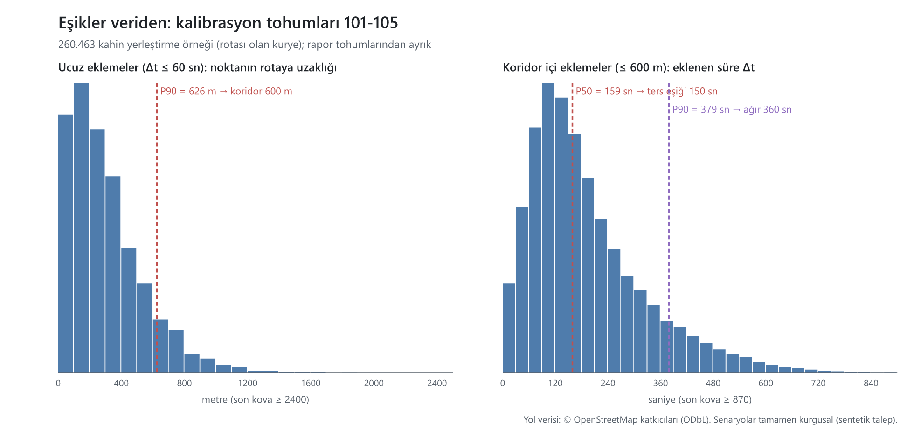
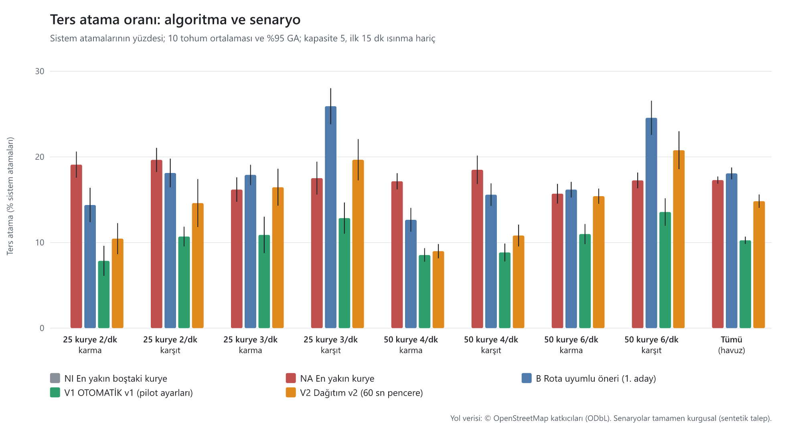
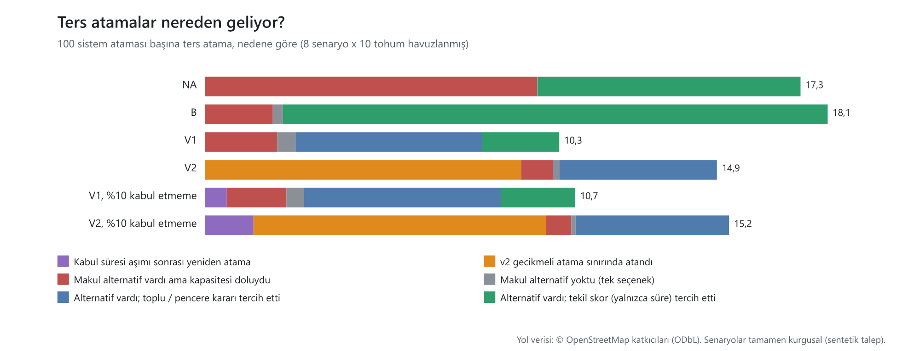
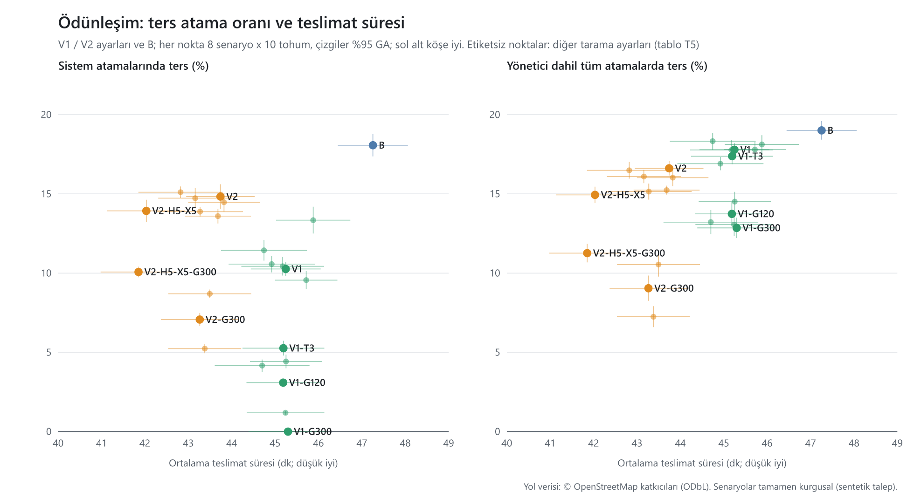

# Ters atama ölçümü (Kasım 2026)

> Tanım: [ADR-0039](../kararlar/0039-ters-atama-olcutu.md). Tüm sayılar `npm run benchmark:ters` ve `npm run benchmark:ters:report` ile üretilir (komutlar en altta). Tüm tablolar: [ters-atama/tablolar.md](ters-atama/tablolar.md); ham sonuçlar: [ters-atama/results.csv](ters-atama/results.csv); eşik kalibrasyonu: [ters-atama/kalibrasyon.json](ters-atama/kalibrasyon.json). Sayılar ölçülmeden bu belgeye girmez; beklentiyle çelişen sonuçlar olduğu gibi yazılır.

## Kısa özet (kod bilmeyen okuyucu için)

- **"Ters atama" ne demek?** Kuryeye, gittiği yönün **arkasında** kalan bir paket verilmesi: alış ya da teslim noktası kuryenin rotasından 600 metreden fazla uzakta ve kuryenin 600 metreden fazla gerisinde, ve bu paket kuryenin yoluna en az 2,5 dakika ekliyor.
- **Bizim sistemde bugün:** pilot ayarlarıyla çalışan otomatik atama (OTOMATİK v1), 25-50 kuryeli ve dakikada 2-6 siparişli yoğun saat senaryolarında, verdiği atamaların **%10,3**'ünde ters atama yapıyor (%95 güven aralığı %9,8-%10,7). Yöneticiye kalan atamalar da sayılınca bu oran **%17,8**. Kuryelerin birbirine karşı yönde çalıştığı senaryolarda bu oran **%11,1**. Aynı senaryolarda "en yakın kuryeye ver" kuralı **%17,3** ters atama yapıyor ve teslimat ortalama 74 dakika sürüyor (bizde 45 dakika).
- **Nereden geliyor?** Ters atamaların yaklaşık yarısı, sistemin 20 saniyelik toplu kararında aslında yolu üzerinde bir kurye varken ters yöndeki kuryeyi seçmesinden geliyor. Üçte birinden fazlası, aynı restorandan çıkan iki paketin birbirine zıt yönlere gitmesi.
- **Önerilen ayarla:** "yön koruması" (sistem ters bir atamayı paket 2 dakikalık olana kadar yapmaz, yolu üstündeki bir kuryenin çıkmasını bekler) ile oran **%3,1**'e iniyor; teslimat süresi ve yöneticiye kalan iş ölçülebilir biçimde değişmiyor. Bu ayar henüz üründe yok; eklenmesi ürün sahibinin kararı (aşağıda).
- **Dürüst uyarı:** yoğun saatte otomatik atamanın yerleştiremediği paketlerin önemli bir kısmı (%37) yöneticiye kalıyor; yöneticinin bunları sistemin ilk önerisiyle atadığı varsayıldığında, yönetici atamaları dahil toplam ters oranı %17,8. Yön korumasıyla bu toplam %13,7'ye iniyor. Toplam oranı en çok düşüren seçenek, dağıtım v2 ile yön korumasının birlikte kullanılması (%9,0); v2'yi pilotta açmak ayrı bir karar.
- Bütün sayılar **sentetik** (kurgusal) siparişlerle ölçüldü; gerçek pilot verisiyle doğrulanmalı.

## 1. Soru

Yönetici, sistemin verdiği bir atamaya güvenebilmeli ("atıyorsa vardır bir bildiği"). Sahada "yanlış atama" denince kastedilen şey, paketin kuryenin **gidiş yönünün tersine** verilmesidir. Bu çalışma üç şey yapar:

1. "Ters atama"yı ölçülebilir, tek kurallı bir tanıma bağlar (ADR-0039).
2. Bugünkü algoritmalarımızı ve iki basit taban çizgisini bu tanımla, tekrar üretilebilir sentetik Eskişehir senaryolarında ölçer.
3. Ters atamanın **nereden** geldiğini ayrıştırır ve oranı düşürecek ayarları kanıtıyla önerir (karar ürün sahibinde).

## 2. Tanım (özet; ayrıntı ADR-0039)

Atama, **atandığı anda** kuryenin taahhüt edilmiş rotasına göre sınıflandırılır:

- **Δt**: yeni paketin kuryenin rotasına eklediği yolculuk süresi (yerleştirme marjinal maliyeti; paketin kendi servis süresi hariç).
- **Koridor**: kuryenin konumundan kalan duraklarına çizilen kırık çizgi; **gidiş yönü**: kuryeden ilk anlamlı (≥ 100 m) durağa yön.
- Alış veya teslim noktası koridorun **600 m** dışında ve kuryenin **600 m'den fazla gerisinde** ise nokta "geride"dir. Rota daha sonra o tarafa dönüyorsa nokta koridordadır, geride sayılmaz.
- **Ters atama** = bir nokta geride **ve** Δt ≥ **150 sn**. **Ağır ters** = ayrıca Δt ≥ 360 sn veya geri mesafe ≥ 2 km.
- Boştaki kurye (durağı yok): yön tanımsız, ters olamaz. Yan sapma (geride nokta yok ama Δt ≥ 150 sn): "sapma", ters değil.



**Eşikler veriden** (kalibrasyon tohumları 101-105, rapor tohumlarından ayrık, 260 463 olası yerleştirme örneği): Δt ≤ 60 sn olan, açıkça yol üstü eklemelerde noktanın rotaya uzaklığının P90'ı **626 m** → koridor 600 m. Koridor içindeki eklemelerin Δt medyanı **159 sn**, P90'ı **379 sn** → ters eşiği 150 sn (olağan bir yol üstü ekleme kadar bile maliyeti olmayan bir geri nokta zarar sayılmaz), ağır eşik 360 sn. Δt eşiğine duyarlılık T3'te.

**MRTA karşılığı.** Kuryeler kapasiteli, çok görevli robotlardır (*multi-task robots*, kapasite 5); paketler tek robotluk görevlerdir (*single-robot tasks*). Atama zaman uzanımlıdır (*time-extended assignment*): görev, robotun mevcut görev demetine (*bundle*, CBBA'daki anlamıyla) yerleştirilir. Δt, yerleştirme sezgiselinin (*insertion heuristic*) marjinal maliyetidir; CBBA'da bir robotun teklifi de bu marjinal kazançtır. Ters ölçütü marjinal maliyete **yön** bilgisini ekler. Yalnızca marjinal maliyete bakan bir atama (açgözlü tekil skor veya regret tabanlı toplu atama) ters bir kararı iki durumda seçer: o karar marjinal olarak ucuzsa (ör. aynı işletme alışı "bedava" olduğu için teslim yönü görmezden gelinir) ya da elde kalan tek seçenekse. Bölüm 6 bu iki durumu ayrıştırır.

## 3. Ölçülen algoritmalar

| Kod | Algoritma | Not |
|---|---|---|
| **NI** | En yakın **boştaki** kurye (taban çizgisi) | Yalnızca rotası boş kuryeler; boşta kurye yoksa bekler (15 dk'da zorunlu atama) |
| **NA** | En yakın kurye (taban çizgisi) | Kapasitesi olan en yakın kurye, eklenme sırası; mevcut benchmark'taki A ile aynı kural |
| **B** | Rota uyumlu öneri, her zaman 1. aday | ONERI kipinin üst sınırı (yönetici hep 1. adayı seçer); tekil skor, yalnızca süre |
| **V1** | **OTOMATİK v1, pilot ayarları** | 20 sn toplu pencere (regret-2), sapma eşiği 5 dk, bekleyenleri 30 sn'de bir (kapasite açılınca en erken 10 sn'de) yeniden deneme, kabul süresi 90 sn, havuz kuryelere kapalı. Bekleyenlerde 3 dk dolan paketi **yönetici modeli** 1. adayla atar |
| **V2** | Dağıtım v2 üretim yolu | 60 sn kayan ufuk penceresi, regret-3, gecikmeli atama (sapma > 7 dk ise en çok 3 dk bekletme); pencere başına en çok 40 paket |

**Sistem ataması** = algoritmanın kendi kararı. Yönetici modeli ve 15 dk zorunlu atama ayrı sayılır: başlık oranı yalnızca sistem atamalarıdır, yönetici dahil oran ayrıca verilir. Üretim dağıtım kodu ve varsayılanları bu çalışmada **değiştirilmedi**; V1 modeli üretimdeki akışı benchmark'ta taklit eder.

## 4. Senaryolar

Mevcut benchmark evreni kullanılır: 40 işletme 4 kümede, 600 teslim noktası ve aynı OSRM motosiklet süre matrisi; düğümler tamamen kurgusal. Her senaryo 2 saatlik bir tepe penceresidir (öğle 11:45 veya akşam 18:45), sabit hızlı Poisson talep, siparişlerin %15'i aynı işletmeden 2-3'lü kümeler, işletme bazlı hazırlık süresi (medyan 6-16 dk; algoritmalar hazır olma anını bilmez). Kapasite **5**. Pencerenin ilk 15 dakikası ısınmadır (kuryeler boş başlar), ölçüme girmez.

| Kod | Kurye | Sipariş / dk | Akış |
|---|---:|---:|---|
| KAR-25-2L / KRS-25-2L | 25 | 2 | karma / karşıt (öğle) |
| KAR-25-3D / KRS-25-3D | 25 | 3 | karma / karşıt (akşam) |
| KAR-50-4L / KRS-50-4L | 50 | 4 | karma / karşıt (öğle) |
| KAR-50-6D / KRS-50-6D | 50 | 6 | karma / karşıt (akşam) |

- **Karma:** mevcut benchmark'ın mekân dağılımı (teslimlerin %70'i işletme kümesine yakın mahallelerde).
- **Karşıt akış:** siparişlerin %80'inde kuzeydeki işletmelerin (Kampüs / Tepebaşı, Vişnelik / Osmangazi) paketleri güneydeki mahallelere, güneydeki işletmelerin (Odunpazarı, Merkez / Adalar) paketleri kuzeydeki mahallelere gider. Porsuk çayı, demiryolu ve çevre yolu bariyerlerini iki yönde geçen kuryeler oluşur: yön hatasının en olası olduğu durum.
- **Yük:** 25 kurye için 3/dk ve 50 kurye için 6/dk aşırı yüklü koşullardır (ortalama teslim 45-50 dk). Bilerek dahil edildi, çünkü ters atama baskısı en çok kapasite sıkışınca artar.

Her algoritma için 10 rapor tohumu (1-10) × 8 senaryo koşuldu. Her oran şöyle hesaplanır: önce her tohum için 8 senaryo havuzlanır, sonra tohumlar arası ortalama ve **%95 güven aralığı** alınır (t dağılımı, sd = 9). Ayar karşılaştırmaları aynı tohumlarla eşleştirilmiş farktır.

## 5. Sonuçlar



**T1. Algoritma başına** (8 senaryo havuzlanmış; [%95 GA]; tüm sütunlar [tablolar.md](ters-atama/tablolar.md) T1'de):

| Algoritma | Ters (% sistem) | Yönetici dahil ters (%) | Aynı işletme alışı hariç ters (%) | Ağır ters (%) | Teslim süresi (dk) | Geç teslim (%) | Paket / kurye-saat | Yönetici / zorunlu payı (%) |
|---|---:|---:|---:|---:|---:|---:|---:|---:|
| NI en yakın boştaki | 0,0 | 14,5 [13,9; 15,0] | 0,0 | 0,0 | 39,1 [38,0; 40,2] | 4,2 | 4,44 | 57,6 [55,2; 59,9] |
| NA en yakın kurye | 17,3 [16,9; 17,7] | 17,3 [16,9; 17,7] | 15,1 [14,8; 15,4] | 15,2 | 74,1 [72,8; 75,4] | 74,9 | 2,69 | 0,0 |
| B öneri 1. aday | 18,1 [17,4; 18,8] | 19,0 [18,4; 19,6] | 14,0 [13,3; 14,6] | 13,4 | 47,3 [46,4; 48,1] | 18,5 | 4,02 | 8,6 [6,3; 10,9] |
| **V1 OTOMATİK v1 (pilot)** | **10,3 [9,8; 10,7]** | 17,8 [17,4; 18,2] | 6,4 [6,0; 6,7] | 4,3 | 45,2 [44,4; 46,1] | 15,9 | 4,13 | 37,3 [33,8; 40,8] |
| V2 dağıtım v2 | 14,8 [14,1; 15,6] | 16,6 [16,2; 17,1] | 11,9 [11,3; 12,6] | 10,3 | 43,7 [42,9; 44,5] | 14,5 | 4,21 | 8,3 [5,3; 11,2] |

**Okuma:**

- **V1 en düşük sistem ters oranına sahip** (%10,3). Bunun nedeni büyük ölçüde 5 dk sapma eşiğidir: eşiği aşan atamaları sistem yapmaz, bekleyenlere bırakır. Bedeli şu: yoğun saatte atamaların **%37'si yöneticiye kalıyor**. Yöneticinin bu zor paketleri sistemin 1. önerisiyle atadığı varsayıldığında (model), yönetici atamalarının yaklaşık üçte biri terstir ve toplam oran %17,8 olur. Hedef "yönetici paneli izlemesin" ise V1'in düşük oranı tek başına yeterli kanıt değildir; yönetici payı da birlikte izlenmelidir.
- **Yalnızca süreye bakan tekil skor (B) yönü korumaz.** %18,1 ile en yakın kurye (NA) düzeyinde ters atama yapar; ama teslim süresini 74 dk'dan 47 dk'ya indirir. Marjinal süre maliyetini en aza indirmek, ters kararı kendiliğinden elemiyor.
- **v2 (V2), V1'den daha çok ters atama yapar** (%14,8), ama yöneticiye çok daha az iş bırakır (%8,3) ve teslim süresi en kısadır (43,7 dk). Ters atamaların çoğu gecikmeli atamanın süre sınırından gelir (bölüm 6).
- **NI hiç ters atama yapmaz**, çünkü yalnızca boş kuryelere verir. Fakat paketlerin %58'i 15 dk bekleyip zorunlu atamaya düşer. "Hiç ters yok" ile "iyi dağıtım" aynı şey değildir.
- **Ağır ters** (geri gidiş ≥ 2 km veya ≥ 6 dk) V1'de %4,3, NA'da %15,2'dir.

**T2. Senaryoya göre** (% sistem atamaları, [%95 GA]):

| Senaryo | NA | B | V1 | V2 |
|---|---:|---:|---:|---:|
| 25 kurye, 2/dk, karma | 19,1 [17,6; 20,6] | 14,4 [12,4; 16,4] | 7,9 [6,1; 9,6] | 10,5 [8,6; 12,3] |
| 25 kurye, 2/dk, karşıt | 19,7 [18,2; 21,1] | 18,1 [16,4; 19,8] | 10,7 [9,5; 11,9] | 14,6 [11,8; 17,4] |
| 25 kurye, 3/dk, karma | 16,2 [14,8; 17,6] | 17,9 [16,7; 19,1] | 10,9 [8,8; 13,0] | 16,5 [14,3; 18,6] |
| 25 kurye, 3/dk, karşıt | 17,5 [15,6; 19,5] | 25,9 [23,8; 28,0] | 12,8 [11,0; 14,7] | 19,7 [17,3; 22,1] |
| 50 kurye, 4/dk, karma | 17,2 [16,2; 18,1] | 12,6 [11,3; 14,0] | 8,5 [7,8; 9,3] | 9,0 [8,2; 9,8] |
| 50 kurye, 4/dk, karşıt | 18,5 [16,8; 20,2] | 15,6 [14,3; 16,9] | 8,8 [7,8; 9,9] | 10,8 [9,5; 12,1] |
| 50 kurye, 6/dk, karma | 15,7 [14,6; 16,9] | 16,2 [15,3; 17,1] | 11,0 [9,8; 12,2] | 15,4 [14,5; 16,3] |
| 50 kurye, 6/dk, karşıt | 17,3 [16,3; 18,2] | 24,6 [22,6; 26,6] | 13,6 [12,0; 15,2] | 20,8 [18,6; 23,0] |
| **Tümü, karma** | 16,6 [15,9; 17,4] | 15,2 [14,7; 15,8] | 9,5 [8,9; 10,2] | 13,1 [12,4; 13,8] |
| **Tümü, karşıt akış** | 18,0 [17,0; 19,0] | 21,1 [19,9; 22,3] | 11,1 [10,4; 11,8] | 16,7 [15,5; 17,9] |

Karşıt akış ve aşırı yük ters oranını artırır: en çok B'de (karşıtta +6 puan), en az V1'de (+1,6 puan). Yük arttıkça (25 kurye 2/dk'dan 3/dk'ya) V1'in oranı %7,9-10,7 bandından %10,9-12,8 bandına çıkar.

**T3. Tanım duyarlılığı** (Δt eşiği τ; koridor 600 m sabit; % sistem):

| Algoritma | τ = 60 sn | **τ = 150 sn** | τ = 240 sn | τ = 360 sn |
|---|---:|---:|---:|---:|
| NA | 17,5 | **17,3** | 16,6 | 14,5 |
| B | 19,6 | **18,1** | 15,1 | 11,0 |
| V1 | 12,5 | **10,3** | 5,7 | 1,1 |
| V2 | 17,7 | **14,8** | 10,9 | 7,6 |

V1 her eşikte en düşük orana sahip olan algoritmadır. NA, B ve V2'nin birbirine göre sırası ise eşiğe bağlıdır. V1'in oranı τ büyüdükçe hızla düşer: ters atamaları çoğunlukla 2,5-6 dk'lık kısa geri dönüşlerdir, çünkü 5 dk eşiği uzun olanları zaten engeller. Bu yüzden başlık sayısı, seçilen τ ile birlikte okunmalıdır.

## 6. Ters atama bizim sistemde nereden geliyor?



Her ters atama tek bir nedene bağlandı (öncelik sırasıyla): kabul süresi aşımı sonrası yeniden atama → v2 gecikmeli atama sınırı → makul alternatif yalnızca dolu kuryelerdeydi → makul alternatif yoktu → alternatif vardı ama toplu / pencere kararı seçti → alternatif vardı ama tekil skor seçti. "Makul alternatif" = ters olmayan ve Δt'si seçilenden en çok 2 dk kötü başka bir kurye ("kahin" karşılaştırması; tazelik ve hazır olma kısıtlarına bakmadığı için iyimserdir).

**T4. 100 sistem ataması başına ters atama, nedene göre:**

| Algoritma | Süre aşımı sonrası | v2 bekletme sınırı | Kapasite (alternatif doluydu) | Tek seçenek | Toplu / pencere kararı | Tekil skor | Ters içinde aynı işletme alışı (%) |
|---|---:|---:|---:|---:|---:|---:|---:|
| NA | – | – | 9,64 | 0,01 | – | 7,63 | 12,7 |
| B | – | – | 1,97 | 0,29 | – | 15,81 | 22,8 |
| **V1** | – | – | 2,10 | 0,53 | **5,41** | 2,24 | **37,8** |
| **V2** | – | **9,18** | 0,91 | 0,19 | 4,58 | – | 19,7 |
| V1, %10 kabul etmeme | 0,63 | – | 1,73 | 0,51 | 5,71 | 2,16 | 38,5 |
| V2, %10 kabul etmeme | 1,41 | 8,50 | 0,72 | 0,13 | 4,45 | – | 18,7 |

**V1'de (bugünkü pilot yolu):**

1. **Ana neden toplu pencere kararıdır.** Ters atamaların yarısından fazlası (100 atamada 5,4), 20 sn'lik toplu kararın, aslında yolu üzerinde bir kurye varken marjinal süresi biraz daha düşük ters yöndeki kuryeyi seçmesidir. Regret ekleme yalnızca süreyi en aza indirir, yönü görmez.
2. **Aynı işletme gruplaması:** V1'in ters atamalarının %38'inde yeni paketin alışı, kuryenin zaten gideceği işletmededir. Alış "bedava" olduğu için Δt küçük görünür ama teslim kuryenin gittiği yönün tersindedir. Bunlar bilinçli toplama olarak savunulabilir; hariç tutulursa V1'in oranı **%6,4**'tür (T1).
3. **Kapasite** (en uygun kurye dolu) 100 atamada 2,1; **tek seçenek** yalnızca 0,5. Yani V1'in ters atamalarının çoğu kaçınılmaz değildir: kahin, vakaların yaklaşık %75'inde ters olmayan, makul bir alternatif buldu.
4. **Kabul süresi aşımı ana neden değildir:** atamaların %10'u kabul edilmese bile V1'in oranı 0,5 puan [-0,4; 1,4] değişir (anlamsız). Süre aşımından sonra yapılan atamalarda ters oranı %9,4'tür, genel oranla aynı düzeydedir (T7).

**V2'de:** ters atamaların %62'si (100 atamada 9,2) gecikmeli atamanın süre sınırında gelir. Sapması 7 dk'yı aşan paket en çok 3 dk bekletilir, sonra o anki en ucuz kuryeye **koşulsuz** verilir; bu paketlerin %20'si terstir (tablolar T8). Bekletme kuralı süreyi korur ama yönü korumaz.

## 7. Ayar taraması ve yön koruması



Denenen ayarlar: V1 için sapma eşiği (3 / 5 / 7 dk), toplu pencere (0 / 20 / 60 sn), yeniden deneme (30 / 60 sn), yönetici bekleme (3 / 5 dk). V2 için gecikmeli atama eşiği ve en uzun bekletme (7/3, 5/3, 3/3, 7/5, 5/5 dk) ve pencere (30 sn). Ayrıca iki ucuz **yön koruması** denendi (yalnızca benchmark'ta; üretimde yok):

- **G1 (V1):** öneri / toplu karar bir ters atama üretirse ve paket G sn'den gençse o aday atanmaz. Sıradaki uygun adaya (ilk 3) geçilir, yoksa paket 30 sn sonraki denemeye kalır. G sn'den sonra koruma devreden çıkar.
- **G2 (V2):** pencere sonucundaki ters atama, paket G sn'den gençse bu pencerede uygulanmaz ve sonraki pencereye kalır.

**T5. Seçilmiş sonuçlar** (8 senaryo havuzlanmış; fark = varyant − taban, aynı tohumlarla eşleştirilmiş [%95 GA]; ✱ = aralık 0'ı içermiyor; tam tablo: tablolar T5):

| Varyant | Ters (% sistem) | Δ ters (puan) | Yönetici dahil ters (%) | Δ teslim (dk) | Yönetici payı (%) | Δ yönetici payı (puan) |
|---|---:|---:|---:|---:|---:|---:|
| V1 (pilot) | 10,3 | – | 17,8 | – | 37,3 | – |
| V1, eşik 3 dk | 5,3 | -5,0 ✱ | 17,4 | -0,1 | 54,2 | **+16,9 ✱** |
| V1, eşik 7 dk | 13,3 | +3,1 ✱ | 18,1 | +0,6 ✱ | 31,4 | -5,9 ✱ |
| V1, pencere 0 sn | 9,6 | -0,7 ✱ | 17,8 | +0,5 ✱ | 40,4 | +3,1 ✱ |
| V1, pencere 60 sn | 11,4 | +1,2 ✱ | 18,3 | -0,5 ✱ | 35,2 | -2,1 ✱ |
| V1, yeniden deneme 60 sn | 10,4 | +0,2 | 17,8 | -0,1 | 37,6 | +0,3 |
| V1, yönetici 5 dk bekler | 10,6 | +0,3 | 16,9 | -0,3 | 31,6 | -5,7 ✱ |
| **V1 + G1 60 sn** | 4,4 | -5,8 ✱ | 14,5 | 0,0 | 37,8 | +0,6 |
| **V1 + G1 120 sn** | **3,1** | **-7,2 ✱** | **13,7** | **-0,1** | 37,6 | +0,3 |
| V1 + G1 180 sn | 1,2 | -9,1 ✱ | 13,1 | 0,0 | 38,8 | +1,5 ✱ |
| V1 + G1 300 sn | 0,0 | -10,3 ✱ | 12,9 | +0,1 | 39,8 | +2,5 ✱ |
| V1 + G1 120 sn, yönetici 5 dk | 4,2 | -6,1 ✱ | 13,2 | -0,5 ✱ | 31,2 | -6,1 ✱ |
| V2 | 14,8 | – | 16,6 | – | 8,3 | – |
| V2, bekletme 5 dk / 5 dk | 13,9 | -0,9 | 14,9 | **-1,7 ✱** | 5,8 | -2,5 ✱ |
| V2 + G2 120 sn | 13,6 | -1,2 ✱ | 15,2 | -0,1 | 8,3 | +0,1 |
| V2 + G2 240 sn | 8,7 | -6,1 ✱ | 10,5 | -0,2 | 7,8 | -0,5 |
| **V2 + G2 300 sn** | **7,1** | **-7,8 ✱** | **9,0** | **-0,5 ✱** | 7,4 | -0,9 ✱ |
| V2 + G2 420 sn | 5,2 | -9,6 ✱ | 7,3 | -0,4 ✱ | 7,3 | -0,9 ✱ |
| V2 + G2 300 sn, bekletme 5/5 | 10,1 | -4,8 ✱ | 11,3 | -1,9 ✱ | 5,3 | -3,0 ✱ |

**Okuma:**

- **Yön koruması en etkili ve en ucuz kaldıraçtır.** V1'de 120 sn'lik koruma ters oranını %10,3'ten %3,1'e indirir. Teslim süresi (-0,1 dk) ve yönetici payı (+0,3 puan) anlamlı biçimde değişmez. Nedeni: bekletilen pakete 30-120 sn içinde çoğunlukla yolu üstündeki bir kurye çıkar. Koruma süresi uzadıkça ters oranı düşmeye devam eder, ama 180 sn'den sonra yönetici payı anlamlı biçimde artmaya başlar (+1,5 / +2,5 puan).
- **Sapma eşiğini 3 dk'ya düşürmek sorunu çözmez, yöneticiye taşır:** sistem ters oranı yarıya iner ama yönetici payı +17 puan artar, toplam ters oranı değişmez (%17,4).
- **Toplu pencere ve yeniden deneme aralığı küçük kaldıraçlardır.** Pencere 0 sn ters oranını 0,7 puan düşürür ama teslimi 0,5 dk uzatır ve yönetici payını 3 puan artırır; 60 sn bunun tersi. 30 ile 60 sn yeniden deneme arasında ölçülebilir fark yoktur.
- **v2'de gecikmeli atama sınırına yön koruması eklemek** (G2 300 sn) ters oranını yarıdan fazla düşürür (%14,8 → %7,1), teslimi biraz kısaltır. Yönetici dahil toplam oran **%9,0** ile denenen tüm seçeneklerin en iyilerindendir. Bekletme eşiklerini değiştirmek tek başına ters oranını anlamlı düşürmez (5/5 dk: -0,9 puan [-1,8; 0,0]), ama teslim süresini 1,7 dk kısaltır.
- Karşıt akış senaryolarında da aynı tablo geçerlidir (tablolar T6): V1 %11,1 → V1+G1 120 sn %3,7.

## 8. Önerilen pilot ayarları (ürün sahibi kararı)

Bu PR üretim davranışını ve varsayılanları **değiştirmez**. Aşağıdakiler kanıtıyla birlikte karar önerileridir.

> **Seçim tohumları:** yön koruması süreleri (G1 120 sn, G2 300 sn) ve diğer ayarlar, sonuçların raporlandığı tohumlarda (1-10) seçildi; ayrı bir doğrulama tohumu kümesi kullanılmadı. Bu yüzden kazançlar hafif iyimser olabilir. Seçilen değerler, korumayı ürüne alan PR'da yeni tohumlarla (ör. 201-210) yeniden doğrulanacak.

| # | Karar | Kanıt | Beklenen etki (sentetik) | Maliyet / risk | Öneri |
|---|---|---|---|---|---|
| 1 | **V1'e yön koruması (G1) eklemek:** kiracı ayarı, varsayılan kapalı; pilotta 120 sn | T5: ters -7,2 puan ✱; teslim -0,1 dk (anlamsız); yönetici payı +0,3 (anlamsız) | Sistem ters oranı **%10,3 → %3,1**; yönetici dahil %17,8 → %13,7 | Üretim kodu değişikliği (ayrı PR, sözleşmede yeni ayar alanı); paket en çok 2 dk daha bekleyebilir | **Evet**, 120 sn ile başla; pilotta ölç, gerekirse 180 sn |
| 2 | Sapma eşiği 5 dk'da kalsın (3 veya 7 dk'ya çekilmesin) | T5: 3 dk yönetici payını +16,9 puan artırır, toplam ters değişmez; 7 dk ters oranını +3,1 puan artırır | Değişiklik yok | – | **Evet (mevcut ayar)** |
| 3 | Toplu pencere 20 sn ve yeniden deneme 30 sn kalsın | T5: pencere 0 / 60 sn küçük ödünleşim; yeniden deneme 30 ile 60 sn arasında fark yok | Değişiklik yok | – | **Evet (mevcut pilot ayarı)** |
| 4 | Yönetici uyarı süresi (`autoWaitMin`) 3 → 5 dk | T5: modelde yönetici payı -5,7 puan ✱, ters değişmez; G1 ile birlikte yönetici payı %31, teslim -0,5 dk ✱ | Yöneticiye düşen atama azalır | Varsayım: yönetici uyarıyı görünce müdahale ediyor; gerçek yönetici davranışı farklı olabilir | Pilotta yönetici davranışı gözlendikten sonra karar |
| 5 | Dağıtım v2 pilotta açılırsa (açık soru 37) gecikmeli atama sınırına yön koruması (G2, 300 sn) ile birlikte açılsın | T5: v2 ters %14,8 → %7,1, yönetici dahil %16,6 → %9,0, teslim -0,5 dk ✱ | Denenenler içinde en düşük toplam ters oranı ve en kısa teslim süresi | v2'yi açmak ayrı ve daha büyük bir karar; G2 de üretim kodu ister | v2 kararı verilirken **G2 şart koşulsun** |
| 6 | Pilottan anonim atama verisi istensin (bölüm 10) | Bu rapordaki tüm sayılar sentetik | Eşikleri ve nedenleri gerçek veride doğrular | Kişisel veri yok; kiracı içi kimlikler | **Evet** |

## 9. Geçerlilik tehditleri ve sınırlar

- **Talep sentetiktir.** Sipariş zamanları ve noktaları kurgusaldır; gerçek siparişlerin mekân dağılımı (özellikle karşıt akış payı) farklı olabilir. Sonuçlar bu ölçekte (25-50 kurye, 2-6 sipariş/dk, Eskişehir) ve bu yük düzeyinde geçerlidir; senaryoların yarısı bilerek aşırı yüklüdür.
- **Yönetici modeli idealdir:** bekleyenlerde 3 dk dolan paketi gecikmesiz 1. adaya atar. Gerçek yönetici daha geç ya da farklı karar verebilir. "Yönetici dahil" oranlar bu varsayıma bağlıdır.
- **Kabul etmeme modeli basittir:** sistem atamalarının sabit bir oranı (%0 veya %10) 90 sn içinde kabul edilmez. Gerçek kuryeler ters atamaları daha sık reddedebilir; bu durumda süre aşımının etkisi burada ölçülenden büyük olur. Kilitli hedefine yönelmiş kuryenin süre aşımı "örtük kabul" sayıldı.
- **Bayat konum modellenmedi:** simülasyonda kurye konumu kusursuzdur, canlıda ise son bilinen konum kullanılır. "En iyi kurye bayat konum yüzünden atlandı" oranı bu yüzden ölçülemedi; yalnızca kapasite kaynaklı atlama ölçüldü (T1 tam tablo: V1'de %49, yük yüksek).
- **Geometri kuş uçuşudur:** koridor ve gidiş yönü doğru parçalarıyla hesaplanır. Yol ağında geri dönüş gerektirdiği hâlde düz çizgide ters görünmeyen durumlar kaçabilir (Δt bunu kısmen yakalar).
- **Kahin iyimserdir:** "makul alternatif vardı" hesabı tazelik (35 dk), hazır olma ve gecikme sınırlarına bakmaz. Bu yüzden "alternatif vardı" nedenlerinin bir kısmı gerçekte uygulanamaz olabilir.
- **Eşikler sentetik veriden kalibre edildi;** pilot verisiyle aynı yöntemle yeniden kalibre edilmeli. Δt eşiğine duyarlılık T3'te.
- **Trafik yok:** OSRM sabit hızlarla süre üretir; bacak başına ±%15 gürültü yalnızca değişkenliği taklit eder.
- **Ayar seçimi ile raporlama aynı tohumlarda:** koruma süreleri ve tarama sonuçları 1-10 tohumlarından seçildi (eşikler ise ayrık 101-105 tohumlarından); uygulama PR'ında yeni tohumlarla doğrulanacak.
- **Korumalar yalnızca benchmark'tadır:** üretimdeki davranış, uygulanacak koda ve ayara bağlıdır; uygulandıktan sonra aynı benchmark ile yeniden doğrulanmalıdır.

## 10. Pilottan istenecek veri

Ölçütü gerçek veride doğrulamak için (kişisel veri olmadan, kiracı içinde, anonim kimliklerle):

1. Atama olayları: zaman, paket, kurye, kaynak (otomatik / yönetici / devir) ve o anki öneri kümesi (atama gerekçesi zaten saklanıyor).
2. Atama anında kuryenin konumu ve rota sürümü (durak sırası); sınıflandırıcının girdisi budur.
3. Ret, süre aşımı ve devir olayları (neden koduyla).
4. Yöneticinin "yanlış atama" diye elle düzelttiği vakalar. Bunlar tanımın doğrulama kümesidir: ölçütümüz bu vakaların ne kadarını yakalıyor?
5. Birkaç haftalık sipariş hacmi ve saatlik dağılım; senaryoların gerçekçiliğini ayarlamak için.

## 11. Canlı ölçüm ile ilişkisi

Bu rapor **çevrimdışı** bir ölçümdür: aynı günü her algoritmayla yeniden oynatıp "ne olurdu" sorusunu yanıtlar. Paneldeki canlı "atama isabeti" kartı ise gerçekleşen atamaların sonucunu izler; ikisi birbirini tamamlar. Panelde canlı bir "ters atama" oranı göstermek için (ayrı iş, bu PR'da değil): atama anında saf sınıflandırıcıyı kuryenin konumu ve rota sürümüyle çalıştırıp sonucu atama gerekçesinin yanına yazmak, ardından bir metrik ucuyla dönem bazında oranı ve nedeni vermek yeterlidir.

## 12. Tekrar üretme

```powershell
npm install
# Kalibrasyon (eşikler; tohum 101-105)
npm run benchmark:ters -w @kurye/api -- --calib --scenarios all --seeds 101-105 --variants NA,V1,V2 --raw-out bench/out/ters/calib.json
# Ana ızgara (tohum 1-10)
npm run benchmark:ters -w @kurye/api -- --scenarios all --seeds 1-10 --variants NI,NA,B,V1,V2 --raw-out bench/out/ters/main.json
# Tarama ve korumalar (paralel süreçler hâlinde)
npm run benchmark:ters -w @kurye/api -- --scenarios all --seeds 1-10 --variants V1-T3,V1-T7,V1-W0,V1-W60,V1-R60,V1-M300,V1-G60,V1-G120,V1-G180,V1-G300,V2-H5,V2-H3,V2-X5,V2-H5-X5,V2-W30 --raw-out bench/out/ters/sweep.json
npm run benchmark:ters -w @kurye/api -- --scenarios all --seeds 1-10 --variants V2-G120,V2-G240,V2-G300 --raw-out bench/out/ters/sweep2a.json
npm run benchmark:ters -w @kurye/api -- --scenarios all --seeds 1-10 --variants V2-G420,V2-H5-X5-G300,V1-G120-M300 --raw-out bench/out/ters/sweep2b.json
# Kabul süresi aşımı duyarlılığı (%10 kabul etmeme, süre 90 sn)
npm run benchmark:ters -w @kurye/api -- --scenarios all --seeds 1-10 --variants V1,V2,V1-G120 --p 0.1 --raw-out bench/out/ters/timeout.json
# Tablolar, CSV ve grafikler (docs/benchmark/ters-atama/)
npm run benchmark:ters:report -w @kurye/api
```

Varyant kodları: `V1-T<dk>` sapma eşiği, `-W<sn>` toplu pencere, `-R<sn>` yeniden deneme, `-M<sn>` yönetici bekleme, `-G<sn>` yön koruması; `V2-H<dk>` gecikmeli atama eşiği, `-X<dk>` en uzun bekletme, `-W<sn>` pencere, `-G<sn>` yön koruması. Önbellekli matris kullanılır (çalışan OSRM gerekmez). Simülasyon tohumlu PRNG ile çalışır ve duvar saati kararları etkilemez: aynı komut aynı ham sonucu verir (CI duman testi bunu denetler). Bu makinede tüm koşular üç paralel süreçte toplam ~35 dk sürdü.

## Veri atfı

Süre ve mesafe matrisi © OpenStreetMap katkıcıları verisinden, [ODbL 1.0](https://www.openstreetmap.org/copyright) lisansıyla üretilmiştir. İşletme, teslim noktası, kurye ve sipariş verileri tamamen kurgusaldır.
