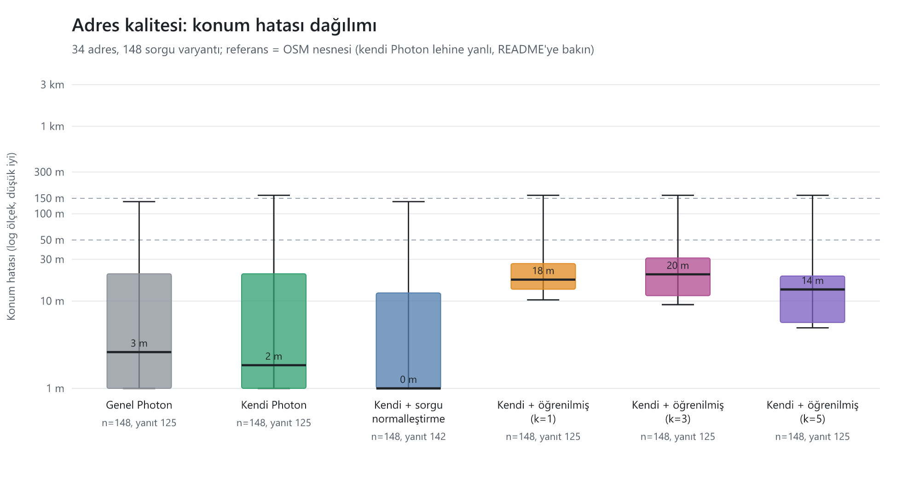

# Adres kalitesi testi (İterasyon 3a-8)

> Bu dosya `npm run geo:quality` ile üretilir; elle düzenlemeyin. `results.csv` zaman damgasızdır ve aynı girdiyle tekrar koşuda aynıdır.

## Ne ölçüldü

Eskişehir'de 34 kamuya açık yer / kurgusal kapı numarası (mahalle sokağı, işyeri, yurt, kampüs kapısı, site, AVM / kamu binası, mahalle adı) için 148 sorgu varyantı (temiz, kısaltma, Türkçe karakter katlama, yazım hatası, kat / daire ekli, işyeri adı). Gerçek müşteri verisi yoktur; `services/api/bench/geo-quality/addresses.json` yalnızca OSM yer adlarını ve OSM nesnelerinin koordinatlarını içerir.

| Yöntem | Açıklama |
|---|---|
| Genel Photon | `photon.komoot.io` (yalnızca bu ölçüm için, saniyede en çok 1 istek, tanımlayıcı User-Agent, yanıtlar `cache/public-photon.json` içinde önbellekli) |
| Kendi Photon | Eskişehir çıkarımından üretilmiş kendi dizinimiz (Photon 1.3.0, Nominatim 5.3.2 ile içe aktarım), API ile aynı sorgu biçimi (`limit`, `bbox`, `lat`, `lon`) |
| Kendi Photon + sorgu normalleştirme (API) | Aynı kendi Photon; sorgu API'deki `PhotonProvider` ile aynı normalleştirmeden geçirilir (`services/api/src/geo/query-normalize.ts`): `Mahallesi` / `Mah.` / `Mh.`, `No:`, `Kat:3 Daire:6` ekleri çıkarılır, `Sk.` / `Cad.` / `Blv.` açılır, BÜYÜK HARF girişi Türkçe küçük harfe çevrilir. **İterasyon 3a entegrasyonunda API'ye alındı** |
| Kendi Photon + öğrenilmiş nokta | **Simülasyon**: referans çevresinde k = 1, 3, 5 gözlem (sigma = 15 m Gauss, %10 aykırı 100-300 m, sabit tohum), ADR-0017 A ağırlıklı geometrik medyan (yer tutucu; 3b-1 gerçek fonksiyonu gelince değişecek). Öğrenilmiş nokta yalnızca kendi Photon'un ilk sonucu doğru yeri (<= 150 m) çözdüğünde devreye girer (yer anahtarı uyuşması varsayımı) |
| Google | Çalıştırılmadı: ücretli anahtar açılmaz (varsayılan kapalı). Anahtar verilirse `--google` ile çalışır (bu yol test edilmedi) |

Ölçütler: yanıt oranı; **medyan / P90 hata** (ilk sonuç ile referans arası, m); **<= 50 m / <= 150 m payı** (payda tüm sorgular, cevapsız = başarısız); öneri listesinde (ilk 5) <= 150 m olan sonuç payı; doğru mahalle oranı (yalnızca beklenen mahallesi bilinen adresler; OSM `district` / `locality` alanı); OSRM `nearest` ile yola oturma mesafesi.

## Sonuçlar

| Yöntem | Sorgu | Yanıt | Medyan hata | P90 hata | <= 50 m | <= 150 m | İlk-5 <= 150 m | Doğru mahalle | OSRM yola oturma (medyan) |
|---|---:|---:|---:|---:|---:|---:|---:|---:|---:|
| Genel Photon | 148 | %84 | 3 m | 138 m | %72 | %76 | %80 | %80 | 19 m |
| Kendi Photon | 148 | %84 | 2 m | 162 m | %71 | %75 | %80 | %81 | 19 m |
| Kendi Photon + sorgu normalleştirme (API) | 148 | %96 | 0 m | 138 m | %83 | %87 | %93 | %99 | 15 m |
| Kendi Photon + öğrenilmiş (k=1) | 148 | %84 | 18 m | 162 m | %72 | %75 | %80 | %81 | 10 m |
| Kendi Photon + öğrenilmiş (k=3) | 148 | %84 | 20 m | 162 m | %67 | %75 | %80 | %81 | 18 m |
| Kendi Photon + öğrenilmiş (k=5) | 148 | %84 | 14 m | 162 m | %75 | %75 | %80 | %81 | 14 m |
| Duyarlılık: k=3, sigma 30 m, %20 aykırı | 148 | %84 | 29 m | 191 m | %67 | %70 | %80 | %81 | 14 m |

### Kategoriye göre (yalnızca gerçek geocoder yöntemleri)

| Kategori | Genel Photon medyan / <= 150 m | Kendi Photon medyan / <= 150 m | Kendi Photon + sorgu normalleştirme (API) medyan / <= 150 m |
|---|---:|---:|---:|
| AVM / kamu binası | 6 m / %85 | 22 m / %81 | 22 m / %81 |
| işyeri | 0 m / %72 | 0 m / %78 | 0 m / %94 |
| kampüs kapısı | 72 m / %50 | 72 m / %50 | 72 m / %50 |
| mahalle adı | 0 m / %50 | 0 m / %50 | 0 m / %75 |
| mahalle sokağı | 0 m / %76 | 0 m / %76 | 0 m / %100 |
| site | 19 m / %33 | 19 m / %33 | 19 m / %33 |
| yurt | 11 m / %96 | 11 m / %89 | 11 m / %93 |

### Sorgu varyantına göre

| Varyant | Genel Photon medyan / <= 150 m | Kendi Photon medyan / <= 150 m | Kendi Photon + sorgu normalleştirme (API) medyan / <= 150 m |
|---|---:|---:|---:|
| abbr | 2 m / %85 | 0 m / %85 | 0 m / %92 |
| clean | 3 m / %89 | 3 m / %86 | 3 m / %86 |
| floor | - / %0 | - / %0 | 0 m / %100 |
| fold | 3 m / %82 | 2 m / %79 | 2 m / %82 |
| name | 0 m / %50 | 0 m / %75 | 0 m / %75 |
| typo | 3 m / %88 | 2 m / %85 | 2 m / %85 |

Varyant adları: `clean` temiz metin, `abbr` kısaltma (Mah. / Cd. / Sk. / Blv.), `fold` Türkçe karakter katlama (ı->i, ş->s ...), `typo` iki harf yer değiştirme, `floor` kat / daire ekli, `name` işyeri adı.

### Bilinen sorun: "Vişnelik" (A34)

Genel Photon'un "Vişnelik" mahallesini yanlış yere koyduğu gözlemlenmişti. Referans (OSM `place=suburb` düğümü): 39.76780, 30.50950.

**Kök neden:** sorguda `Mahallesi` / `Mah.` varsa Photon tüm belirteçlerin eşleşmesini ister; mahalle düğümünün adı yalnızca `Vişnelik` olduğu için elenir, adres alanında `Vişnelik Mahallesi` geçen **Özel Ümit Vişnelik Hastanesi** (yaklaşık 1 km uzakta) ilk sonuç olur. Sorunun kaynağı verinin yeri değil, kendi Photon'da da aynen görülen sorgu eşleşmesidir; yani kendi Photon bunu tek başına düzeltmez. Eki çıkaran sorgu temizleme (aşağıdaki satırlar) düzeltir. Photon `layer=district` filtresi ve eş anlamlı sözlük bunu çözmez (denendi): sözlük yalnızca terimleri birbirine eşler, `place` anahtarı sınıflandırma terimi olamaz.

| Yöntem | Sorgu | İlk sonuç | Hata | Ad |
|---|---|---|---:|---|
| Genel Photon | `Vişnelik Mahallesi Eskişehir` | 39.76237, 30.49964 | 1037 m | Özel Ümit Vişnelik Hastanesi |
| Kendi Photon | `Vişnelik Mahallesi Eskişehir` | 39.76237, 30.49964 | 1037 m | Özel Ümit Vişnelik Hastanesi |
| Kendi Photon + sorgu normalleştirme (API) | `Vişnelik Mahallesi Eskişehir` | 39.76758, 30.50631 | 274 m | Vişnelik |
| Genel Photon | `Vişnelik Mah.` | 39.76237, 30.49964 | 1037 m | Özel Ümit Vişnelik Hastanesi |
| Kendi Photon | `Vişnelik Mah.` | 39.76237, 30.49964 | 1037 m | Özel Ümit Vişnelik Hastanesi |
| Kendi Photon + sorgu normalleştirme (API) | `Vişnelik Mah.` | 39.76780, 30.50950 | 0 m | Vişnelik |
| Genel Photon | `visnelik` | 39.76780, 30.50950 | 0 m | Vişnelik |
| Kendi Photon | `visnelik` | 39.76780, 30.50950 | 0 m | Vişnelik |
| Kendi Photon + sorgu normalleştirme (API) | `visnelik` | 39.76780, 30.50950 | 0 m | Vişnelik |

## PLAN hedeflerinin durumu

| Hedef | Ölçülen | Durum |
|---|---|---|
| Kendi Photon medyan hatası <= genel Photon | kendi 2 m / genel 3 m | **TUTTU** |
| Yer tutucuyla 3 gözlem sonrası adreslerin >= %80'i <= 30 m | %88.3 (200 tohumlu deneme ortalaması; k=1: %77.0, k=5: %96.9; duyarlılık k=3, sigma 30 m, %20 aykırı: %45.2) | **TUTTU** |

## Dürüstlük notları ve yanlılık

- **Ev sahibi avantajı (yanlılık):** referans konumların hepsi (`referenceSource = OSM_OBJECT`) OSM nesnelerinden alındı. Kendi Photon aynı OSM verisinden üretildiği için, doğru nesneyi bulduğunda hatası yapısal olarak sıfıra yakındır; genel Photon aynı veriyi farklı bir tarihte, farklı bir içe aktarım ve sıralama ayarıyla sunar. Bu ölçüm "Photon'umuz OSM'deki nesneyi bulabiliyor mu" sorusunu yanıtlar, **"gerçek kapı konumunu bulabiliyor mu"** sorusunu yanıtlamaz. Saha ziyaretiyle işaretlenmiş referanslar (`OWNER_MARKED`) ürün sahibi tarafından eklenince bu yanlılık azalır; Google ile karşılaştırma da ancak o zaman anlamlıdır.
- **Öğrenilmiş nokta, OSM nesnesi referansına karşı Photon'u geçemez:** kendi Photon doğru nesneyi bulduğunda hata zaten ~0 m'dir; simüle gözlemler (sigma 15 m, aykırılar) ondan daha kötü çıkar. Bu yüzden öğrenilmiş satırlar tabloda Photon'dan kötü görünür; öğrenilmiş noktanın değeri, gerçek kapı konumunun OSM nesnesinden farklı olduğu yerlerde (`OWNER_MARKED` referanslar) ortaya çıkar. Yer tutucu bu testte "gözlemler ne çabuk ~30 m'ye yakınsıyor" sorusunun (hedef 2) cevabıdır.
- **Öğrenilmiş nokta simülasyondur:** gözlemler referansın kendisi etrafında üretildi; gerçek kuryeler "Teslim ettim"e basarken kapıdan uzakta olabilir (ADR-0017 "Sınırlar"). Yer tutucunun başarısı gerçek saha verisi gelene kadar bir **üst sınır** olarak okunmalıdır. Duyarlılık satırı (sigma 30 m, %20 aykırı) daha kötü bir durumu gösterir.
- **İlçe (Odunpazarı / Tepebaşı) doğruluğu ölçülemedi:** OSM çıkarımında ilçe sınırı yalnızca çizgi olarak var (idari ilişki yok), bu yüzden Photon sonuçlarında `county` alanı boş. Belirsizlik, ilçe adı sorguda olmasa da konum hatasıyla (yanlış ilçedeki aynı adlı sokak, yüzlerce metre ile kilometre hata) görünür; ayrı bir "doğru ilçe" ölçütü yoktur.
- **Dizin yeniden derlemesi küçük gürültü ekler:** aynı OSM nesnesinin hem düğümü hem bina çokgeni dizinde varsa (ör. A04 polis merkezi) eşit puanlı yinelenenler arasındaki seçim, dizin her yeniden üretildiğinde değişebilir (birkaç metre fark; altın set isabeti değişmez). Aynı dizinle tekrar koşuda sonuçlar baytça aynıdır.
- Örneklem küçüktür (34 adres); yüzdeler yaklaşıktır, küçük farklar anlamlı değildir.
- Süre (gecikme) ölçümü bu raporda yok (tekrar üretilebilirlik için); yazarken arama gecikmesi altın set çalıştırıcısında ölçülür (`infra/geocoder/golden.mjs`).

## API'de uygulandı: sorgu normalleştirme (İterasyon 3a entegrasyonu)

`PhotonProvider.autocomplete` artık sorguyu `normalizeGeoQuery` (`services/api/src/geo/query-normalize.ts`) ile normalleştirip Photon'a öyle gönderir; kullanıcıya gösterilen metin ve `placeId` içindeki adres Photon'un döndürdüğü metindir, değişmez. Önce / sonra (aynı Photon dizini, aynı 148 sorgu; "önce" = `Kendi Photon` satırı, "sonra" = `sorgu normalleştirme (API)` satırı): yanıt oranı %84.5 -> %95.9, <= 50 m payı %70.9 -> %83.1, <= 150 m payı %75.0 -> %87.2, doğru mahalle %81.1 -> %98.9.

**Dürüstlük:** İterasyon 3a-8'in ilk ölçümünde "önce" %74'tü ve normalleştirme ~%86'ya çıkarıyordu; entegrasyonda Photon dizini yeniden üretildiği için (aynı PBF, ama eşit puanlı yinelenenler arasındaki seçim değişiyor; aşağıdaki not) taban çizgisi bu koşuda daha düşüktür, kazanç (yüzde puanı) benzerdir. Kalan <= 50 m kaçakları sokak ekleriyle ilgisizdir: site / kampüs kapıları, belediye binaları ve işyeri adı sorguları (yer adı kısaltması, birden çok eşit puanlı nesne).

## ADR-0017 sabitlerine öneri

- Doğrulanmış adres noktası (öğrenilmiş) kullanımı için **yer anahtarı** olarak Photon `osm_type + osm_id` yerine **normalleştirilmiş adres metni + yaklaşık konum kümesi** önerilir: hata dağılımında (yukarıdaki `typo` / `fold` varyantları) aynı yerin farklı yazımları farklı nesnelere çözülebiliyor; yalnızca `osm_id` anahtarı bu durumda öğrenilmiş noktayı kaçırır.
- Aykırı eşiği: simülasyonda %10 aykırı (100-300 m) ağırlıklı geometrik medyanla k >= 3'te büyük ölçüde sönümleniyor; k = 1'de tek aykırı gözlem doğrudan hata olur. Bu yüzden ilk gözlemde noktayı "kesin" saymamak (Photon konumu ile birlikte göstermek) önerilir; k >= 3'ten sonra öğrenilmiş noktayı varsayılan yapmak.
- Gerçek veriyle yeniden ölçüm: pilotta ilk iki haftanın "Teslim ettim" konumları (KVKK onayından sonra, ADR-0017) bu testin simülasyon parametrelerini (sigma, aykırı oranı) gerçek değerlerle değiştirmek için kullanılmalıdır.
