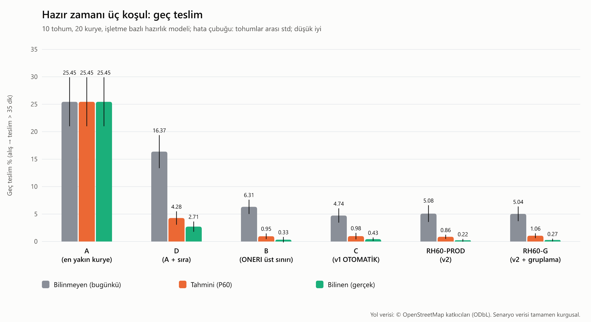
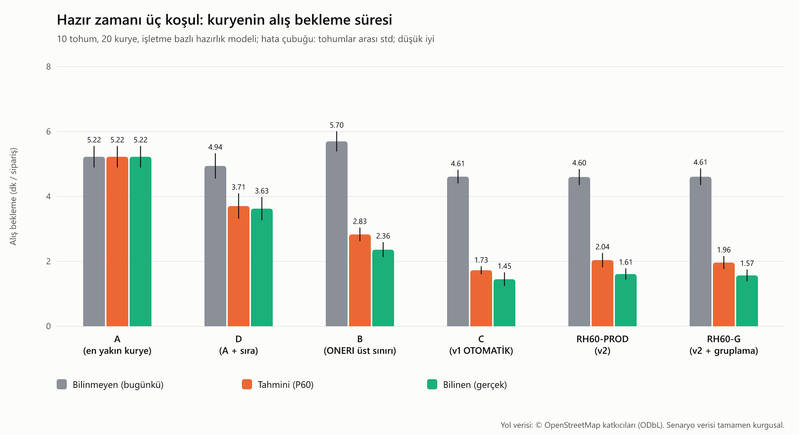

## Hazır zamanı: üç koşul (İterasyon 3b-2)

Hazır zamanının stratejilere nasıl bildirildiği üç koşulda karşılaştırılır; aynı gün, aynı tohum, aynı matris (10 tohum, varsayılan gün ~400 sipariş). Hazırlık süresi bu koşuda **işletme bazlı** modelle üretilir (`--prep business`): işletme medyanı U(6, 16) dk, tepe saatlerde × 1,2, lognormal σ = 0,35, [3, 30] dk kırpma. Varsayılan tablolar (yukarıdaki) bugünkü, işletmeden bağımsız 5-20 dk üreteciyle üretilmeye devam eder ve **değişmez**.

- **Bilinmeyen:** hazır anı stratejiye bildirilmez; kurye gelir ve hazır olana kadar bekler (bugünkü durum).
- **Tahmini:** `readyAt` = sipariş girişi + işletme × gün dilimi (tepe / tepe dışı) **P60** hazırlık süresi. Tahmin 14 eğitim gününden (tohum 1001-1014, rapor tohumları 1-10 ile ayrık) öğrenilir; bir kovada 10'dan az gözlem varsa kiracı varsayılanı 12 dk kullanılır. Stratejiler tahmini gerçek gibi kullanır; kurye gerçek hazır anına kadar bekler.
- **Bilinen:** `readyAt` = gerçek hazır anı.

Her hücre 10 tohumun ortalaması ± standart sapmasıdır.

| Strateji | Koşul | Geç teslim (%) | Alış bekleme (dk/sipariş) | Toplam km | Teslimat süresi (dk) | Aynı işletme aynı kuryede (%) |
|---|---|---:|---:|---:|---:|---:|
| **A (en yakın kurye)** | Bilinmeyen (bugünkü) | 25.45 ± 4.46 | 5.22 ± 0.33 | 1918.38 ± 116.72 | 43.68 ± 1.30 | 46.67 ± 6.16 |
| **A (en yakın kurye)** | Tahmini (P60) | 25.45 ± 4.46 | 5.22 ± 0.33 | 1918.38 ± 116.72 | 43.68 ± 1.30 | 46.67 ± 6.16 |
| **A (en yakın kurye)** | Bilinen (gerçek) | 25.45 ± 4.46 | 5.22 ± 0.33 | 1918.38 ± 116.72 | 43.68 ± 1.30 | 46.67 ± 6.16 |
| **D (A + sıra)** | Bilinmeyen (bugünkü) | 16.37 ± 3.02 | 4.94 ± 0.39 | 1673.52 ± 120.21 | 40.28 ± 1.01 | 47.57 ± 9.63 |
| **D (A + sıra)** | Tahmini (P60) | 4.28 ± 1.21 | 3.71 ± 0.39 | 1727.91 ± 127.06 | 35.04 ± 0.95 | 49.79 ± 8.10 |
| **D (A + sıra)** | Bilinen (gerçek) | 2.71 ± 0.94 | 3.63 ± 0.36 | 1716.10 ± 115.26 | 33.75 ± 0.70 | 50.52 ± 9.42 |
| **B (ONERI üst sınırı)** | Bilinmeyen (bugünkü) | 6.31 ± 1.30 | 5.70 ± 0.31 | 1308.21 ± 73.18 | 32.12 ± 0.51 | 46.87 ± 11.22 |
| **B (ONERI üst sınırı)** | Tahmini (P60) | 0.95 ± 0.51 | 2.83 ± 0.21 | 1853.31 ± 83.14 | 28.63 ± 0.48 | 29.91 ± 11.27 |
| **B (ONERI üst sınırı)** | Bilinen (gerçek) | 0.33 ± 0.49 | 2.36 ± 0.23 | 1823.37 ± 83.81 | 26.89 ± 0.58 | 28.06 ± 10.56 |
| **C (v1 OTOMATİK)** | Bilinmeyen (bugünkü) | 4.74 ± 1.30 | 4.61 ± 0.21 | 1311.81 ± 65.38 | 31.58 ± 0.49 | 60.49 ± 16.27 |
| **C (v1 OTOMATİK)** | Tahmini (P60) | 0.98 ± 0.59 | 1.73 ± 0.12 | 1711.76 ± 73.95 | 29.56 ± 0.54 | 42.19 ± 18.06 |
| **C (v1 OTOMATİK)** | Bilinen (gerçek) | 0.43 ± 0.30 | 1.45 ± 0.21 | 1719.04 ± 76.61 | 27.17 ± 0.33 | 39.98 ± 7.51 |
| **RH60-PROD (v2)** | Bilinmeyen (bugünkü) | 5.08 ± 1.52 | 4.60 ± 0.25 | 1307.41 ± 73.98 | 30.55 ± 0.75 | 72.67 ± 7.76 |
| **RH60-PROD (v2)** | Tahmini (P60) | 0.86 ± 0.38 | 2.04 ± 0.22 | 1652.94 ± 69.77 | 28.42 ± 0.32 | 51.52 ± 11.40 |
| **RH60-PROD (v2)** | Bilinen (gerçek) | 0.22 ± 0.25 | 1.61 ± 0.17 | 1658.53 ± 77.87 | 26.23 ± 0.29 | 53.36 ± 9.01 |
| **RH60-G (v2 + gruplama)** | Bilinmeyen (bugünkü) | 5.04 ± 1.33 | 4.61 ± 0.26 | 1318.06 ± 71.99 | 30.74 ± 0.54 | 74.53 ± 8.16 |
| **RH60-G (v2 + gruplama)** | Tahmini (P60) | 1.06 ± 0.44 | 1.96 ± 0.20 | 1649.27 ± 78.48 | 28.61 ± 0.47 | 44.28 ± 12.94 |
| **RH60-G (v2 + gruplama)** | Bilinen (gerçek) | 0.27 ± 0.24 | 1.57 ± 0.18 | 1660.89 ± 71.68 | 26.30 ± 0.40 | 52.00 ± 10.97 |

**Bilinmeyen koşuya göre eşleştirilmiş fark** (aynı tohum), ortalama [%95 GA, t dağılımı, sd = 9]; ✱ = aralık 0'ı içermiyor. Negatif geç teslim ve bekleme iyidir.

| Strateji | Karşılaştırma | Geç teslim (%) | Alış bekleme (dk/sipariş) | Toplam km | Teslimat süresi (dk) |
|---|---|---:|---:|---:|---:|
| **A (en yakın kurye)** | Tahmini (P60) − Bilinmeyen (bugünkü) | +0.00 [0.00, 0.00] | +0.00 [0.00, 0.00] | +0.00 [0.00, 0.00] | +0.00 [0.00, 0.00] |
| **A (en yakın kurye)** | Bilinen (gerçek) − Bilinmeyen (bugünkü) | +0.00 [0.00, 0.00] | +0.00 [0.00, 0.00] | +0.00 [0.00, 0.00] | +0.00 [0.00, 0.00] |
| **D (A + sıra)** | Tahmini (P60) − Bilinmeyen (bugünkü) | -12.10 [-14.57, -9.63] ✱ | -1.24 [-1.47, -1.00] ✱ | +54.40 [15.17, 93.62] ✱ | -5.24 [-6.04, -4.43] ✱ |
| **D (A + sıra)** | Bilinen (gerçek) − Bilinmeyen (bugünkü) | -13.66 [-15.75, -11.58] ✱ | -1.32 [-1.52, -1.11] ✱ | +42.58 [11.41, 73.76] ✱ | -6.53 [-7.20, -5.87] ✱ |
| **B (ONERI üst sınırı)** | Tahmini (P60) − Bilinmeyen (bugünkü) | -5.36 [-6.28, -4.43] ✱ | -2.87 [-3.02, -2.72] ✱ | +545.09 [526.78, 563.41] ✱ | -3.49 [-4.07, -2.90] ✱ |
| **B (ONERI üst sınırı)** | Bilinen (gerçek) − Bilinmeyen (bugünkü) | -5.98 [-7.07, -4.89] ✱ | -3.34 [-3.50, -3.17] ✱ | +515.15 [492.22, 538.08] ✱ | -5.23 [-5.77, -4.69] ✱ |
| **C (v1 OTOMATİK)** | Tahmini (P60) − Bilinmeyen (bugünkü) | -3.76 [-4.76, -2.76] ✱ | -2.88 [-2.96, -2.81] ✱ | +399.94 [370.17, 429.72] ✱ | -2.02 [-2.30, -1.74] ✱ |
| **C (v1 OTOMATİK)** | Bilinen (gerçek) − Bilinmeyen (bugünkü) | -4.31 [-5.28, -3.34] ✱ | -3.16 [-3.31, -3.02] ✱ | +407.23 [389.18, 425.27] ✱ | -4.41 [-4.90, -3.91] ✱ |
| **RH60-PROD (v2)** | Tahmini (P60) − Bilinmeyen (bugünkü) | -4.23 [-5.14, -3.32] ✱ | -2.56 [-2.75, -2.38] ✱ | +345.53 [319.49, 371.58] ✱ | -2.13 [-2.60, -1.66] ✱ |
| **RH60-PROD (v2)** | Bilinen (gerçek) − Bilinmeyen (bugünkü) | -4.86 [-5.90, -3.82] ✱ | -2.99 [-3.14, -2.84] ✱ | +351.12 [325.88, 376.36] ✱ | -4.32 [-4.86, -3.77] ✱ |
| **RH60-G (v2 + gruplama)** | Tahmini (P60) − Bilinmeyen (bugünkü) | -3.98 [-4.87, -3.09] ✱ | -2.64 [-2.84, -2.45] ✱ | +331.21 [304.21, 358.20] ✱ | -2.13 [-2.64, -1.62] ✱ |
| **RH60-G (v2 + gruplama)** | Bilinen (gerçek) − Bilinmeyen (bugünkü) | -4.76 [-5.74, -3.78] ✱ | -3.04 [-3.18, -2.91] ✱ | +342.83 [316.01, 369.65] ✱ | -4.45 [-5.00, -3.89] ✱ |

**Tahminin kapattığı fark:** tahmini koşuyla bilinen koşu arasında kalan fark (tahmini − bilinen) ve bilinmeyenden bilinene toplam iyileşmenin ne kadarını tahmin yakaladığı:

| Strateji | Geç teslim: tahmini − bilinen (puan) | Alış bekleme: tahmini − bilinen (dk) | Bekleme iyileşmesinin yakalanan payı |
|---|---:|---:|---:|
| **A (en yakın kurye)** | 0.00 | 0.00 | - |
| **D (A + sıra)** | 1.57 | 0.08 | %94 |
| **B (ONERI üst sınırı)** | 0.62 | 0.47 | %86 |
| **C (v1 OTOMATİK)** | 0.55 | 0.28 | %91 |
| **RH60-PROD (v2)** | 0.63 | 0.43 | %86 |
| **RH60-G (v2 + gruplama)** | 0.79 | 0.40 | %87 |

**Tahmin hatası (MAE):** gerçek hazırlık süresi ile tahmin arasındaki ortalama mutlak hata, rapor günlerindeki tüm siparişler üzerinden.

| Tahmin | MAE (dk) |
|---|---:|
| İşletme × gün dilimi P60 (14 eğitim günü) | 3.57 |
| Kiracı varsayılanı (sabit 12 dk) | 4.44 |
| İşletme × gün dilimi P50 (bilgi amaçlı; stratejilere verilmez) | 3.45 |
| P60'ın varsayılana göre farkı | -19.8% |
| P50'nin varsayılana göre farkı | -22.3% |

SPEC §15.1 3b-2 (b): ≥ 10 gözlemli işletmede MAE'nin işletme varsayılanından en az %20 düşük olması beklenir; bu sentetik veride P60 için karşılanmadı (-19.8%), P50 için karşılandı (-22.3%; MAE'yi en aza indiren tahmin medyandır, P60 ise bilinçli olarak biraz yüksek tahmin eder: kurye hazır olmadan gelmesin) (kovaların 80/80'i ≥ 10 gözlemli). Hazırlık süresi bu senaryoda yalnızca işletmeye ve tepe saate bağlıdır; gerçek hayatta hazırlık günlük dalgalanmaya, sipariş içeriğine ve yoğunluğa da bağlıdır, bu yüzden pilot verisiyle (`GET /metrics/preparation`) doğrulanmalıdır.

Sentetik senaryodur; bulgular pilotla doğrulanır. Tahmin yalnızca işletmeye göre değişen hazırlığı yakalar, günlük dalgalanmayı yakalayamaz; bu yüzden "bilinen" koşuya hiçbir zaman ulaşmaması beklenir.
