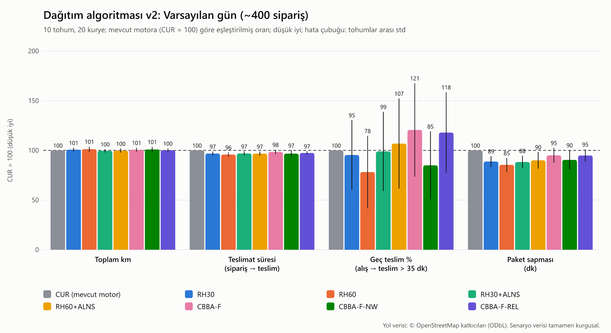
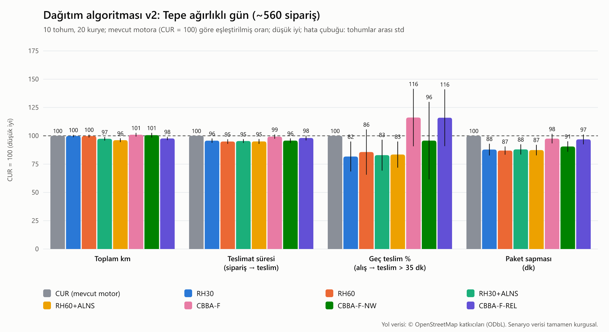
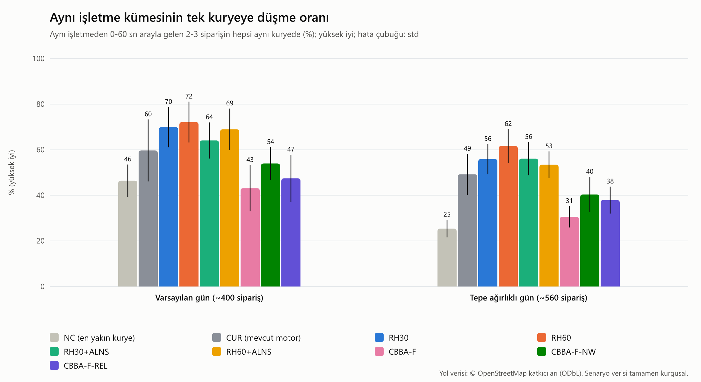
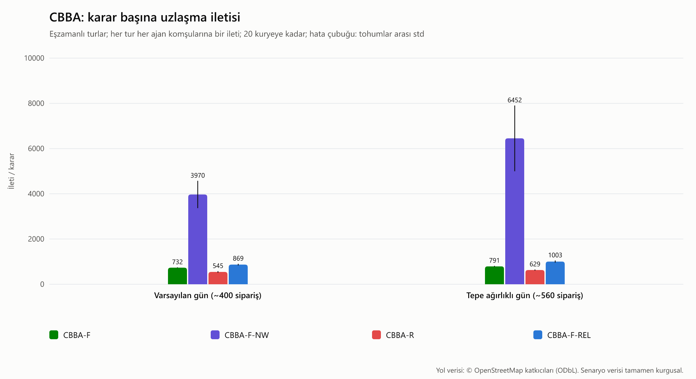

# Benchmark v2: dağıtım algoritması v2 (kayan ufuk, ALNS, CBBA)

> Bu rapor `npm run benchmark:v2` ile üretilir (tek komut). `results.csv` tohumlu ve duvar saatinden bağımsızdır: iki koşu bayt düzeyinde aynı dosyayı üretir. Hesaplama süreleri (`timing.csv`) makineye bağlıdır. Tasarım ve gerekçe: DAGITIM-ALGORITMASI-V2.md.





## Yorum ve öneri

Sayılar aşağıdaki tablolardandır (tohum 1-10; fark = CUR'a göre eşleştirilmiş ortalama, ✱ = %95 güven aralığı 0'ı içermiyor). Bu bölüm elle yazılır (`bench/v2/yorum.md`); tablolar ve grafikler betikle üretilir.

**1. Kayan ufuk (RH) tek başına güvenli ve tutarlı bir iyileşme.** RH60, mevcut motora göre teslimat süresini varsayılan günde −1,16 dk ✱, tepe gününde −1,55 dk ✱ kısaltır; paket sapması −1,0 / −1,1 dk ✱; aynı işletme kümesi aynı kuryede oranı +12,5 / +12,4 puan ✱ (%59,7 → %72,1; %49,2 → %61,6). Geç teslim tepe gününde −0,74 puan ✱ (%4,87 → %4,12), varsayılan günde −0,64 puan (anlamlı değil). Bedeli: km'de anlamlı fark yok (+%1,2 / −%0,2). Pencere 15 → 60 sn uzadıkça gruplama artar; 0-60 sn arayla gelen kümeler aynı pencereye düşer.

**2. Gecikmeli atama gerekli.** Aynı RH30 gecikmeli atama kapalıyken (RH30-NH) tepe gününde km +%1,28 ✱ kötüleşir, gruplama kazancı kaybolur (+0,9 / −0,7 puan) ve geç teslim kazancı anlamsızlaşır. Kazancın büyük kısmı "kötü kuryeye hemen verme, 1-3 dk bekle" kuralından gelir; hazırlık süresi 5-20 dk olduğundan bu bekleme çoğu zaman bedavadır.

**3. Regret-3 ile Macar eşleştirmesi arasında anlamlı fark yok** (RH30 ↔ RH30-M: tüm ölçütlerde güven aralıkları örtüşür). Regret-k önerilir: aynı işletme birimlerini ve kurye başına birden çok atamayı doğal olarak taşır, ADR-0014 ile aynı ailededir ve açıklanabilirdir.

**4. ALNS yalnızca yoğunlukta km kazandırıyor.** RH60+ALNS tepe gününde toplam km'yi −%3,88 ✱ ([−5,09; −2,67]) azaltır; teslimat süresi −1,52 dk ✱, geç teslim −0,87 puan ✱ (%4,87 → %3,99). Varsayılan günde km farkı −%0,2 (anlamsız), geç teslim değişmez. Bedeli: 100 pakette 2,7 (varsayılan) / 5,0 (tepe) yeniden atama, yani kuryeye "paket rotandan çıkarıldı" bildirimi. Ayar tohumlarında 1000 yineleme 250 yinelemeyle aynı sonucu verdi (km farkı < %0,1): darboğaz arama bütçesi değil, kararlılık sınırlarıdır (paket başına 1 taşıma, alışa 5 dk kala dondurma, 150 sn taşıma eşiği). Taşıma eşiği 60 sn'ye indirildiğinde yeniden atama iki katına çıktı, km ise yalnızca tepe gününde %0,6 daha azaldı (varsayılan günde değişmedi).

**5. Shaw yıkımı gruplamayı artırmadı.** Beklentinin aksine ALNS eklemek aynı işletme oranını RH'ye göre biraz düşürdü (RH30 %69,9 → %64,1; RH60 %72,1 → %69,0; tepe gününde RH60 %61,6 → %53,4). Amaç yalnızca süreyi ödüllendirir; ALNS bazen kümeyi bölerek toplam süreyi kısaltır. Gruplama ayrı bir hedefse amaca açık bir "aynı işletme" terimi gerekir (İterasyon 3b-3 κ ödülü).

**6. CBBA: merkeziyetsiz taban çizgisi bu alanda kaybediyor, nedeni öğretici.** Tam bağlı CBBA (CBBA-F) km ve süre olarak CUR'a yakın kalır (km +%0,7 / +%1,0, anlamsız) ama aynı işletme oranı −16,6 / −18,7 puan ✱ düşer ve geç teslim tepe gününde +0,82 puan kötüleşir. Neden: yakınsama için uygulanan **teklif bükme** (bid warping) teklifi demetteki son teklifle sınırlar; aynı işletmenin ikinci siparişi ilkinden ucuzdur (pozitif sinerji, DMG ihlali), ama bu ucuzluk teklife yansıyamaz. Teklif bükme kapatılınca (CBBA-F-NW) gruplama kısmen geri gelir (%43 → %54; %31 → %40), teslimat süresi CUR'dan −0,9 / −1,3 dk ✱ iyi olur, varsayılan günde geç teslimde en iyi ikinci yöntemdir (%2,12) — ama kararların %4,4 / %7,5'i 200 tur sınırında **yakınsamaz**, karar başına ileti 5-8 kat artar (~4.000-6.500) ve p95 süre 255 ms'ye çıkar. Bu, Johnson ve ark.'nın tarif ettiği ödünleşimin sahadaki karşılığıdır.

**7. CBBA iletişim maliyeti ve sınırlı menzil.** CBBA-F karar başına ortalama 2,2 turda (en çok 6-7) yakınsar ve ~730-790 ileti (sipariş başına ~500) kullanır; merkezi motor için bu sayı sıfırdır. 2 km menzilde (CBBA-R) iletişim grafiği ortalama 1,6-1,7 bileşene bölünür; ileti %20-25 azalır ama tur iki katına çıkar (4,8) ve günde ~230-250 görev **birden çok kuryenin demetinde kalır**: merkezi bir kayıt sunucusu olmadan aynı paket iki kuryeye gitmiş olurdu. Merkeziyetsizliğin bu alandaki tek gerçek gerekçesi (sunucusuz çalışma) bu yüzden geçerli değildir.

**8. CBBA'da görevleri serbest bırakmak (CBBA-F-REL)** tepe gününde km'yi ALNS'ye yakın düşürür (−%2,35 ✱) ama 100 pakette 17,6 yeniden atama (ALNS'nin 3,5 katı), daha kötü geç teslim (+0,64 puan) ve gruplama (−11,3 puan ✱) ile. Sınırsız yeniden açık artırma, kararlılık kuralları olmadan kurye güvenini bozacak düzeyde oynaklık üretir.

**9. Hesaplama süresi bütçe içinde.** RH pencere kararları p95 ~2 ms; ALNS'li kararlar p95 77-140 ms, en çok ~300 ms (bütçe 300 ms; üretimde ayrıca süre sınırı); CBBA-F p95 7-9 ms (merkezde simüle edildiğinde; gerçek ağ gecikmesi tur başına eklenir). Bu süreler matris önbelleğiyle saf CPU'dur; üretimde filonun tamamı için bir OSRM `table` çağrısı eklenir.

**10. Faz 2 üretim yolu (RH60-PROD) Faz 1 ile birebir aynı.** Kararları üretimin çağırdığı `RoutingEngine.planDispatch` (DISPATCH_V2, kiracı varsayılanları 60 sn / 7 dk / 3 dk) ile veren RH60-PROD, iki senaryoda 140'ar değerin hiçbirinde RH60'tan ayrılmaz (fark 0,00): üretim kodu Faz 1 algoritmasının kopyası değil, aynı saf modüllerdir; yukarıdaki RH60 kazançları üretim yoluna aynen geçer. Gölge ALNS (uygulanmaz) en az bir kez taşımayı önerdiği farklı paket sayısında 100 siparişte 2,4 (varsayılan) / 6,7 (tepe) ve taşıma başına ~250-290 sn tahmini kazanç gösterir; bu, RH60+ALNS'nin gerçek yeniden atama sayılarıyla (2,7 / 5,0) aynı büyüklüktedir. Gölge koşu süresi p95 ~150 ms; tek tük koşular süre sınırını bir yineleme kadar aşar (en çok ~400-540 ms), bu yüzden ALNS gerçek kipe alınırken yineleme içi süre denetimi sıkılaştırılmalıdır. Pilotta aynı ölçümler `GET /metrics/dispatch-v2` ile izlenir.

**Öneri (Faz 2):** (a) **RH + gecikmeli atama + regret-3**, W = 60 sn (kiracı ayarı 30-60), sapma eşiği 7 dk, en çok 3 dk bekletme: `DISPATCH_V2` bayrağı arkasında, OTOMATİK modda CUR'un yerine; (b) **ALNS** ayrı bayrakla (`DISPATCH_V2_ALNS`), önce gölge kipte (hesapla, kaydet, uygulama) ve sonra yalnızca yoğunlukta (bekleyen + atanmış alınmamış paket sayısı eşiği) açık; 250 yineleme + 300 ms süre sınırı, taşıma eşiği 150 sn, paket başına 1 taşıma, alışa 5 dk kala dondurma; (c) **CBBA üretime alınmaz**, araştırma taban çizgisi olarak benchmark'ta kalır; (d) eşleştirme kipi gerekmez. Sınırlamalar: sentetik senaryo, 10 tohum (gruplama ölçütünün std'si yüksek), hazırlık anı bilinmiyor, sürücü davranışı yok; pilotta önce gölge kip ve A/B karşılaştırması gerekir.

**11. Aynı işletme gruplaması (İterasyon 3b-3).** Ayrı raporda: [gruplama.md](gruplama.md) (30 tohum, ablation, kabul kriterleri). Gerçek etki RH60-PROD'a göre okunmalıdır (NC'ye göre +33 puan v2'nin kendisindendir): spec varsayılanlarıyla (RH60-G) fark anlamsız (+1,4 [-1,1; 4,0] / -1,2 [-3,3; 0,9] puan); τ = 0,10 gruplamayı azaltır, κ ve sonradan bağlama artırır; önerilen değerlerle (RH60-G-T) +7,8 / +9,5 puan ✱ (%82,2 / %69,9). Tepe günde mutlak %75 karşılanmadı.

## Sonuçlar: Varsayılan gün (~400 sipariş)

Her hücre 10 tohumun ortalaması ± standart sapmasıdır.

| Yöntem | Toplam km | Ort. teslimat süresi (sipariş → teslim, dk) | Ort. alış → teslim (dk) | Geç teslim (alış → teslim > 35 dk, %) | Ort. paket sapması (dk) | Aynı işletme kümesi aynı kuryede (%) | Yeniden atama (100 paket başına) |
|---|---:|---:|---:|---:|---:|---:|---:|
| **NC** | 1886.15 ± 112.55 | 38.61 ± 1.10 | 23.91 ± 0.94 | 19.91 ± 2.09 | 18.56 ± 0.91 | 46.41 ± 7.12 | 0.00 ± 0.00 |
| **CUR** | 1317.79 ± 72.06 | 27.52 ± 0.52 | 12.14 ± 0.40 | 2.66 ± 0.70 | 6.79 ± 0.40 | 59.69 ± 13.61 | 0.00 ± 0.00 |
| **RH15** | 1334.88 ± 70.03 | 26.82 ± 0.62 | 11.42 ± 0.50 | 2.59 ± 1.01 | 6.06 ± 0.47 | 65.16 ± 10.02 | 0.00 ± 0.00 |
| **RH30** | 1327.62 ± 70.89 | 26.65 ± 0.50 | 11.37 ± 0.36 | 2.45 ± 1.03 | 6.02 ± 0.34 | 69.89 ± 8.85 | 0.00 ± 0.00 |
| **RH60** | 1332.98 ± 66.08 | 26.37 ± 0.76 | 11.15 ± 0.49 | 2.01 ± 0.96 | 5.79 ± 0.47 | 72.14 ± 8.93 | 0.00 ± 0.00 |
| **RH30-M** | 1333.05 ± 70.46 | 26.43 ± 0.62 | 11.23 ± 0.45 | 2.48 ± 0.68 | 5.87 ± 0.44 | 64.12 ± 8.08 | 0.00 ± 0.00 |
| **RH30-NH** | 1322.83 ± 58.10 | 26.87 ± 0.79 | 11.76 ± 0.67 | 2.63 ± 0.99 | 6.40 ± 0.64 | 60.60 ± 11.75 | 0.00 ± 0.00 |
| **RH30+ALNS** | 1312.50 ± 71.03 | 26.68 ± 0.69 | 11.34 ± 0.46 | 2.56 ± 1.20 | 5.98 ± 0.43 | 64.08 ± 7.93 | 2.40 ± 0.78 |
| **RH60+ALNS** | 1314.58 ± 63.58 | 26.63 ± 0.71 | 11.45 ± 0.55 | 2.66 ± 0.98 | 6.10 ± 0.55 | 68.98 ± 9.10 | 2.71 ± 0.83 |
| **CBBA-F** | 1325.79 ± 61.75 | 27.09 ± 0.75 | 11.80 ± 0.58 | 3.00 ± 0.73 | 6.45 ± 0.56 | 43.14 ± 10.12 | 0.00 ± 0.00 |
| **CBBA-F-NW** | 1329.78 ± 54.05 | 26.63 ± 0.85 | 11.48 ± 0.67 | 2.12 ± 0.72 | 6.13 ± 0.64 | 53.97 ± 7.18 | 0.00 ± 0.00 |
| **CBBA-R** | 1330.14 ± 56.80 | 26.70 ± 0.66 | 11.64 ± 0.51 | 2.71 ± 0.57 | 6.28 ± 0.48 | 42.39 ± 9.82 | 0.00 ± 0.00 |
| **CBBA-F-REL** | 1319.50 ± 62.32 | 26.81 ± 0.58 | 11.79 ± 0.42 | 2.96 ± 0.75 | 6.43 ± 0.40 | 47.46 ± 10.35 | 10.23 ± 2.65 |
| **RH60-PROD** | 1332.98 ± 66.08 | 26.37 ± 0.76 | 11.15 ± 0.49 | 2.01 ± 0.96 | 5.79 ± 0.47 | 72.14 ± 8.93 | 0.00 ± 0.00 |

**Mevcut motora (CUR) göre eşleştirilmiş fark**, ortalama [%95 güven aralığı, t dağılımı]; ✱ = aralık 0'ı içermiyor. Negatif km / süre / geç teslim iyidir; aynı işletme oranında pozitif iyidir.

| Yöntem − CUR | Toplam km (%) | Teslimat süresi (dk) | Geç teslim (puan) | Paket sapması (dk) | Aynı işletme aynı kuryede (puan) |
|---|---:|---:|---:|---:|---:|
| **RH15** | +1.33% [-0.40, 3.07] | -0.71 [-1.05, -0.36] ✱ | -0.07 [-0.72, 0.59] | -0.73 [-1.01, -0.45] ✱ | +5.47 [-4.37, 15.30] |
| **RH30** | +0.77% [-0.55, 2.09] | -0.87 [-1.27, -0.47] ✱ | -0.20 [-0.96, 0.56] | -0.77 [-1.05, -0.49] ✱ | +10.20 [0.47, 19.93] ✱ |
| **RH60** | +1.21% [-0.70, 3.12] | -1.16 [-1.59, -0.73] ✱ | -0.64 [-1.36, 0.08] | -1.00 [-1.35, -0.64] ✱ | +12.45 [1.04, 23.86] ✱ |
| **RH30-M** | +1.18% [-0.21, 2.58] | -1.09 [-1.37, -0.81] ✱ | -0.17 [-0.70, 0.35] | -0.91 [-1.19, -0.64] ✱ | +4.43 [-6.74, 15.60] |
| **RH30-NH** | +0.46% [-1.37, 2.29] | -0.66 [-1.18, -0.14] ✱ | -0.03 [-0.82, 0.76] | -0.38 [-0.86, 0.09] | +0.91 [-9.44, 11.26] |
| **RH30+ALNS** | -0.39% [-1.53, 0.75] | -0.84 [-1.25, -0.44] ✱ | -0.10 [-0.95, 0.76] | -0.80 [-1.12, -0.48] ✱ | +4.39 [-4.05, 12.82] |
| **RH60+ALNS** | -0.20% [-1.61, 1.22] | -0.90 [-1.31, -0.49] ✱ | +0.00 [-0.88, 0.89] | -0.69 [-1.11, -0.28] ✱ | +9.29 [-3.96, 22.53] |
| **CBBA-F** | +0.66% [-0.78, 2.10] | -0.43 [-0.87, 0.01] | +0.34 [-0.38, 1.07] | -0.34 [-0.71, 0.02] | -16.55 [-27.92, -5.18] ✱ |
| **CBBA-F-NW** | +1.00% [-0.86, 2.86] | -0.90 [-1.52, -0.27] ✱ | -0.54 [-1.30, 0.23] | -0.66 [-1.14, -0.18] ✱ | -5.72 [-15.81, 4.38] |
| **CBBA-R** | +1.02% [-0.79, 2.83] | -0.82 [-1.35, -0.30] ✱ | +0.05 [-0.60, 0.71] | -0.51 [-0.90, -0.11] ✱ | -17.30 [-28.19, -6.42] ✱ |
| **CBBA-F-REL** | +0.18% [-1.08, 1.44] | -0.72 [-1.06, -0.37] ✱ | +0.30 [-0.40, 1.00] | -0.36 [-0.66, -0.06] ✱ | -12.23 [-23.11, -1.36] ✱ |
| **RH60-PROD** | +1.21% [-0.70, 3.12] | -1.16 [-1.59, -0.73] ✱ | -0.64 [-1.36, 0.08] | -1.00 [-1.35, -0.64] ✱ | +12.45 [1.04, 23.86] ✱ |

## Sonuçlar: Tepe ağırlıklı gün (~560 sipariş)

Her hücre 10 tohumun ortalaması ± standart sapmasıdır.

| Yöntem | Toplam km | Ort. teslimat süresi (sipariş → teslim, dk) | Ort. alış → teslim (dk) | Geç teslim (alış → teslim > 35 dk, %) | Ort. paket sapması (dk) | Aynı işletme kümesi aynı kuryede (%) | Yeniden atama (100 paket başına) |
|---|---:|---:|---:|---:|---:|---:|---:|
| **NC** | 2977.73 ± 284.62 | 48.04 ± 3.19 | 30.02 ± 1.33 | 39.92 ± 3.67 | 24.63 ± 1.29 | 25.40 ± 3.84 | 0.00 ± 0.00 |
| **CUR** | 1712.33 ± 106.08 | 30.21 ± 1.37 | 13.98 ± 0.84 | 4.87 ± 1.19 | 8.60 ± 0.79 | 49.23 ± 9.01 | 0.00 ± 0.00 |
| **RH15** | 1699.17 ± 105.05 | 29.16 ± 1.23 | 13.17 ± 0.65 | 4.26 ± 1.31 | 7.78 ± 0.63 | 52.22 ± 9.31 | 0.00 ± 0.00 |
| **RH30** | 1708.58 ± 100.97 | 28.91 ± 1.30 | 12.93 ± 0.81 | 3.97 ± 1.12 | 7.54 ± 0.79 | 55.88 ± 6.61 | 0.00 ± 0.00 |
| **RH60** | 1708.19 ± 104.64 | 28.65 ± 1.01 | 12.85 ± 0.62 | 4.12 ± 1.31 | 7.46 ± 0.57 | 61.63 ± 7.44 | 0.00 ± 0.00 |
| **RH30-M** | 1698.00 ± 93.10 | 28.71 ± 0.98 | 12.94 ± 0.52 | 3.83 ± 1.37 | 7.55 ± 0.50 | 55.43 ± 8.58 | 0.00 ± 0.00 |
| **RH30-NH** | 1734.79 ± 120.40 | 29.46 ± 1.47 | 13.55 ± 0.94 | 4.75 ± 1.74 | 8.16 ± 0.90 | 48.49 ± 12.24 | 0.00 ± 0.00 |
| **RH30+ALNS** | 1666.50 ± 87.82 | 28.81 ± 1.12 | 12.94 ± 0.72 | 4.07 ± 1.34 | 7.56 ± 0.70 | 56.08 ± 7.29 | 4.48 ± 1.79 |
| **RH60+ALNS** | 1644.75 ± 84.25 | 28.69 ± 1.01 | 12.89 ± 0.72 | 3.99 ± 0.79 | 7.50 ± 0.70 | 53.44 ± 5.84 | 5.02 ± 1.63 |
| **CBBA-F** | 1729.36 ± 122.13 | 29.99 ± 1.44 | 13.78 ± 0.95 | 5.69 ± 1.91 | 8.39 ± 0.91 | 30.57 ± 4.68 | 0.00 ± 0.00 |
| **CBBA-F-NW** | 1722.08 ± 119.56 | 28.91 ± 0.98 | 13.16 ± 0.71 | 4.58 ± 1.60 | 7.77 ± 0.66 | 40.37 ± 7.72 | 0.00 ± 0.00 |
| **CBBA-R** | 1727.79 ± 126.07 | 30.00 ± 1.40 | 13.78 ± 0.91 | 5.59 ± 2.16 | 8.40 ± 0.87 | 30.05 ± 6.49 | 0.00 ± 0.00 |
| **CBBA-F-REL** | 1672.18 ± 105.79 | 29.60 ± 0.90 | 13.69 ± 0.54 | 5.50 ± 1.17 | 8.30 ± 0.50 | 37.91 ± 5.88 | 17.62 ± 4.19 |
| **RH60-PROD** | 1708.19 ± 104.64 | 28.65 ± 1.01 | 12.85 ± 0.62 | 4.12 ± 1.31 | 7.46 ± 0.57 | 61.63 ± 7.44 | 0.00 ± 0.00 |

**Mevcut motora (CUR) göre eşleştirilmiş fark**, ortalama [%95 güven aralığı, t dağılımı]; ✱ = aralık 0'ı içermiyor. Negatif km / süre / geç teslim iyidir; aynı işletme oranında pozitif iyidir.

| Yöntem − CUR | Toplam km (%) | Teslimat süresi (dk) | Geç teslim (puan) | Paket sapması (dk) | Aynı işletme aynı kuryede (puan) |
|---|---:|---:|---:|---:|---:|
| **RH15** | -0.77% [-1.30, -0.23] ✱ | -1.05 [-1.52, -0.58] ✱ | -0.61 [-1.04, -0.17] ✱ | -0.82 [-1.17, -0.46] ✱ | +2.99 [-5.07, 11.04] |
| **RH30** | -0.20% [-0.91, 0.51] | -1.30 [-1.71, -0.88] ✱ | -0.89 [-1.35, -0.44] ✱ | -1.05 [-1.39, -0.71] ✱ | +6.65 [-0.22, 13.52] |
| **RH60** | -0.23% [-1.14, 0.67] | -1.55 [-2.03, -1.08] ✱ | -0.74 [-1.39, -0.09] ✱ | -1.14 [-1.40, -0.87] ✱ | +12.39 [7.16, 17.63] ✱ |
| **RH30-M** | -0.79% [-1.70, 0.12] | -1.50 [-1.96, -1.04] ✱ | -1.04 [-1.66, -0.42] ✱ | -1.05 [-1.38, -0.72] ✱ | +6.20 [-1.56, 13.96] |
| **RH30-NH** | +1.28% [0.15, 2.41] ✱ | -0.74 [-1.09, -0.40] ✱ | -0.12 [-0.67, 0.44] | -0.43 [-0.70, -0.17] ✱ | -0.74 [-6.37, 4.89] |
| **RH30+ALNS** | -2.62% [-3.73, -1.51] ✱ | -1.40 [-1.80, -1.01] ✱ | -0.80 [-1.25, -0.34] ✱ | -1.04 [-1.34, -0.74] ✱ | +6.85 [-0.79, 14.49] |
| **RH60+ALNS** | -3.88% [-5.09, -2.67] ✱ | -1.52 [-2.01, -1.03] ✱ | -0.87 [-1.38, -0.36] ✱ | -1.09 [-1.40, -0.79] ✱ | +4.21 [-0.85, 9.28] |
| **CBBA-F** | +0.96% [-0.21, 2.13] | -0.22 [-0.63, 0.19] | +0.82 [-0.01, 1.66] | -0.21 [-0.46, 0.05] | -18.67 [-24.97, -12.36] ✱ |
| **CBBA-F-NW** | +0.55% [-0.93, 2.02] | -1.30 [-1.78, -0.82] ✱ | -0.29 [-1.39, 0.82] | -0.83 [-1.16, -0.50] ✱ | -8.86 [-14.81, -2.92] ✱ |
| **CBBA-R** | +0.85% [-0.48, 2.19] | -0.21 [-0.68, 0.25] | +0.73 [-0.38, 1.83] | -0.20 [-0.55, 0.15] | -19.19 [-25.55, -12.82] ✱ |
| **CBBA-F-REL** | -2.35% [-3.39, -1.30] ✱ | -0.60 [-1.10, -0.11] ✱ | +0.64 [-0.27, 1.54] | -0.30 [-0.61, 0.02] | -11.33 [-17.82, -4.84] ✱ |
| **RH60-PROD** | -0.23% [-1.14, 0.67] | -1.55 [-2.03, -1.08] ✱ | -0.74 [-1.39, -0.09] ✱ | -1.14 [-1.40, -0.87] ✱ | +12.39 [7.16, 17.63] ✱ |

## Aynı işletme gruplaması



## Faz 2: üretim yolu (RH60-PROD)

`RH60-PROD` kararları simülatörün motoru üzerinden **üretimin çağırdığı** `RoutingEngine.planDispatch` yöntemiyle verir (`services/api/src/routing/v2/dispatch.ts`, kiracı ayarı eşlemesi `windowParamsFrom`). Faz 1 `RH60` stratejisi aynı saf modülleri doğrudan çağırır. Aşağıdaki tablo iki yolun tüm tohum ve ölçütlerde aynı sonucu verip vermediğini gösterir (fark = RH60-PROD − RH60).

| Senaryo | Karşılaştırılan değer | Farklı değer | Toplam km farkı | Teslimat süresi farkı (dk) | Geç teslim farkı (puan) | Aynı işletme farkı (puan) |
|---|---:|---:|---:|---:|---:|---:|
| default | 140 | 0 | 0.00 | 0.00 | 0.00 | 0.00 |
| peak | 140 | 0 | 0.00 | 0.00 | 0.00 | 0.00 |

**Gölge ALNS** (ADR-0023 madde 2, `DISPATCH_V2_ALNS_SHADOW`): her pencere kapanışında ve en çok 60 sn'de bir tüm müsait kuryeler üzerinde 250 yineleme / 300 ms; öneriler **uygulanmaz**, bu yüzden yukarıdaki sonuçları etkilemez. Uygulanmayan öneri sonraki koşularda tekrar edebilir: "farklı paket" sütunu en az bir kez önerilen paketleri sayar (uygulansaydı yeniden atama sayısına yakın üst sınır). Süre sınırı duvar saatine bağlı olduğundan bu tablo makineye bağlıdır ve `results.csv`'ye girmez; pilotta aynı ölçümler `GET /metrics/dispatch-v2` ile izlenir.

| Senaryo | Koşu (gün ort.) | Önerili koşu (%) | Önerilen taşıma / 100 sipariş | Farklı paket / 100 sipariş | Taşıma başına tahmini kazanç (sn) | Süre p50 (ms) | Süre p95 (ms) | en çok (ms) |
|---|---:|---:|---:|---:|---:|---:|---:|---:|
| default | 639 | 5.4 | 10.07 | 2.36 | 254 | 23.8 | 154.2 | 535.5 |
| peak | 653 | 12.4 | 24.28 | 6.70 | 288 | 16.5 | 149.3 | 395.8 |

## CBBA: uzlaşma turu ve ileti



| Yöntem | Senaryo | Tur (karar ort.) | Tur (en çok) | İleti (karar ort.) | İleti / sipariş | Kayıtta çakışma (gün) | Yakınsama (%) | İletişim bileşeni (ort.) |
|---|---|---:|---:|---:|---:|---:|---:|---:|
| CBBA-F | default | 2.19 | 6 | 732.43 | 518.27 | 0.00 | 100.0 | 1.00 |
| CBBA-F-NW | default | 10.80 | 200 | 3969.89 | 2828.63 | 0.00 | 95.6 | 1.00 |
| CBBA-R | default | 4.82 | 15 | 544.99 | 385.83 | 246.40 | 100.0 | 1.74 |
| CBBA-F-REL | default | 2.56 | 6 | 868.73 | 614.80 | 0.00 | 100.0 | 1.00 |
| CBBA-F | peak | 2.26 | 6 | 791.38 | 482.16 | 0.00 | 100.0 | 1.00 |
| CBBA-F-NW | peak | 17.16 | 200 | 6452.22 | 3877.94 | 0.00 | 92.5 | 1.00 |
| CBBA-R | peak | 4.83 | 22 | 628.63 | 382.30 | 226.60 | 100.0 | 1.59 |
| CBBA-F-REL | peak | 2.83 | 7 | 1003.22 | 595.36 | 0.00 | 100.0 | 1.00 |

Tur: demet kurma + ileti alışverişi bir tur; durum değişmeyen ilk turda durulur (sabit nokta). İleti: her tur her ajanın her komşusuna gönderdiği (y, z, s) vektörü (boyut sayılmaz). Kayıtta çakışma: tur sonunda birden çok ajanın demetinde kalan görev (yalnızca bağlantısız iletişim grafiğinde beklenir), en yüksek teklifle çözülür.

## Hesaplama süresi (karar başına, bu makinede)

Karar: kayan ufukta bir pencere kapanışı (regret / eşleştirme + varsa ALNS) veya dönemsel ALNS, CBBA'da bir açık artırma, CUR'da `planBatch` ve `suggest` çağrıları. Süreler matris önbelleğiyle saf CPU'dur (OSRM çağrısı yok); makineye bağlıdır ve `results.csv`'ye girmez.

| Yöntem | Senaryo | Karar sayısı (gün ort.) | p50 (ms) | p95 (ms) | en çok (ms) |
|---|---|---:|---:|---:|---:|
| CUR | default | 1040 | 0.78 | 3.16 | 270.9 |
| RH15 | default | 1673 | 0.38 | 2.91 | 60.3 |
| RH30 | default | 843 | 0.40 | 2.51 | 32.7 |
| RH60 | default | 424 | 0.45 | 2.69 | 16.7 |
| RH30-M | default | 849 | 0.43 | 2.26 | 12.5 |
| RH30-NH | default | 280 | 0.40 | 1.35 | 6.3 |
| RH30+ALNS | default | 1096 | 0.55 | 131.50 | 2534.2 |
| RH60+ALNS | default | 657 | 12.62 | 130.71 | 745.9 |
| CBBA-F | default | 280 | 2.18 | 9.32 | 30.8 |
| CBBA-F-NW | default | 282 | 2.32 | 21.06 | 3500.0 |
| CBBA-R | default | 280 | 2.85 | 14.07 | 157.4 |
| CBBA-F-REL | default | 280 | 5.65 | 31.92 | 91.8 |
| RH60-PROD | default | 424 | 1.01 | 3.38 | 45.8 |
| CUR | peak | 1229 | 1.20 | 2.73 | 2020.6 |
| RH15 | peak | 1661 | 0.49 | 1.84 | 8.2 |
| RH30 | peak | 838 | 0.54 | 2.07 | 7.4 |
| RH60 | peak | 417 | 0.62 | 2.48 | 8.6 |
| RH30-M | peak | 838 | 0.57 | 2.03 | 23.9 |
| RH30-NH | peak | 322 | 0.51 | 1.54 | 4.3 |
| RH30+ALNS | peak | 1098 | 0.65 | 130.35 | 498.2 |
| RH60+ALNS | peak | 670 | 13.79 | 155.28 | 640.2 |
| CBBA-F | peak | 325 | 2.58 | 11.12 | 32.5 |
| CBBA-F-NW | peak | 322 | 2.75 | 459.05 | 2322.4 |
| CBBA-R | peak | 324 | 3.71 | 15.83 | 101.2 |
| CBBA-F-REL | peak | 316 | 13.80 | 42.90 | 114.2 |
| RH60-PROD | peak | 417 | 1.51 | 4.36 | 66.7 |

## Yöntemler

| Kod | Tanım |
|---|---|
| NC | En yakın kurye (pilotun bugünkü yazılımı), FIFO sıra |
| CUR | Mevcut motor: OTOMATİK + 20 sn toplu pencere (regret-2, ADR-0014), eşik altı otomatik, kuyruk, 3 dk sonra yönetici |
| RH15 | Kayan ufuk, W = 15 sn, regret-3, gecikmeli atama açık |
| RH30 | Kayan ufuk, W = 30 sn, regret-3, gecikmeli atama açık |
| RH60 | Kayan ufuk, W = 60 sn, regret-3, gecikmeli atama açık |
| RH30-M | Kayan ufuk, W = 30 sn, yinelemeli Macar eşleştirmesi, gecikmeli atama açık |
| RH30-NH | Kayan ufuk, W = 30 sn, regret-3, gecikmeli atama KAPALI (ablation) |
| RH30+ALNS | RH30 + kuryeler arası ALNS (250 yineleme, taşıma eşiği 150 sn, paket başına en çok 1 taşıma) |
| RH60+ALNS | RH60 + kuryeler arası ALNS (aynı ALNS ayarları; ayar tohumlarında seçilen bileşim, önerilen v2) |
| CBBA-F | CBBA, tam bağlı iletişim, 30 sn pencere, atanmış görevler serbest bırakılmaz |
| CBBA-F-NW | CBBA-F, teklif bükme KAPALI (ablation: DMG garantisi yok, aynı işletme sinerjisi teklife yansır) |
| CBBA-R | CBBA, sınırlı menzil (2 km), 30 sn pencere, serbest bırakma yok |
| CBBA-F-REL | CBBA, tam bağlı, alınmamış atanmış görevler her pencerede serbest bırakılıp yeniden açık artırmaya girer |
| RH60-PROD | Faz 2 üretim yolu: karar `RoutingEngine.planDispatch` (DISPATCH_V2), kiracı varsayılanları 60 sn / 7 dk / 3 dk; gölge ALNS hesaplanır, uygulanmaz |

Ortak kurallar: aynı simülatör, senaryo, tohum ve OSRM matrisi ([benchmark](../README.md)); hazırlık anı stratejilere bildirilmez (pilotun bugünkü durumu); 15 dk atanamayan sipariş "yönetici elle atar" varsayımıyla en yakın kapasiteli kuryeye en az kötü yerleştirmeyle verilir; her atama veya taşıma sonrası değişen kuryeler için üretimdeki nihai sıralama (`planRoute` + EXACT + kararlılık kuralları) çalışır. Sert kısıtlar tüm v2 yöntemlerinde üretim motorunun saf fonksiyonlarıyla denetlenir: kapasite 4, alıştan teslime 35 dk, yeni paket için alışa en çok 15 dk, mevcut paket başına en çok 8 dk ek gecikme.

## Ölçüt tanımları

| Ölçüt | Tanım |
|---|---|
| Toplam km | Tüm kuryelerin kat ettiği yol (matris mesafesi) |
| Teslimat süresi | Sipariş girişi → teslim (servis dahil) ortalaması |
| Geç teslim | Alış → teslim > 35 dk olan paket yüzdesi |
| Paket sapması | Gerçekleşen alış → teslim yolculuğu − doğrudan alış → teslim matris süresi (dk), paket ortalaması |
| Aynı işletme aynı kuryede | Aynı işletmeden art arda gelen 2-3'lü kümelerin hepsinin aynı kuryeye düşme oranı |
| Yeniden atama | Atanmış (alınmamış) paketin kuryeler arası taşınma sayısı; aynı karar içinde henüz bildirilmemiş paketin yeri değişirse sayılmaz |

## Senaryo ve tohumlar

Varsayılan gün mevcut benchmark ile aynıdır (`buildDay`, tohum 1-10). Tepe ağırlıklı gün: aynı düğüm evreni ve 20 kurye, ~560 sipariş, öğle ve akşam tepeleri daha sivri (ağırlık 3,0 / 3,6), tepe saatte aynı işletme küme olasılığı iki kat (ayrı rastgele akış). Parametre ayarı tohum 11-20 ile yapıldı (`npm run benchmark:v2:tune`); yayımlanan sonuçlar ayar tohumlarından bağımsızdır.

| Senaryo | Tohum | Sipariş |
|---|---:|---:|
| default | 1 | 417 |
| default | 2 | 365 |
| default | 3 | 395 |
| default | 4 | 420 |
| default | 5 | 383 |
| default | 6 | 410 |
| default | 7 | 371 |
| default | 8 | 397 |
| default | 9 | 415 |
| default | 10 | 391 |
| peak | 1 | 585 |
| peak | 2 | 560 |
| peak | 3 | 511 |
| peak | 4 | 553 |
| peak | 5 | 537 |
| peak | 6 | 564 |
| peak | 7 | 510 |
| peak | 8 | 492 |
| peak | 9 | 469 |
| peak | 10 | 549 |

Matris özeti (sha256): `748bf740090acd3ee2cb481acf1c79db0aefc6861c7f2899e08bf6952776bfcd`.

## Tekrar üretme

```powershell
npm install
npm run benchmark:v2                 # docs/benchmark/v2/ altındaki dosyaları yeniden üretir
npm run benchmark:v2 -- --quick      # hızlı duman koşusu (yayımlanmaz)
npm run benchmark:v2:tune            # ayar ızgarası, tohum 11-20 (yayımlanmaz)
```

## Veri atfı

Süre ve mesafe matrisi © OpenStreetMap katkıcıları verisinden, [ODbL 1.0](https://www.openstreetmap.org/copyright) lisansıyla üretilmiştir. İşletme, teslim noktası ve kurye başlangıçları tamamen kurgusaldır.
