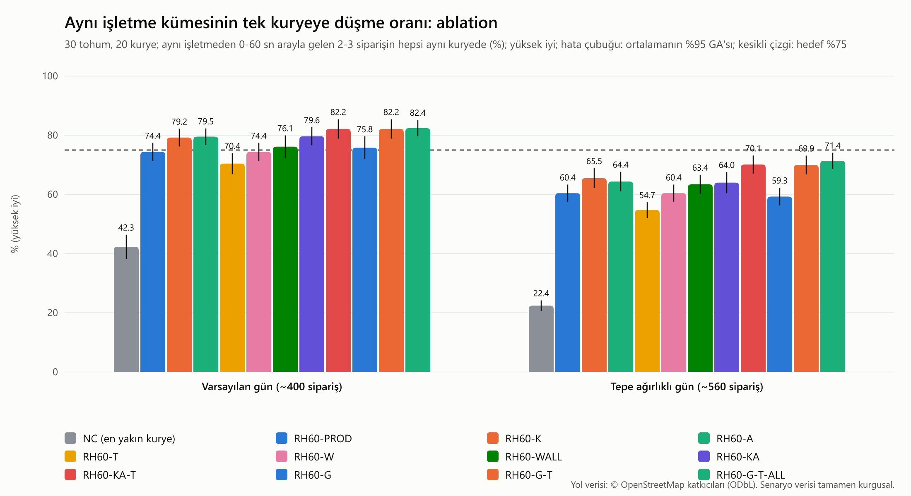

# Benchmark v2: aynı işletme gruplaması (İterasyon 3b-3)

> Bu rapor `npm run benchmark:v2 -- --seeds 30` ile üretilir (30 tohum, iki senaryo, tüm varyantlar). Dağıtım v2 ana raporu: [README](README.md). `results-gruplama.csv` tohumlu ve duvar saatinden bağımsızdır (iki koşu bayt düzeyinde aynıdır); `timing-gruplama.csv` makineye bağlıdır. Tasarım: SPEC-3b §8.



## Kabul kriterleri (RH60-G)

> **Nasıl okunmalı:** NC'ye göre fark büyük görünür ama büyük kısmı dağıtım v2'nin kendisinden (60 sn pencere, regret-3) gelir, gruplamadan değil. Gruplamanın gerçek etkisi **RH60-PROD'a göre** farktır; spec varsayılanlarıyla (RH60-G) bu fark istatistiksel olarak sıfırdan ayırt edilemez, önerilen değerlerle (RH60-G-T) anlamlıdır. Aşağıdaki 'v2 taban çizgisine' satırı bunu gösterir.

SPEC-3b §15.1 3b-3: aynı işletme kümesi aynı kuryede **>= %75**, NC'ye (A) göre eşleştirilmiş fark **>= +20 puan** (%95 GA 0'ı içermez), toplam km RH60-PROD'a göre en çok **+%2**, geç teslim en çok **+0,5 puan**, `suggest` p95 <= 300 ms.

**RH60-G, Varsayılan gün (~400 sipariş)**

- Karşılandı: Aynı işletme kümesi aynı kuryede >= %75: **%75.8**
- Karşılandı: NC'ye göre eşleştirilmiş fark >= +20 puan ve GA 0'ı içermiyor: **+33.47 [27.41, 39.53] ✱**
- Bilgi (anlamsız): Gruplamanın gerçek etkisi, v2 taban çizgisine (RH60-PROD) göre eşleştirilmiş fark (bilgi; spec ölçütü değil): **+1.43 [-1.11, 3.97]** puan
- Karşılandı: Toplam km RH60-PROD'a göre en çok +%2: **+0.17% [-0.28, 0.62]**
- Karşılandı: Geç teslim RH60-PROD'a göre en çok +0,5 puan: **+0.15 [-0.15, 0.45]**

**RH60-G, Tepe ağırlıklı gün (~560 sipariş)**

- KARŞILANMADI: Aynı işletme kümesi aynı kuryede >= %75: **%59.3**
- Karşılandı: NC'ye göre eşleştirilmiş fark >= +20 puan ve GA 0'ı içermiyor: **+36.84 [33.26, 40.42] ✱**
- Bilgi (anlamsız): Gruplamanın gerçek etkisi, v2 taban çizgisine (RH60-PROD) göre eşleştirilmiş fark (bilgi; spec ölçütü değil): **-1.17 [-3.25, 0.92]** puan
- Karşılandı: Toplam km RH60-PROD'a göre en çok +%2: **-0.01% [-0.56, 0.54]**
- Karşılandı: Geç teslim RH60-PROD'a göre en çok +0,5 puan: **+0.37 [-0.01, 0.76]**

**RH60-G-ALL, Varsayılan gün (~400 sipariş)**

- Karşılandı: Aynı işletme kümesi aynı kuryede >= %75: **%76.0**
- Karşılandı: NC'ye göre eşleştirilmiş fark >= +20 puan ve GA 0'ı içermiyor: **+33.65 [28.36, 38.93] ✱**
- Bilgi (anlamsız): Gruplamanın gerçek etkisi, v2 taban çizgisine (RH60-PROD) göre eşleştirilmiş fark (bilgi; spec ölçütü değil): **+1.61 [-1.73, 4.94]** puan
- Karşılandı: Toplam km RH60-PROD'a göre en çok +%2: **+0.20% [-0.38, 0.77]**
- Karşılandı: Geç teslim RH60-PROD'a göre en çok +0,5 puan: **+0.39 [0.01, 0.76] ✱**

**RH60-G-ALL, Tepe ağırlıklı gün (~560 sipariş)**

- KARŞILANMADI: Aynı işletme kümesi aynı kuryede >= %75: **%61.8**
- Karşılandı: NC'ye göre eşleştirilmiş fark >= +20 puan ve GA 0'ı içermiyor: **+39.31 [35.73, 42.90] ✱**
- Bilgi (anlamsız): Gruplamanın gerçek etkisi, v2 taban çizgisine (RH60-PROD) göre eşleştirilmiş fark (bilgi; spec ölçütü değil): **+1.31 [-0.62, 3.24]** puan
- Karşılandı: Toplam km RH60-PROD'a göre en çok +%2: **+0.02% [-0.48, 0.52]**
- Karşılandı: Geç teslim RH60-PROD'a göre en çok +0,5 puan: **+0.04 [-0.36, 0.45]**

**RH60-G-T, Varsayılan gün (~400 sipariş)**

- Karşılandı: Aynı işletme kümesi aynı kuryede >= %75: **%82.2**
- Karşılandı: NC'ye göre eşleştirilmiş fark >= +20 puan ve GA 0'ı içermiyor: **+39.83 [34.08, 45.58] ✱**
- Bilgi (anlamlı): Gruplamanın gerçek etkisi, v2 taban çizgisine (RH60-PROD) göre eşleştirilmiş fark (bilgi; spec ölçütü değil): **+7.79 [5.20, 10.38] ✱** puan
- Karşılandı: Toplam km RH60-PROD'a göre en çok +%2: **+1.09% [0.68, 1.50] ✱**
- Karşılandı: Geç teslim RH60-PROD'a göre en çok +0,5 puan: **+0.28 [0.00, 0.57] ✱**

**RH60-G-T, Tepe ağırlıklı gün (~560 sipariş)**

- KARŞILANMADI: Aynı işletme kümesi aynı kuryede >= %75: **%69.9**
- Karşılandı: NC'ye göre eşleştirilmiş fark >= +20 puan ve GA 0'ı içermiyor: **+47.50 [44.14, 50.87] ✱**
- Bilgi (anlamlı): Gruplamanın gerçek etkisi, v2 taban çizgisine (RH60-PROD) göre eşleştirilmiş fark (bilgi; spec ölçütü değil): **+9.50 [7.41, 11.58] ✱** puan
- Karşılandı: Toplam km RH60-PROD'a göre en çok +%2: **+1.17% [0.62, 1.72] ✱**
- Karşılandı: Geç teslim RH60-PROD'a göre en çok +0,5 puan: **+0.45 [0.10, 0.79] ✱**

**RH60-G-T-ALL, Varsayılan gün (~400 sipariş)**

- Karşılandı: Aynı işletme kümesi aynı kuryede >= %75: **%82.4**
- Karşılandı: NC'ye göre eşleştirilmiş fark >= +20 puan ve GA 0'ı içermiyor: **+40.08 [34.50, 45.66] ✱**
- Bilgi (anlamlı): Gruplamanın gerçek etkisi, v2 taban çizgisine (RH60-PROD) göre eşleştirilmiş fark (bilgi; spec ölçütü değil): **+8.04 [5.03, 11.06] ✱** puan
- Karşılandı: Toplam km RH60-PROD'a göre en çok +%2: **+0.99% [0.47, 1.50] ✱**
- Karşılandı: Geç teslim RH60-PROD'a göre en çok +0,5 puan: **+0.22 [-0.03, 0.47]**

**RH60-G-T-ALL, Tepe ağırlıklı gün (~560 sipariş)**

- KARŞILANMADI: Aynı işletme kümesi aynı kuryede >= %75: **%71.4**
- Karşılandı: NC'ye göre eşleştirilmiş fark >= +20 puan ve GA 0'ı içermiyor: **+48.95 [45.94, 51.95] ✱**
- Bilgi (anlamlı): Gruplamanın gerçek etkisi, v2 taban çizgisine (RH60-PROD) göre eşleştirilmiş fark (bilgi; spec ölçütü değil): **+10.94 [9.00, 12.88] ✱** puan
- Karşılandı: Toplam km RH60-PROD'a göre en çok +%2: **+1.35% [0.84, 1.85] ✱**
- Karşılandı: Geç teslim RH60-PROD'a göre en çok +0,5 puan: **+0.14 [-0.30, 0.58]**

## Yorum, ablation ve öneri

Sayılar aşağıdaki tablolardandır (tohum 1-30; fark = eşleştirilmiş ortalama, ✱ = %95 GA 0'ı içermiyor). Bu bölüm elle yazılır (`bench/v2/yorum-gruplama.md`).

**Kısa sonuç (dürüst okuma).** Gruplamanın gerçek etkisi **v2 taban çizgisine (RH60-PROD) göredir**; NC'ye göre +33,5 / +36,8 puanın neredeyse tamamı dağıtım v2'nin kendisinden (60 sn pencere, regret-3) gelir, gruplamadan değil. Spec varsayılanlarıyla (RH60-G) PROD'a göre fark **istatistiksel olarak sıfırdan ayırt edilemez**: varsayılan gün +1,4 puan [-1,1; 4,0], tepe gün -1,2 puan [-3,3; 0,9]. Varsayılan günde RH60-G'nin mutlak %75,8'i spec ölçütünü geçer, ama taban çizgi zaten %74,4 idi; tepe günde mutlak %75 karşılanmaz (%59,3). Gerçek kazanç ayar tohumlarıyla seçilen RH60-G-T'dedir: PROD'a göre +7,8 / +9,5 puan ✱ (%82,2 / %69,9); kapanış uzatmasıyla (G-T-ALL) tepe gün %71,4; %75'e ulaşmaz.

**Hangi değişiklik işe yaradı (ablation, RH60-PROD'a göre, varsayılan / tepe).**

- **κ (RH60-K): işe yarıyor.** +4,8 / +5,1 puan ✱; km ve geç teslim anlamsız (+%0,31 / +%0,29; +0,12 / +0,02). Teslimat süresi +0,16 / +0,21 dk (küçük ama anlamlı) bedeli var.
- **Sonradan bağlama (RH60-A): işe yarıyor, κ'yla büyük ölçüde aynı kümeleri yakalıyor.** +5,2 / +3,9 puan ✱. κ = 90 < bağlama eşiği 120 olduğu için ikisi birlikte tek başlarına toplanmaz: RH60-G'de κ + bağlama birlikte yalnızca +1,4 puan (GA 0'ı içerir) bırakır.
- **τ = 0,10 (RH60-T): ters etki.** −4,0 / −5,7 puan ✱ (km −%1,0 tepe günde). Beklenen: τ bir koruma, gruplamayı artırmaz; 0,10 eşiği, teslimleri 2-3 km uzakta olan birimleri sık sık bölüp κ ve bağlamanın kazancını siliyor. Bu yüzden RH60-G (τ = 0,10) tepe günde kazanç göstermiyor. Daha gevşek τ = 0,5 bu etkiyi kaldırır ve en uç durumları (çok uzak teslimler) hâlâ böler.
- **κ + bağlama, τ olmadan (RH60-KA, spec değerleri κ 90 / 120): +5,3 / +3,5 puan ✱; önerilen değerlerle (RH60-KA-T, κ 150 / 240): +7,8 / +9,7 puan ✱.** RH60-G'nin (aynı κ ve bağlama + τ = 0,10) +1,4 / −1,2 olması, farkın tamamının τ = 0,10'dan geldiğini gösterir. Önerilen bileşimde τ = 0,5 bu veride hiç tetiklenmez: RH60-KA-T ile RH60-G-T varsayılan günde bayt düzeyinde aynıdır; yani kazanç τ'dan değil, κ = 150 ve bağlama = 240'tandır, τ = 0,5 yalnızca uç kötü kümelere karşı koruma olarak kalır.
- **Kapanış uzatması (RH60-WALL, `ALL`): sınırda.** +1,8 puan (varsayılan, GA 0'ı içerir) / +3,0 puan ✱ (tepe); geç teslim −0,19 / −0,31 puan (anlamsız iyileşme); karşılığında sipariş → atama gecikmesi p95 +10 sn ✱ (180 → 190 sn), en çok 218 sn (sınır +40 sn içinde). **`HISTORY` bu sentetik veride hiçbir işletmeyi seçmiyor** (en büyük π_b 0,16 / 0,27 < 0,3: sentetik işletmelerin küme olasılığı birbirinden ayırt edilemeyecek kadar benzer), bu yüzden RH60-W ≡ RH60-PROD; `HISTORY`'nin değeri gerçek işletmelerin farklı olduğu pilot verisinde ölçülür.
- **`groupSplitM` 3000 → 5000 (RH60-G-S5, bilgi amaçlı):** RH60-G'ye göre +5,9 / +10,3 puan. Kümelerin ~%8'i teslimleri 3 km'den uzak olduğu için hiç birim olamıyor (ayrı pencere ve uzak teslim iki baskın ayrılma nedeni, ayar ızgarası teşhisi). 5 km'de km ve geç teslim değişmiyor; bu bir ayar değil, ileri bir adaydır (ADR-0014 `groupSplitM` sabit kalır, karar ürün sahibinin).

**Önerilen varsayılanlar (tohum 101-110'da seçildi, 1-30'da doğrulandı).** `kappaS = 150`, `attachSlackS = 240`, `tau = 0,5`, `jointCheck = true`, `clusterWindowMode = HISTORY`, `clusterExtendS = 40` (RH60-G-T). Varsayılan günde %82,2 (+7,8 puan ✱), tepe günde %69,9 (+9,5 puan ✱); bedeli toplam km +%1,09 / +%1,17 ✱ (hedef +%2'nin içinde), geç teslim +0,28 / +0,45 puan (hedef +0,5'in içinde, tepe günde sınırda; GA'nın alt ucu ~0), teslimat süresi +0,26 / +0,42 dk. Spec varsayılanlarında (κ 90, bağlama 120, τ 0,10) kabul ölçütleri yalnızca varsayılan günde ve yalnızca mutlak olarak sağlanır; v2 taban çizgisine göre kazanç anlamsızdır. **Gruplama açıldığında bu değerler uygulanır** (SPEC §5.5'ten bilinçli sapma, SPEC-3b'de belgelendi); ana anahtar kapalı başlar. Spec değerlerine dönmek ürün sahibinin kararıdır (benchmark RH60-G bunları ölçer).

**`suggest` (ONERI üst sınırı).** B-G − B (κ = 90 + bağlama 120): aynı işletme oranı +10,3 puan ✱ (varsayılan) / +7,8 puan ✱ (tepe); varsayılan günde km (+%0,49) ve geç teslim (+0,29 puan) anlamsız, **tepe günde km +%1,38 ✱ ve geç teslim +0,94 puan ✱**. Önerilen değerlerle (B-G-T − B): +16,6 / +8,7 puan ✱, ama km +%1,15 ✱ / +%2,16 ✱ ve tepe günde geç teslim +1,29 puan ✱ (varsayılan günde +0,29, anlamsız). Yani `suggest` yolunda κ tepe günde bedelsiz değildir: sıralamayı değiştirmek hemen atama demektir ve v2'deki gibi pencere içi telafi yoktur (B zaten tepe günde en kötü geç teslimli yöntemdir, %6,8). Bu yüzden `suggest` yolunda önerilen değerlerin tepe günde fazla agresif olduğu not edilir; yönetici 1. adayı kabul etmek zorunda değildir ve ayar kapalıyken etki yoktur. `suggest` çağrısı p95 ~1,1-1,2 ms (bütçe 300 ms).

**Neden %75'e ulaşılmıyor (tepe gün).** Tanı: RH60-PROD'da ayrılan kümelerin ~%70'i "ayrı pencere ve ilk sipariş henüz alınmamış" (yani bağlanabilir), geri kalanı aynı pencerede ama teslimleri 3 km'den uzak. κ = 600 ve bağlama = 600 gibi uç değerlerde bile bağlanabilir kümelerin büyük kısmı ayrı kalıyor: ikinci siparişin teslimi birincinin teslimlerinden çok uzaksa o kuryeye eklemek, sert kısıtları (alıştan teslime 35 dk, mevcut paket başına 8 dk gecikme) ve maliyeti aşıyor. Sentetik senaryoda bir kümenin teslimleri bağımsız çizildiği için bu, gerçek hayattaki aynı apartman / semt kümelerinden daha kötümser olabilir (pilotla doğrulanır). Gruplama ödüllerini artırmak km (+%2'ye yaklaşır) ve geç teslim (+0,5 puan'ı aşar) pahasınadır: ödünleşim sınırı bu, ölçütün kendisi değil.

**Süre.** v2 pencere kararı (`planDispatch`) p95, varsayılan / tepe gün: RH60-PROD 2,7 / 3,9 ms; RH60-KA (τ yok) 2,9 / 4,3 ms (+%8 / +%11); RH60-G 3,2 / 5,0 ms (+%18 / +%28); RH60-G-T 3,1 / 5,2 ms (+%14 / +%34). Maliyet çoğunlukla τ koruması içindir (çok paketli birimlerin ortak ve tekil fiyatlanması); τ'nun hesapladığı fiyatlar artık regret döngüsüne taşınır ve ikinci kez hesaplanmaz. Spec bütçesi (+%25 motor p95) tepe günde RH60-G ve RH60-G-T için aşılıyor; mutlak değerler çok küçük (5 ms) ve zamanlamalar yüke bağlı gürültülüdür, üretimde `GET /metrics/dispatch-v2` ile izlenmelidir. `suggest` p95 ~1,1-1,2 ms (B, B-G, B-G-T), bütçe 300 ms.

**Alış bekleme.** Hazır anı stratejilere bildirilmediğinden alış bekleme (3,2 dk/sipariş) gruplamayla anlamlı değişmez (±0,03). Hazır zamanının bilinmesi / tahmin edilmesi gruplamayı **bozar** (RH60-PROD %72,7 → %51,5 tahmini, %53,4 bilinen; ayrıntı: [README, hazır zamanı üç koşul](../README.md)): motor beklemeyi önlemek için siparişleri kuryeler arasında dağıtıyor. Bu iki hedef (az bekleme ve tek kuryede küme) çatışıyor; hazır zamanı etkinleştirilirken gruplama ayarı birlikte değerlendirilmeli.

**Sınırlamalar.** Sentetik veri; kümenin teslimleri bağımsız; hazırlık anı bilinmiyor; HISTORY kipi bu veride etkisiz; geç teslim farkı tepe gün RH60-G-T'de +0,45 ile sınırda (GA [0,10; 0,79]). Parametre seçimi 10 tohumda yapıldı (gürültülü); 30 tohumlu doğrulama ayrık tohumlardadır.

## Sonuçlar: Varsayılan gün (~400 sipariş)

Her hücre 30 tohumun ortalaması ± standart sapmasıdır.

| Yöntem | Aynı işletme kümesi aynı kuryede (%) | Toplam km | Geç teslim (alış → teslim > 35 dk, %) | Ort. teslimat süresi (sipariş → teslim, dk) | Alış bekleme (kurye varış → hazır, dk/sipariş) | Sipariş → atama gecikmesi, p95 (sn) | Sipariş → atama gecikmesi, en çok (sn) |
|---|---:|---:|---:|---:|---:|---:|---:|
| **NC** | 42.33 ± 10.87 | 1912.24 ± 149.40 | 21.08 ± 3.49 | 38.90 ± 1.35 | 3.90 ± 0.21 | 0.00 ± 0.00 | 0.83 ± 4.52 |
| **CUR** | 60.41 ± 12.52 | 1322.85 ± 79.80 | 2.42 ± 0.75 | 27.44 ± 0.63 | 3.27 ± 0.20 | 246.24 ± 2.38 | 258.60 ± 0.81 |
| **RH60-PROD** | 74.36 ± 8.20 | 1334.28 ± 76.54 | 2.35 ± 0.88 | 26.43 ± 0.68 | 3.20 ± 0.21 | 180.00 ± 0.00 | 180.00 ± 0.00 |
| **RH60-K** | 79.20 ± 7.99 | 1338.23 ± 76.49 | 2.47 ± 1.01 | 26.59 ± 0.64 | 3.22 ± 0.20 | 180.00 ± 0.00 | 180.00 ± 0.00 |
| **RH60-A** | 79.53 ± 7.40 | 1337.44 ± 78.27 | 2.56 ± 0.80 | 26.71 ± 0.63 | 3.21 ± 0.20 | 180.00 ± 0.00 | 180.00 ± 0.00 |
| **RH60-T** | 70.42 ± 9.50 | 1333.62 ± 74.21 | 2.44 ± 0.84 | 26.44 ± 0.72 | 3.21 ± 0.21 | 180.00 ± 0.00 | 180.00 ± 0.00 |
| **RH60-W** | 74.36 ± 8.20 | 1334.28 ± 76.54 | 2.35 ± 0.88 | 26.43 ± 0.68 | 3.20 ± 0.21 | 180.00 ± 0.00 | 180.00 ± 0.00 |
| **RH60-WALL** | 76.15 ± 10.22 | 1338.25 ± 75.10 | 2.16 ± 0.81 | 26.36 ± 0.55 | 3.23 ± 0.20 | 190.03 ± 3.71 | 218.10 ± 2.17 |
| **RH60-G** | 75.80 ± 10.19 | 1336.44 ± 76.46 | 2.50 ± 0.86 | 26.70 ± 0.63 | 3.23 ± 0.16 | 180.00 ± 0.00 | 180.00 ± 0.00 |
| **RH60-G-ALL** | 75.97 ± 9.50 | 1336.65 ± 75.04 | 2.73 ± 0.81 | 26.73 ± 0.61 | 3.22 ± 0.19 | 189.87 ± 3.89 | 217.67 ± 3.01 |
| **RH60-G-S5** | 81.66 ± 7.55 | 1337.32 ± 76.30 | 2.55 ± 0.69 | 26.71 ± 0.58 | 3.23 ± 0.17 | 180.00 ± 0.00 | 180.00 ± 0.00 |
| **RH60-KA** | 79.63 ± 8.16 | 1338.78 ± 78.16 | 2.50 ± 0.91 | 26.64 ± 0.64 | 3.22 ± 0.20 | 180.00 ± 0.00 | 180.00 ± 0.00 |
| **RH60-KA-T** | 82.16 ± 8.74 | 1348.72 ± 77.11 | 2.63 ± 0.90 | 26.69 ± 0.61 | 3.23 ± 0.20 | 180.00 ± 0.00 | 180.00 ± 0.00 |
| **RH60-G-T** | 82.16 ± 8.74 | 1348.72 ± 77.11 | 2.63 ± 0.90 | 26.69 ± 0.61 | 3.23 ± 0.20 | 180.00 ± 0.00 | 180.00 ± 0.00 |
| **RH60-G-T-ALL** | 82.41 ± 7.44 | 1347.47 ± 80.17 | 2.57 ± 0.69 | 26.70 ± 0.66 | 3.21 ± 0.16 | 190.53 ± 4.21 | 217.63 ± 3.01 |
| **B** | 50.43 ± 9.59 | 1329.71 ± 82.06 | 3.17 ± 1.20 | 27.72 ± 0.73 | 4.34 ± 0.21 | 0.00 ± 0.00 | 0.00 ± 0.00 |
| **B-G** | 60.73 ± 9.66 | 1335.67 ± 76.11 | 3.46 ± 1.07 | 28.12 ± 0.84 | 4.26 ± 0.22 | 0.00 ± 0.00 | 0.00 ± 0.00 |
| **B-G-T** | 66.99 ± 10.93 | 1344.43 ± 76.24 | 3.46 ± 1.00 | 28.16 ± 0.74 | 4.26 ± 0.19 | 0.00 ± 0.00 | 0.00 ± 0.00 |

**RH60-PROD'a göre eşleştirilmiş fark** (ablation), ortalama [%95 GA, t dağılımı, sd = 29 serbestlik derecesi]; ✱ = aralık 0'ı içermiyor. Negatif km / süre / geç teslim / bekleme iyidir; aynı işletme oranında pozitif iyidir.

| Yöntem − RH60-PROD | Aynı işletme aynı kuryede (puan) | Toplam km (%) | Geç teslim (puan) | Teslimat süresi (dk) | Alış bekleme (dk/sipariş) | Atama gecikmesi p95 (sn) |
|---|---:|---:|---:|---:|---:|---:|
| **NC** | -32.04 [-37.49, -26.59] ✱ | +43.22% [41.24, 45.20] ✱ | +18.74 [17.49, 19.98] ✱ | +12.48 [12.07, 12.89] ✱ | +0.70 [0.61, 0.78] ✱ | -180.00 [-180.00, -180.00] ✱ |
| **CUR** | -13.96 [-18.58, -9.34] ✱ | -0.85% [-1.65, -0.05] ✱ | +0.07 [-0.33, 0.48] | +1.01 [0.78, 1.25] ✱ | +0.07 [0.02, 0.12] ✱ | +66.24 [65.35, 67.13] ✱ |
| **RH60-K** | +4.84 [2.61, 7.07] ✱ | +0.31% [-0.16, 0.77] | +0.12 [-0.21, 0.45] | +0.16 [0.01, 0.31] ✱ | +0.02 [-0.03, 0.07] | +0.00 [0.00, 0.00] |
| **RH60-A** | +5.17 [3.07, 7.27] ✱ | +0.24% [-0.26, 0.74] | +0.22 [-0.11, 0.54] | +0.28 [0.12, 0.44] ✱ | +0.01 [-0.04, 0.06] | +0.00 [0.00, 0.00] |
| **RH60-T** | -3.95 [-5.94, -1.96] ✱ | -0.03% [-0.45, 0.38] | +0.09 [-0.16, 0.35] | +0.01 [-0.12, 0.14] | +0.01 [-0.02, 0.04] | +0.00 [0.00, 0.00] |
| **RH60-W** | +0.00 [0.00, 0.00] | +0.00% [0.00, 0.00] | +0.00 [0.00, 0.00] | +0.00 [0.00, 0.00] | +0.00 [0.00, 0.00] | +0.00 [0.00, 0.00] |
| **RH60-WALL** | +1.78 [-1.64, 5.20] | +0.31% [-0.13, 0.75] | -0.19 [-0.54, 0.16] | -0.06 [-0.20, 0.08] | +0.02 [-0.03, 0.08] | +10.03 [8.65, 11.42] ✱ |
| **RH60-G** | +1.43 [-1.11, 3.97] | +0.17% [-0.28, 0.62] | +0.15 [-0.15, 0.45] | +0.27 [0.11, 0.43] ✱ | +0.02 [-0.03, 0.08] | +0.00 [0.00, 0.00] |
| **RH60-G-ALL** | +1.61 [-1.73, 4.94] | +0.20% [-0.38, 0.77] | +0.39 [0.01, 0.76] ✱ | +0.30 [0.14, 0.47] ✱ | +0.01 [-0.04, 0.06] | +9.87 [8.41, 11.32] ✱ |
| **RH60-G-S5** | +7.30 [4.59, 10.00] ✱ | +0.24% [-0.26, 0.74] | +0.20 [-0.11, 0.51] | +0.29 [0.12, 0.45] ✱ | +0.02 [-0.02, 0.07] | +0.00 [0.00, 0.00] |
| **RH60-KA** | +5.26 [3.08, 7.44] ✱ | +0.34% [-0.17, 0.85] | +0.15 [-0.17, 0.47] | +0.22 [0.04, 0.39] ✱ | +0.01 [-0.04, 0.07] | +0.00 [0.00, 0.00] |
| **RH60-KA-T** | +7.79 [5.20, 10.38] ✱ | +1.09% [0.68, 1.50] ✱ | +0.28 [0.00, 0.57] ✱ | +0.26 [0.11, 0.41] ✱ | +0.03 [-0.02, 0.07] | +0.00 [0.00, 0.00] |
| **RH60-G-T** | +7.79 [5.20, 10.38] ✱ | +1.09% [0.68, 1.50] ✱ | +0.28 [0.00, 0.57] ✱ | +0.26 [0.11, 0.41] ✱ | +0.03 [-0.02, 0.07] | +0.00 [0.00, 0.00] |
| **RH60-G-T-ALL** | +8.04 [5.03, 11.06] ✱ | +0.99% [0.47, 1.50] ✱ | +0.22 [-0.03, 0.47] | +0.27 [0.12, 0.42] ✱ | +0.01 [-0.04, 0.06] | +10.53 [8.96, 12.10] ✱ |
| **B** | -23.94 [-27.82, -20.06] ✱ | -0.35% [-1.01, 0.30] | +0.83 [0.45, 1.20] ✱ | +1.30 [1.07, 1.52] ✱ | +1.13 [1.07, 1.19] ✱ | -180.00 [-180.00, -180.00] ✱ |
| **B-G** | -13.63 [-17.38, -9.89] ✱ | +0.13% [-0.65, 0.91] | +1.12 [0.71, 1.52] ✱ | +1.70 [1.49, 1.90] ✱ | +1.06 [1.00, 1.12] ✱ | -180.00 [-180.00, -180.00] ✱ |
| **B-G-T** | -7.38 [-11.04, -3.72] ✱ | +0.78% [0.06, 1.51] ✱ | +1.11 [0.70, 1.52] ✱ | +1.73 [1.53, 1.94] ✱ | +1.06 [1.00, 1.12] ✱ | -180.00 [-180.00, -180.00] ✱ |

**NC'ye (A, en yakın kurye) göre eşleştirilmiş fark**

| Yöntem − NC | Aynı işletme aynı kuryede (puan) | Toplam km (%) | Geç teslim (puan) | Teslimat süresi (dk) | Alış bekleme (dk/sipariş) | Atama gecikmesi p95 (sn) |
|---|---:|---:|---:|---:|---:|---:|
| **CUR** | +18.08 [11.88, 24.28] ✱ | -30.71% [-31.49, -29.93] ✱ | -18.66 [-20.01, -17.32] ✱ | -11.47 [-11.94, -10.99] ✱ | -0.63 [-0.70, -0.55] ✱ | +246.24 [245.35, 247.13] ✱ |
| **RH60-PROD** | +32.04 [26.59, 37.49] ✱ | -30.09% [-31.05, -29.12] ✱ | -18.74 [-19.98, -17.49] ✱ | -12.48 [-12.89, -12.07] ✱ | -0.70 [-0.78, -0.61] ✱ | +180.00 [180.00, 180.00] ✱ |
| **RH60-K** | +36.88 [31.17, 42.59] ✱ | -29.89% [-30.76, -29.01] ✱ | -18.61 [-19.91, -17.31] ✱ | -12.32 [-12.74, -11.89] ✱ | -0.67 [-0.76, -0.59] ✱ | +180.00 [180.00, 180.00] ✱ |
| **RH60-A** | +37.21 [31.72, 42.69] ✱ | -29.94% [-30.76, -29.11] ✱ | -18.52 [-19.84, -17.20] ✱ | -12.20 [-12.63, -11.76] ✱ | -0.69 [-0.77, -0.61] ✱ | +180.00 [180.00, 180.00] ✱ |
| **RH60-T** | +28.09 [22.42, 33.76] ✱ | -30.11% [-31.06, -29.17] ✱ | -18.64 [-19.85, -17.43] ✱ | -12.47 [-12.83, -12.10] ✱ | -0.68 [-0.77, -0.60] ✱ | +180.00 [180.00, 180.00] ✱ |
| **RH60-W** | +32.04 [26.59, 37.49] ✱ | -30.09% [-31.05, -29.12] ✱ | -18.74 [-19.98, -17.49] ✱ | -12.48 [-12.89, -12.07] ✱ | -0.70 [-0.78, -0.61] ✱ | +180.00 [180.00, 180.00] ✱ |
| **RH60-WALL** | +33.82 [27.60, 40.04] ✱ | -29.87% [-30.82, -28.93] ✱ | -18.93 [-20.29, -17.57] ✱ | -12.54 [-12.98, -12.11] ✱ | -0.67 [-0.75, -0.60] ✱ | +190.03 [188.65, 191.42] ✱ |
| **RH60-G** | +33.47 [27.41, 39.53] ✱ | -29.98% [-30.83, -29.13] ✱ | -18.59 [-19.88, -17.29] ✱ | -12.20 [-12.63, -11.78] ✱ | -0.67 [-0.75, -0.59] ✱ | +180.00 [180.00, 180.00] ✱ |
| **RH60-G-ALL** | +33.65 [28.36, 38.93] ✱ | -29.96% [-30.89, -29.03] ✱ | -18.35 [-19.69, -17.01] ✱ | -12.18 [-12.60, -11.75] ✱ | -0.68 [-0.75, -0.61] ✱ | +189.87 [188.41, 191.32] ✱ |
| **RH60-G-S5** | +39.34 [34.30, 44.37] ✱ | -29.93% [-30.80, -29.07] ✱ | -18.54 [-19.76, -17.31] ✱ | -12.19 [-12.59, -11.80] ✱ | -0.67 [-0.74, -0.60] ✱ | +180.00 [180.00, 180.00] ✱ |
| **RH60-KA** | +37.30 [31.54, 43.05] ✱ | -29.86% [-30.71, -29.02] ✱ | -18.59 [-19.88, -17.29] ✱ | -12.26 [-12.68, -11.84] ✱ | -0.68 [-0.76, -0.60] ✱ | +180.00 [180.00, 180.00] ✱ |
| **RH60-KA-T** | +39.83 [34.08, 45.58] ✱ | -29.33% [-30.27, -28.39] ✱ | -18.45 [-19.75, -17.15] ✱ | -12.21 [-12.65, -11.77] ✱ | -0.67 [-0.75, -0.59] ✱ | +180.00 [180.00, 180.00] ✱ |
| **RH60-G-T** | +39.83 [34.08, 45.58] ✱ | -29.33% [-30.27, -28.39] ✱ | -18.45 [-19.75, -17.15] ✱ | -12.21 [-12.65, -11.77] ✱ | -0.67 [-0.75, -0.59] ✱ | +180.00 [180.00, 180.00] ✱ |
| **RH60-G-T-ALL** | +40.08 [34.50, 45.66] ✱ | -29.41% [-30.27, -28.56] ✱ | -18.52 [-19.79, -17.25] ✱ | -12.21 [-12.62, -11.79] ✱ | -0.69 [-0.76, -0.62] ✱ | +190.53 [188.96, 192.10] ✱ |
| **B** | +8.10 [3.37, 12.84] ✱ | -30.36% [-31.08, -29.65] ✱ | -17.91 [-19.27, -16.55] ✱ | -11.18 [-11.64, -10.73] ✱ | +0.44 [0.36, 0.52] ✱ | +0.00 [0.00, 0.00] |
| **B-G** | +18.40 [13.06, 23.75] ✱ | -30.03% [-30.81, -29.25] ✱ | -17.62 [-18.85, -16.39] ✱ | -10.78 [-11.22, -10.34] ✱ | +0.37 [0.28, 0.45] ✱ | +0.00 [0.00, 0.00] |
| **B-G-T** | +24.66 [19.27, 30.06] ✱ | -29.57% [-30.32, -28.81] ✱ | -17.62 [-18.83, -16.42] ✱ | -10.75 [-11.19, -10.31] ✱ | +0.37 [0.28, 0.45] ✱ | +0.00 [0.00, 0.00] |

**`suggest` türü: B-G − B ve B-G-T − B** (ONERI üst sınırı; κ ve sonradan bağlama, spec ve önerilen değerler)

| Yöntem | Aynı işletme aynı kuryede (puan) | Toplam km (%) | Geç teslim (puan) | Teslimat süresi (dk) | Alış bekleme (dk/sipariş) | Atama gecikmesi p95 (sn) |
|---|---:|---:|---:|---:|---:|---:|
| **B-G − B** | +10.30 [6.16, 14.44] ✱ | +0.49% [-0.08, 1.05] | +0.29 [-0.20, 0.78] | +0.40 [0.17, 0.63] ✱ | -0.07 [-0.13, -0.01] ✱ | +0.00 [0.00, 0.00] |
| **B-G-T − B** | +16.56 [12.30, 20.82] ✱ | +1.15% [0.52, 1.79] ✱ | +0.29 [-0.20, 0.78] | +0.44 [0.24, 0.63] ✱ | -0.07 [-0.13, -0.01] ✱ | +0.00 [0.00, 0.00] |

## Sonuçlar: Tepe ağırlıklı gün (~560 sipariş)

Her hücre 30 tohumun ortalaması ± standart sapmasıdır.

| Yöntem | Aynı işletme kümesi aynı kuryede (%) | Toplam km | Geç teslim (alış → teslim > 35 dk, %) | Ort. teslimat süresi (sipariş → teslim, dk) | Alış bekleme (kurye varış → hazır, dk/sipariş) | Sipariş → atama gecikmesi, p95 (sn) | Sipariş → atama gecikmesi, en çok (sn) |
|---|---:|---:|---:|---:|---:|---:|---:|
| **NC** | 22.44 ± 4.70 | 3027.27 ± 221.49 | 40.06 ± 3.20 | 48.51 ± 2.78 | 2.40 ± 0.34 | 952.96 ± 482.62 | 1176.32 ± 508.15 |
| **CUR** | 47.25 ± 8.56 | 1725.32 ± 93.27 | 5.10 ± 1.15 | 30.26 ± 0.94 | 2.78 ± 0.19 | 240.44 ± 4.36 | 345.28 ± 189.94 |
| **RH60-PROD** | 60.44 ± 7.70 | 1726.79 ± 93.34 | 4.02 ± 1.23 | 28.94 ± 0.97 | 2.79 ± 0.20 | 180.00 ± 0.00 | 239.83 ± 142.39 |
| **RH60-K** | 65.51 ± 8.99 | 1731.67 ± 94.87 | 4.04 ± 0.92 | 29.15 ± 0.85 | 2.79 ± 0.19 | 180.00 ± 0.00 | 207.20 ± 82.57 |
| **RH60-A** | 64.36 ± 8.80 | 1736.96 ± 95.01 | 4.11 ± 1.35 | 29.21 ± 0.98 | 2.79 ± 0.16 | 180.00 ± 0.00 | 233.80 ± 119.83 |
| **RH60-T** | 54.73 ± 7.08 | 1708.78 ± 84.58 | 4.05 ± 1.00 | 29.12 ± 0.88 | 2.81 ± 0.21 | 180.00 ± 0.00 | 208.97 ± 118.53 |
| **RH60-W** | 60.44 ± 7.70 | 1726.79 ± 93.34 | 4.02 ± 1.23 | 28.94 ± 0.97 | 2.79 ± 0.20 | 180.00 ± 0.00 | 239.83 ± 142.39 |
| **RH60-WALL** | 63.41 ± 8.70 | 1735.17 ± 88.54 | 3.71 ± 0.90 | 28.77 ± 0.77 | 2.73 ± 0.19 | 189.20 ± 4.50 | 252.43 ± 129.20 |
| **RH60-G** | 59.28 ± 8.05 | 1725.99 ± 84.55 | 4.39 ± 1.09 | 29.30 ± 0.90 | 2.80 ± 0.19 | 180.00 ± 0.00 | 213.33 ± 84.87 |
| **RH60-G-ALL** | 61.75 ± 8.36 | 1726.70 ± 87.60 | 4.06 ± 1.28 | 29.07 ± 1.06 | 2.78 ± 0.17 | 189.87 ± 5.69 | 236.60 ± 79.49 |
| **RH60-G-S5** | 69.61 ± 7.99 | 1726.94 ± 93.08 | 4.34 ± 1.03 | 29.15 ± 0.98 | 2.80 ± 0.20 | 180.00 ± 0.00 | 219.13 ± 118.16 |
| **RH60-KA** | 63.99 ± 9.53 | 1735.41 ± 95.17 | 4.16 ± 1.31 | 29.30 ± 0.98 | 2.81 ± 0.18 | 180.00 ± 0.00 | 205.07 ± 83.40 |
| **RH60-KA-T** | 70.11 ± 8.20 | 1745.23 ± 93.42 | 4.39 ± 1.27 | 29.39 ± 1.00 | 2.78 ± 0.17 | 180.47 ± 2.56 | 247.43 ± 153.41 |
| **RH60-G-T** | 69.94 ± 8.53 | 1746.83 ± 95.61 | 4.47 ± 1.23 | 29.36 ± 0.99 | 2.79 ± 0.17 | 180.47 ± 2.56 | 238.80 ± 149.90 |
| **RH60-G-T-ALL** | 71.38 ± 7.30 | 1749.89 ± 94.86 | 4.15 ± 1.16 | 29.15 ± 0.83 | 2.74 ± 0.21 | 189.67 ± 3.95 | 256.60 ± 135.88 |
| **B** | 34.64 ± 6.29 | 1798.34 ± 135.54 | 6.78 ± 1.76 | 31.22 ± 1.30 | 3.46 ± 0.28 | 28.04 ± 76.09 | 222.24 ± 290.65 |
| **B-G** | 42.40 ± 7.17 | 1823.53 ± 147.18 | 7.71 ± 2.30 | 31.67 ± 1.42 | 3.42 ± 0.28 | 47.44 ± 103.18 | 254.35 ± 304.08 |
| **B-G-T** | 43.36 ± 7.74 | 1837.19 ± 147.59 | 8.06 ± 2.02 | 31.90 ± 1.45 | 3.39 ± 0.32 | 47.16 ± 124.87 | 249.51 ± 303.62 |

**RH60-PROD'a göre eşleştirilmiş fark** (ablation), ortalama [%95 GA, t dağılımı, sd = 29 serbestlik derecesi]; ✱ = aralık 0'ı içermiyor. Negatif km / süre / geç teslim / bekleme iyidir; aynı işletme oranında pozitif iyidir.

| Yöntem − RH60-PROD | Aynı işletme aynı kuryede (puan) | Toplam km (%) | Geç teslim (puan) | Teslimat süresi (dk) | Alış bekleme (dk/sipariş) | Atama gecikmesi p95 (sn) |
|---|---:|---:|---:|---:|---:|---:|
| **NC** | -38.01 [-41.34, -34.67] ✱ | +75.22% [72.79, 77.64] ✱ | +36.04 [34.87, 37.21] ✱ | +19.56 [18.73, 20.40] ✱ | -0.39 [-0.50, -0.29] ✱ | +772.96 [592.76, 953.15] ✱ |
| **CUR** | -13.19 [-16.12, -10.26] ✱ | -0.08% [-0.57, 0.42] | +1.08 [0.62, 1.55] ✱ | +1.32 [1.09, 1.54] ✱ | -0.00 [-0.04, 0.04] | +60.44 [58.81, 62.07] ✱ |
| **RH60-K** | +5.06 [3.42, 6.71] ✱ | +0.29% [-0.30, 0.88] | +0.02 [-0.25, 0.29] | +0.21 [0.04, 0.37] ✱ | +0.00 [-0.04, 0.05] | +0.00 [0.00, 0.00] |
| **RH60-A** | +3.91 [1.79, 6.04] ✱ | +0.60% [0.07, 1.12] ✱ | +0.09 [-0.21, 0.39] | +0.26 [0.12, 0.41] ✱ | +0.01 [-0.04, 0.05] | +0.00 [0.00, 0.00] |
| **RH60-T** | -5.71 [-7.45, -3.97] ✱ | -1.01% [-1.54, -0.48] ✱ | +0.03 [-0.37, 0.43] | +0.18 [-0.00, 0.36] | +0.02 [-0.01, 0.05] | +0.00 [0.00, 0.00] |
| **RH60-W** | +0.00 [0.00, 0.00] | +0.00% [0.00, 0.00] | +0.00 [0.00, 0.00] | +0.00 [0.00, 0.00] | +0.00 [0.00, 0.00] | +0.00 [0.00, 0.00] |
| **RH60-WALL** | +2.96 [1.09, 4.84] ✱ | +0.51% [0.08, 0.93] ✱ | -0.31 [-0.74, 0.13] | -0.17 [-0.36, 0.02] | -0.06 [-0.10, -0.02] ✱ | +9.20 [7.52, 10.88] ✱ |
| **RH60-G** | -1.17 [-3.25, 0.92] | -0.01% [-0.56, 0.54] | +0.37 [-0.01, 0.76] | +0.36 [0.14, 0.57] ✱ | +0.01 [-0.03, 0.05] | +0.00 [0.00, 0.00] |
| **RH60-G-ALL** | +1.31 [-0.62, 3.24] | +0.02% [-0.48, 0.52] | +0.04 [-0.36, 0.45] | +0.13 [-0.07, 0.33] | -0.01 [-0.05, 0.03] | +9.87 [7.74, 11.99] ✱ |
| **RH60-G-S5** | +9.17 [6.86, 11.48] ✱ | +0.02% [-0.59, 0.64] | +0.32 [-0.02, 0.66] | +0.21 [0.05, 0.36] ✱ | +0.01 [-0.02, 0.05] | +0.00 [0.00, 0.00] |
| **RH60-KA** | +3.54 [1.48, 5.61] ✱ | +0.50% [-0.00, 1.01] | +0.15 [-0.17, 0.46] | +0.36 [0.21, 0.51] ✱ | +0.02 [-0.03, 0.07] | +0.00 [0.00, 0.00] |
| **RH60-KA-T** | +9.66 [7.64, 11.69] ✱ | +1.08% [0.52, 1.64] ✱ | +0.37 [0.02, 0.73] ✱ | +0.45 [0.28, 0.61] ✱ | -0.00 [-0.05, 0.04] | +0.47 [-0.49, 1.42] |
| **RH60-G-T** | +9.50 [7.41, 11.58] ✱ | +1.17% [0.62, 1.72] ✱ | +0.45 [0.10, 0.79] ✱ | +0.42 [0.25, 0.59] ✱ | -0.00 [-0.05, 0.05] | +0.47 [-0.49, 1.42] |
| **RH60-G-T-ALL** | +10.94 [9.00, 12.88] ✱ | +1.35% [0.84, 1.85] ✱ | +0.14 [-0.30, 0.58] | +0.20 [0.03, 0.38] ✱ | -0.05 [-0.09, -0.01] ✱ | +9.67 [8.19, 11.14] ✱ |
| **B** | -25.80 [-27.83, -23.77] ✱ | +4.06% [2.75, 5.38] ✱ | +2.76 [2.23, 3.29] ✱ | +2.28 [2.04, 2.51] ✱ | +0.67 [0.61, 0.73] ✱ | -151.96 [-180.37, -123.55] ✱ |
| **B-G** | -18.05 [-20.86, -15.24] ✱ | +5.49% [4.00, 6.99] ✱ | +3.70 [2.93, 4.47] ✱ | +2.73 [2.42, 3.04] ✱ | +0.63 [0.56, 0.70] ✱ | -132.56 [-171.08, -94.04] ✱ |
| **B-G-T** | -17.08 [-20.34, -13.83] ✱ | +6.30% [4.67, 7.93] ✱ | +4.05 [3.37, 4.73] ✱ | +2.95 [2.63, 3.28] ✱ | +0.61 [0.53, 0.68] ✱ | -132.84 [-179.46, -86.22] ✱ |

**NC'ye (A, en yakın kurye) göre eşleştirilmiş fark**

| Yöntem − NC | Aynı işletme aynı kuryede (puan) | Toplam km (%) | Geç teslim (puan) | Teslimat süresi (dk) | Alış bekleme (dk/sipariş) | Atama gecikmesi p95 (sn) |
|---|---:|---:|---:|---:|---:|---:|
| **CUR** | +24.82 [21.28, 28.35] ✱ | -42.90% [-43.69, -42.11] ✱ | -34.95 [-36.09, -33.82] ✱ | -18.25 [-19.07, -17.42] ✱ | +0.39 [0.28, 0.50] ✱ | -712.52 [-892.45, -532.58] ✱ |
| **RH60-PROD** | +38.01 [34.67, 41.34] ✱ | -42.85% [-43.66, -42.04] ✱ | -36.04 [-37.21, -34.87] ✱ | -19.56 [-20.40, -18.73] ✱ | +0.39 [0.29, 0.50] ✱ | -772.96 [-953.15, -592.76] ✱ |
| **RH60-K** | +43.07 [39.63, 46.51] ✱ | -42.69% [-43.52, -41.85] ✱ | -36.02 [-37.15, -34.88] ✱ | -19.35 [-20.18, -18.52] ✱ | +0.40 [0.30, 0.50] ✱ | -772.96 [-953.15, -592.76] ✱ |
| **RH60-A** | +41.92 [38.35, 45.49] ✱ | -42.51% [-43.36, -41.66] ✱ | -35.95 [-37.15, -34.75] ✱ | -19.30 [-20.13, -18.47] ✱ | +0.40 [0.29, 0.50] ✱ | -772.96 [-953.15, -592.76] ✱ |
| **RH60-T** | +32.30 [29.13, 35.46] ✱ | -43.43% [-44.29, -42.57] ✱ | -36.01 [-37.08, -34.94] ✱ | -19.38 [-20.26, -18.50] ✱ | +0.41 [0.31, 0.52] ✱ | -772.96 [-953.15, -592.76] ✱ |
| **RH60-W** | +38.01 [34.67, 41.34] ✱ | -42.85% [-43.66, -42.04] ✱ | -36.04 [-37.21, -34.87] ✱ | -19.56 [-20.40, -18.73] ✱ | +0.39 [0.29, 0.50] ✱ | -772.96 [-953.15, -592.76] ✱ |
| **RH60-WALL** | +40.97 [37.26, 44.68] ✱ | -42.56% [-43.42, -41.70] ✱ | -36.34 [-37.52, -35.17] ✱ | -19.73 [-20.61, -18.85] ✱ | +0.33 [0.24, 0.43] ✱ | -763.76 [-943.34, -584.18] ✱ |
| **RH60-G** | +36.84 [33.26, 40.42] ✱ | -42.85% [-43.77, -41.93] ✱ | -35.66 [-36.86, -34.47] ✱ | -19.21 [-20.10, -18.31] ✱ | +0.41 [0.30, 0.51] ✱ | -772.96 [-953.15, -592.76] ✱ |
| **RH60-G-ALL** | +39.31 [35.73, 42.90] ✱ | -42.84% [-43.71, -41.97] ✱ | -35.99 [-37.15, -34.84] ✱ | -19.44 [-20.24, -18.63] ✱ | +0.38 [0.27, 0.49] ✱ | -763.09 [-942.55, -583.63] ✱ |
| **RH60-G-S5** | +47.18 [43.80, 50.55] ✱ | -42.84% [-43.71, -41.97] ✱ | -35.72 [-36.86, -34.58] ✱ | -19.36 [-20.20, -18.51] ✱ | +0.41 [0.30, 0.51] ✱ | -772.96 [-953.15, -592.76] ✱ |
| **RH60-KA** | +41.55 [37.65, 45.45] ✱ | -42.57% [-43.39, -41.75] ✱ | -35.89 [-37.15, -34.63] ✱ | -19.20 [-20.03, -18.38] ✱ | +0.41 [0.31, 0.51] ✱ | -772.96 [-953.15, -592.76] ✱ |
| **RH60-KA-T** | +47.67 [44.39, 50.95] ✱ | -42.24% [-43.05, -41.42] ✱ | -35.66 [-36.80, -34.53] ✱ | -19.11 [-19.93, -18.30] ✱ | +0.39 [0.29, 0.49] ✱ | -772.49 [-952.26, -592.72] ✱ |
| **RH60-G-T** | +47.50 [44.14, 50.87] ✱ | -42.19% [-43.01, -41.36] ✱ | -35.59 [-36.71, -34.47] ✱ | -19.14 [-19.96, -18.32] ✱ | +0.39 [0.29, 0.49] ✱ | -772.49 [-952.26, -592.72] ✱ |
| **RH60-G-T-ALL** | +48.95 [45.94, 51.95] ✱ | -42.08% [-42.95, -41.21] ✱ | -35.90 [-37.05, -34.76] ✱ | -19.36 [-20.19, -18.53] ✱ | +0.34 [0.24, 0.44] ✱ | -763.29 [-942.96, -583.62] ✱ |
| **B** | +12.21 [9.52, 14.89] ✱ | -40.55% [-41.52, -39.57] ✱ | -33.28 [-34.52, -32.03] ✱ | -17.29 [-18.03, -16.55] ✱ | +1.06 [0.97, 1.15] ✱ | -924.92 [-1089.25, -760.58] ✱ |
| **B-G** | +19.96 [17.06, 22.86] ✱ | -39.75% [-40.65, -38.84] ✱ | -32.34 [-33.65, -31.03] ✱ | -16.84 [-17.50, -16.18] ✱ | +1.02 [0.94, 1.10] ✱ | -905.52 [-1061.21, -749.83] ✱ |
| **B-G-T** | +20.92 [18.08, 23.76] ✱ | -39.29% [-40.21, -38.37] ✱ | -31.99 [-33.27, -30.72] ✱ | -16.61 [-17.25, -15.97] ✱ | +1.00 [0.90, 1.09] ✱ | -905.80 [-1059.87, -751.73] ✱ |

**`suggest` türü: B-G − B ve B-G-T − B** (ONERI üst sınırı; κ ve sonradan bağlama, spec ve önerilen değerler)

| Yöntem | Aynı işletme aynı kuryede (puan) | Toplam km (%) | Geç teslim (puan) | Teslimat süresi (dk) | Alış bekleme (dk/sipariş) | Atama gecikmesi p95 (sn) |
|---|---:|---:|---:|---:|---:|---:|
| **B-G − B** | +7.75 [5.12, 10.38] ✱ | +1.38% [0.57, 2.19] ✱ | +0.94 [0.31, 1.57] ✱ | +0.45 [0.20, 0.70] ✱ | -0.04 [-0.08, 0.01] | +19.40 [-4.92, 43.72] |
| **B-G-T − B** | +8.72 [5.55, 11.88] ✱ | +2.16% [1.09, 3.23] ✱ | +1.29 [0.74, 1.83] ✱ | +0.68 [0.38, 0.97] ✱ | -0.06 [-0.13, 0.00] | +19.12 [-10.99, 49.22] |

## İşletme duyarlı kapanış: π_b

`HISTORY` kipi son 28 günde (burada eğitim günleri, tohum 101-110) π_b >= 0,3 olan işletmeleri kümeleyen sayar. Sentetik evrende tüm işletmeler aynı küme olasılığına sahiptir (küme işletmeden bağımsız bir olay): default: en büyük π_b = 0.159, eşik üstü işletme sayısı 0; peak: en büyük π_b = 0.271, eşik üstü işletme sayısı 0. Bu yüzden `HISTORY` bu veride kapanışı hiç uzatmaz (`RH60-W` = `RH60-PROD`) ve kapanışın etkisini `ALL` kipi (`RH60-WALL`) ölçer. Gerçek işletmeler farklı olacağından `HISTORY` pilotta anlamlıdır.

## Hesaplama süresi (karar başına, bu makinede)

Karar: v2 varyantlarında bir pencere kapanışındaki `planDispatch` çağrısı; B ve B-G'de `suggest` çağrıları; CUR'da `planBatch` ve `suggest`. Süreler matris önbelleğiyle saf CPU'dur (OSRM çağrısı yok); makineye bağlıdır.

| Yöntem | Senaryo | Karar sayısı (gün ort.) | p50 (ms) | p95 (ms) | en çok (ms) |
|---|---|---|---:|---:|---:|
| CUR | default | 1046 | 0.78 | 1.78 | 21.5 |
| RH60-PROD | default | 421 | 1.00 | 2.73 | 38.2 |
| RH60-K | default | 421 | 1.04 | 2.82 | 40.4 |
| RH60-A | default | 422 | 1.02 | 2.71 | 36.7 |
| RH60-T | default | 422 | 1.04 | 3.07 | 29.0 |
| RH60-W | default | 421 | 1.04 | 2.74 | 44.7 |
| RH60-WALL | default | 393 | 0.99 | 2.75 | 37.5 |
| RH60-G | default | 422 | 1.10 | 3.23 | 37.8 |
| RH60-G-ALL | default | 393 | 1.04 | 3.19 | 30.0 |
| RH60-G-S5 | default | 420 | 1.08 | 3.27 | 13.2 |
| RH60-KA | default | 422 | 1.11 | 2.94 | 37.9 |
| RH60-KA-T | default | 422 | 1.06 | 2.82 | 35.9 |
| RH60-G-T | default | 422 | 1.06 | 3.12 | 40.0 |
| RH60-G-T-ALL | default | 392 | 1.02 | 3.28 | 39.5 |
| B | default | 394 | 0.64 | 1.15 | 7.1 |
| B-G | default | 394 | 0.62 | 1.12 | 9.2 |
| B-G-T | default | 394 | 0.61 | 1.14 | 8.0 |
| CUR | peak | 1253 | 1.21 | 2.57 | 14.2 |
| RH60-PROD | peak | 418 | 1.67 | 3.88 | 15.8 |
| RH60-K | peak | 418 | 1.72 | 3.89 | 26.9 |
| RH60-A | peak | 417 | 1.70 | 3.80 | 17.6 |
| RH60-T | peak | 417 | 1.82 | 4.68 | 27.0 |
| RH60-W | peak | 418 | 1.80 | 4.22 | 21.9 |
| RH60-WALL | peak | 382 | 1.72 | 4.28 | 26.8 |
| RH60-G | peak | 417 | 1.88 | 4.98 | 35.6 |
| RH60-G-ALL | peak | 380 | 1.81 | 5.16 | 31.1 |
| RH60-G-S5 | peak | 416 | 1.91 | 5.20 | 26.9 |
| RH60-KA | peak | 418 | 1.84 | 4.30 | 65.3 |
| RH60-KA-T | peak | 418 | 1.83 | 4.48 | 22.1 |
| RH60-G-T | peak | 418 | 1.80 | 5.19 | 40.7 |
| RH60-G-T-ALL | peak | 381 | 1.71 | 5.25 | 26.4 |
| B | peak | 690 | 0.60 | 1.25 | 25.0 |
| B-G | peak | 733 | 0.57 | 1.17 | 11.6 |
| B-G-T | peak | 753 | 0.55 | 1.12 | 11.5 |

## Yöntemler

| Kod | Tanım |
|---|---|
| NC | En yakın kurye (A; pilotun bugünkü yazılımı), FIFO sıra |
| CUR | Mevcut v1 motor: OTOMATİK + 20 sn pencere (C) |
| RH60-PROD | Dağıtım v2 (ADR-0023) üretim yolu: `planDispatch`, 60 sn / 7 dk / 3 dk, gruplama YOK (taban çizgisi) |
| RH60-K | Yalnızca κ = 90 sn: aynı işletmenin alınmamış alışı olan kuryeye maliyet ödülü |
| RH60-A | Yalnızca sonradan bağlama: aynı işletme kuryesi, en iyiden en çok 120 sn pahalıysa seçilir |
| RH60-T | Yalnızca τ = 0,10: ortak maliyet > 1,10 x ayrık + 30 sn ise küme tekillere bölünür (koruma) |
| RH60-W | Yalnızca işletme duyarlı kapanış, `clusterWindowMode = HISTORY` (π_b >= 0,3, tohum 101-110 eğitim günleri), en çok +40 sn |
| RH60-WALL | Yalnızca kapanış, `ALL` (tüm işletmeler kümeleyen sayılır), en çok +40 sn |
| RH60-G | Tümü varsayılan değerlerle: κ + bağlama + τ + kapanış (`HISTORY`) |
| RH60-G-ALL | Tümü, kapanış `ALL` (bilgi amaçlı) |
| RH60-G-S5 | RH60-G ile `groupSplitM = 5000` (bilgi amaçlı; ayar değildir) |
| RH60-KA | κ = 90 + bağlama 120, τ KAPALI, kapanış yok (κ ve bağlama birlikte, τ olmadan) |
| RH60-KA-T | κ = 150 + bağlama 240, τ KAPALI, kapanış yok (önerilen değerler, τ olmadan) |
| RH60-G-T | Önerilen ayar (tohum 101-110 ile seçildi): κ = 150 sn, bağlama 240 sn, τ = 0,5, kapanış `HISTORY` |
| RH60-G-T-ALL | RH60-G-T ile kapanış `ALL` (bilgi amaçlı) |
| B | ONERI üst sınırı: her sipariş `suggest` 1. adayına (v1 B stratejisi), gruplama yok |
| B-G | B + `suggest` içinde κ = 90 sn ve sonradan bağlama (120 sn) |
| B-G-T | B + `suggest` içinde önerilen değerler: κ = 150 sn, bağlama 240 sn |

Ortak kurallar: aynı simülatör, senaryo, tohum ve OSRM matrisi; hazırlık anı stratejilere bildirilmez; 15 dk atanamayan sipariş yönetici tarafından atanır; sert kısıtlar (kapasite 4, tazelik 35 dk, alış ETA 15 dk, mevcut paket başına 8 dk ek gecikme) tüm varyantlarda aynıdır. Gruplama ödülü kısıtları delemez: yalnızca uygulanabilir yerleştirmelerde seçimi etkiler, eşikler (`holdDetourMin`) ödülsüz sapmayla uygulanır.

## Ölçüt tanımları

| Ölçüt | Tanım |
|---|---|
| Aynı işletme aynı kuryede | Aynı işletmeden art arda gelen (0-60 sn arayla) 2-3'lü kümelerin hepsinin aynı kuryeye düşme oranı |
| Alış bekleme | Kuryenin alışa varışından hazır olana kadar beklediği süre (sipariş başına ortalama, dk). Hazır anı stratejiye bildirilmediği için bu koşuda grup lehine ya da aleyhine olabilir |
| Atama gecikmesi | Sipariş girişi → kuryeye atama (sn); pencere kapanışı uzatmasının p95 / en çok etkisi buradadır; uzatma en çok `clusterExtendS` = 40 sn ekler |

## Tekrar üretme

```powershell
npm install
npm run benchmark:v2 -- --seeds 30                 # bu raporu ve results-gruplama.csv dosyasını üretir
npm run benchmark:v2 -- --quick --variants CUR,RH60-PROD,RH60-G   # hızlı duman koşusu (yayımlanmaz)
npm run benchmark:v2:tune -- --grouping --seeds 101-110        # parametre ızgarası (yayımlanmaz)
```

## Senaryo ve tohumlar

Varsayılan gün ve tepe ağırlıklı gün [v2 raporuyla](README.md#senaryo-ve-tohumlar) aynıdır; rapor tohumları 1-30, parametre seçimi ve π_b eğitimi tohum 101-110 (ayrık, sızıntı yok).

Matris özeti (sha256): `748bf740090acd3ee2cb481acf1c79db0aefc6861c7f2899e08bf6952776bfcd`.

## Veri atfı

Süre ve mesafe matrisi © OpenStreetMap katkıcıları verisinden, [ODbL 1.0](https://www.openstreetmap.org/copyright) lisansıyla üretilmiştir. İşletme, teslim noktası ve kurye başlangıçları tamamen kurgusaldır.
